# Just Talking Behind — Project Blog

A day-by-day log of making this work. Click a date to jump to that entry.

## Contents

- [July 27, 2026](#2026-07-27) — Confirming the Topic
- [August 2, 2026](#2026-08-02) — How AI Image Generation Works
- [August 14, 2026](#2026-08-14) — Decided to Learn More About Models
- [August 17, 2026](#2026-08-17) — Paper Recommended by My Teacher
- [August 18, 2026](#2026-08-18) — Refining the Topic
- [August 21, 2026](#2026-08-21) — Rereading the Paper
- [September 3, 2026](#2026-09-03) — Settling on a Topic: Researching Racial Discrimination
- [September 4, 2026](#2026-09-04) — Ideas
- [September 6, 2026](#2026-09-06) — Missing Datasets as Artworks, and Possible Ideas
- [September 16, 2026](#2026-09-16) — Recording Model Commands
- [September 18, 2026](#2026-09-18) — Sounds Through the Wall
- [September 19, 2026](#2026-09-19) — Generating Images in Batches
- [September 20, 2026](#2026-09-20) — Privacy, Boundaries, and Covert Photography
- [September 21, 2026](#2026-09-21) — Change as a Theme
- [September 23, 2026](#2026-09-23) — Work Title Decided: “I Can Hear You”
- [September 28, 2026](#2026-09-28) — Changing the Model’s Hidden Layers
- [September 29, 2026](#2026-09-29) — Making a Prototype
- [October 1, 2026](#2026-10-01) — Refining the Question
- [October 2, 2026](#2026-10-02) — Downloading a Video-to-Video Model
- [October 3, 2026](#2026-10-03) — Tokens
- [October 5, 2026](#2026-10-05) — Tracking the Generation Process of Specific Words
- [October 7, 2026](#2026-10-07) — Comparing AI Attention and Human Attention
- [October 9, 2026](#2026-10-09) — Queer Input Methods
- [October 10, 2026](#2026-10-10) — Preparing a Model to Connect to TD
- [October 11, 2026](#2026-10-11) — Tracking Gaze to Change a Face
- [October 12, 2026](#2026-10-12) — Continuing in the Lab
- [October 13, 2026](#2026-10-13) — Mapping the Keyboard
- [October 14, 2026](#2026-10-14) — Adding Attention Tracking
- [October 15, 2026](#2026-10-15) — Adding Face Switching by Clapping
- [October 16, 2026](#2026-10-16) — Adding New Elements
- [October 17, 2026](#2026-10-17) — Thinking of a Children’s Castle
- [October 18, 2026](#2026-10-18) — Inspired by a Church Light Show
- [October 19, 2026](#2026-10-19) — Adding Pixel Angel Eyes
- [October 20, 2026](#2026-10-20) — Rethinking the Theme
- [October 21, 2026](#2026-10-21) — Projecting onto Face Masks
- [October 22, 2026](#2026-10-22) — Making the Theme of Bias More Prominent
- [October 23, 2026](#2026-10-23) — Adding Other Average Faces and User Testing
- [October 24, 2026](#2026-10-24) — Mosaic Effect
- [October 25, 2026](#2026-10-25) — Rethinking the Prototype
- [October 26, 2026](#2026-10-26) — Choosing a Suitcase Prototype and User Testing
- [October 27, 2026](#2026-10-27) — Initial Projection
- [October 28, 2026](#2026-10-28) — Adding a Bed and a Gift Box to the Projection
- [October 29, 2026](#2026-10-29) — Continuing
- [October 30, 2026](#2026-10-30) — Adding a Duvet
- [October 31, 2026](#2026-10-31) — Adding Lines That Invade Reality
- [November 2, 2026](#2026-11-02) — Adding a Piano Book and User Testing
- [November 3, 2026](#2026-11-03) — Adding a Chair and Wardrobe
- [November 4, 2026](#2026-11-04) — Attending a Hackathon
- [November 5, 2026](#2026-11-05) — Making “Breath Wave” at the Hackathon
- [November 6, 2026](#2026-11-06) — Simplifying the Project
- [November 7, 2026](#2026-11-07) — Thinking About How to Reconstruct Reality
- [November 8, 2026](#2026-11-08) — Rewriting the Question Being Explored
- [November 9, 2026](#2026-11-09) — A New Interaction Idea
- [November 10, 2026](#2026-11-10) — Further Adjustments
- [November 11, 2026](#2026-11-11) — Recording a Video
- [November 17, 2026](#2026-11-17) — Recording the Video Again
- [November 18, 2026](#2026-11-18) — Recording a Video
- [November 19, 2026](#2026-11-19) — Possible Future Changes

---

<a id="2026-07-27"></a>

### July 27, 2026 — Confirming the Topic

- Use AI to make art.

[↑ Back to contents](#contents)

---

<a id="2026-08-02"></a>

### August 2, 2026 — How AI Image Generation Works

- [GAN Dissect](https://gandissect.csail.mit.edu/)
- [Feature Visualization](https://distill.pub/2017/feature-visualization/)
- The official ComfyUI tutorial has an OpenPose example with images: [Pose ControlNet, two-pass](https://docs.comfy.org/tutorials/controlnet/pose-controlnet-2-pass).
- Or a more user-oriented explanation of ControlNet, written more like a guide: [Civitai’s guide to ControlNet](https://education.civitai.com/civitai-guide-to-controlnet/).
🔗 [https://gandissect.csail.mit.edu/](https://gandissect.csail.mit.edu/)

🔗 [https://distill.pub/2017/feature-visualization/](https://distill.pub/2017/feature-visualization/)

[↑ Back to contents](#contents)

---

<a id="2026-08-14"></a>

### August 14, 2026 — Decided to Learn More About Models

- After exploring this open-source model community, I plan to start by studying courses that interest me: [Hugging Face Learn](https://huggingface.co/learn).
🔗 [https://huggingface.co/learn](https://huggingface.co/learn)

[↑ Back to contents](#contents)

---

<a id="2026-08-17"></a>

### August 17, 2026 — Paper Recommended by My Teacher

- I had previously settled on a topic: visualising the black box behind AI.
- I received a reply from my teacher today.
- I read the paper they recommended; it was very useful.
- Today I started the LLM Course and tried some hands-on exercises.
> 📎 Attachment: Sanchez et al. - 2026 - Artists on a Decade of AI Evolution An Interview Study of Affordances, Culture, and Artistic Practi (1).pdf — see [the original Notion entry](https://app.notion.com/p/44a37ec6ecd383d8bfd401302929afcd)

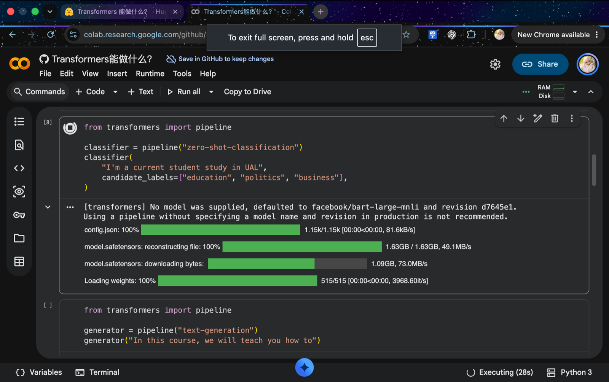

[↑ Back to contents](#contents)

---

<a id="2026-08-18"></a>

### August 18, 2026 — Refining the Topic

- Think about making AI art that critiques and exposes AI.

[↑ Back to contents](#contents)

---

<a id="2026-08-21"></a>

### August 21, 2026 — Rereading the Paper

Three different ways of understanding creativity:

1. Creativity takes time; it happens gradually.
1. Become familiar with old tools and keep practising.
1. Build a relationship with new tools and experiment with them.
My understanding of creativity: mainly the third approach, and partly the second.

So I have decided to embrace new tools and practise with them appropriately.

[↑ Back to contents](#contents)

---

<a id="2026-09-03"></a>

### September 3, 2026 — Settling on a Topic: Researching Racial Discrimination

All modern humans (*Homo sapiens*) originate from **Africa**, where our species first evolved roughly 300,000 years ago. [Source](https://www.nhm.ac.uk/discover/modern-humans-homo-sapiens-when-where-how-did-we-evolve.html); [video](https://www.youtube.com/shorts/6yAJeGwdNcc).

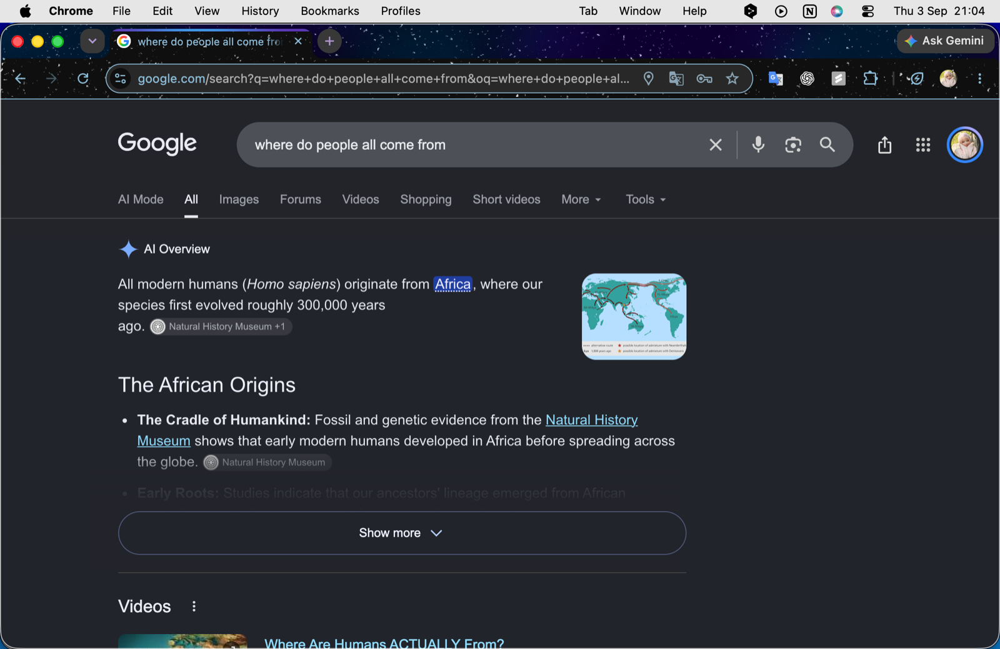

[↑ Back to contents](#contents)

---

<a id="2026-09-04"></a>

### September 4, 2026 — Ideas

- Robots wearing masks.
- A timeline.
- Robots switching masks.
- Everyone comes from the same factory, but is given a different mask and sprayed a different colour.
- This made me think of *The Boss Baby*.

[↑ Back to contents](#contents)

---

<a id="2026-09-06"></a>

### September 6, 2026 — Missing Datasets as Artworks, and Possible Ideas

- [The Missing Datasets](https://github.com/MimiOnuoha/missing-datasets)
- Inspired by the Missing Datasets artwork, I am thinking about focusing on a similar topic.
- People who experience racial discrimination without realising it.
- People who do not realise they are being racist toward others. They may act arrogantly and believe they do not need to understand the pain of other ethnic groups.
- Subtle racism.

[↑ Back to contents](#contents)

---

<a id="2026-09-16"></a>

### September 16, 2026 — Recording Model Commands

- Downloaded the model `stabilityai/stable-diffusion-xl-base-1.0`.
- I planned to use English prompts because I had heard that the model’s training captions were in English.
- The model I initially downloaded ran slowly on my computer.
- It responded poorly to this prompt and generated a black image:
```
A scene showing an Asian woman experiencing racial discrimination at home.
```

- I downloaded Stable Diffusion 1.5 instead.
- This one can generate images.

[↑ Back to contents](#contents)

---

<a id="2026-09-18"></a>

### September 18, 2026 — Sounds Through the Wall

- Voices coming through the wall have played a significant part in my past experiences. I have started thinking about training AI on sounds.
- I could look for a satisfying sound database, or record sounds myself and train a model to see what happens.
- I could download a speech-emotion-recognition model from Hugging Face and experiment with it.
- Other keywords to consider: language barriers, English, Chinese. When the sound is loud, the language barrier makes it hard to understand; when it is quiet, hearing only fragments can make me imagine all sorts of things. Not being able to hear clearly can be even more frightening.

[↑ Back to contents](#contents)

---

<a id="2026-09-19"></a>

### September 19, 2026 — Generating Images in Batches

- I generated ten images at once, and my computer got extremely hot.
- I reduced the batch to five images at a time.
- I tried prompts about humans but had no inspiration, so I switched to animals.
- I could make my own dataset and train an AI on it.
- I could use TouchDesigner to make something, generate it, and then see what an AI trained on it produces.
- I also noticed that Stable Diffusion generates excellent animal images, which would work well when connected to TD for art.
- Perhaps both directions are worth considering.
- I suddenly thought of models that classify emotions in voices. Could I collect sounds and have AI classify or train on them?
- The generated owl images seem perfect for connecting to TD. Maybe I can adjust the AI’s hidden layers.
- I still need to think about how to take this further and clarify the discussion question.
- Some images look 3D, which is fun.

[↑ Back to contents](#contents)

---

<a id="2026-09-20"></a>

### September 20, 2026 — Privacy, Boundaries, and Covert Photography

- Possible material: I went out after dyeing my hair and twice encountered strangers trying to look at my phone screen.
- I noticed the first woman; I did not notice the second man. He photographed my phone screen and then shared it with other people in the same carriage.

[↑ Back to contents](#contents)

---

<a id="2026-09-21"></a>

### September 21, 2026 — Change as a Theme

- Use AI to keep generating images and make family-style group portraits.
- East Asian families, emotions, influence, group portraits.
- Faces and facial features.
- Question to explore: How do East Asian family dynamics affect children, and what is the right answer?
- “What is the right way for a family to relate to one another?”
- Differentiation of self.
- Perhaps: generational curses, problems, birth to death, trees, energy, projection.
- What I want to make: a strange 3D video scene.
- Everything looks fine; beautiful music, strings.
- Then voices appear—strange ones.
- Portraits could work well.
- A scene in which requests are made and emotions are continually shut away.
- Family invading everyday life.
- Continuously generated blurry images accompanied by generated voices.
- Something is still missing—perhaps a dataset.
- A game about taking off a face: *Martha Is Dead*.
- Why have humans not yet invented something that lets us share our senses with another person?
- My latest question: “Is changing yourself really so frightening?” My previous work was about dissociation; I think it is time to move into the next chapter.
- What is a lie? What is the definition of a lie?

[↑ Back to contents](#contents)

---

<a id="2026-09-23"></a>

### September 23, 2026 — Work Title Decided: “I Can Hear You”

- [David Rokeby:](https://www.youtube.com/watch?v=SrawKucSSRw&t=7s) *[Very Nervous System](https://www.youtube.com/watch?v=SrawKucSSRw&t=7s)*
- Moses’ prophecy about water.

###### Installation concept

- AI-generated Baroque-style portraits are continuously projected onto a wall.
- When someone enters the space, their movement could make sound visible—perhaps using TD.
- Possible interaction: a distant portrait looks frightening, but becomes clear and normal when approached (confronting fear).
- Perhaps the image could be unstable.
- Hair could be placed beside the frame.
I’m developing an art installation about “freak” — the feeling of being visibly different from the people around you. Could I ask you three quick questions?

1. **When you first noticed me, how would you describe me?** What stood out to you first?
1. **If you imagined an installation about “freak”, what would you expect to see, hear, or feel?** It could be a colour, object, material, sound, space — anything.
1. **How would you want to interact with it?** Would you touch something, speak, listen, look into something, change something, or just observe?
I spoke face-to-face with three people who had been discussing me. I told them I was an artist. One was an older man and two were older women.

The older man told me in person that he saw me as a normal, attractive woman. He showed me his bald head and said that *that* was what was strange.

When I showed the questions on my phone to the other two women, one said she could not read, and the other said she did not want to answer. Overall, the interview did not yield much.

At a gathering earlier, one person discussed my hair and asked why I could not show less of my personality. Another person agreed, and the two quickly exchanged contact details. They said they did not like students, or students talking about so many AI-related things.

🔗 [https://www.youtube.com/watch?v=SrawKucSSRw&t=7s](https://www.youtube.com/watch?v=SrawKucSSRw&t=7s)

[↑ Back to contents](#contents)

---

<a id="2026-09-28"></a>

### September 28, 2026 — Changing the Model’s Hidden Layers

- I need a frightening Baroque-style model. I want to remove other elements and generate a specific world of fear from a particular perspective.
- A blurry style; people should look uncanny.
- Perhaps the people on three walls could follow viewers with their eyes, or look at one another.
- I could adapt the eye-tracking technology used in VR headsets—for example, track eyes in TD so that the part a viewer looks at becomes clear while everything else stays blurry.
- Becoming clear when looked at could connect well to racism.
- TD eye tracking is not precise enough. Perhaps I could combine it with Arduino sensors, placing three sensors behind the screen.
- Then Arduino and TD could work together. I will need to test how to do this.

[↑ Back to contents](#contents)

---

<a id="2026-09-29"></a>

### September 29, 2026 — Making a Prototype

- I am getting ready to make a prototype.
- First, I will connect images to three scenes in TD and play them to see how they look.
- I like the effect in this image. I am thinking about making the model’s characters have large eyes and small mouths, so they look mean.
- Huge mouths and out-of-control facial features.
- Mean-looking faces.
- Attention being drawn in.
- Perhaps add animation, with mouths opening and closing.
- Facial features shifting out of place.
- Electronic music sounds good.
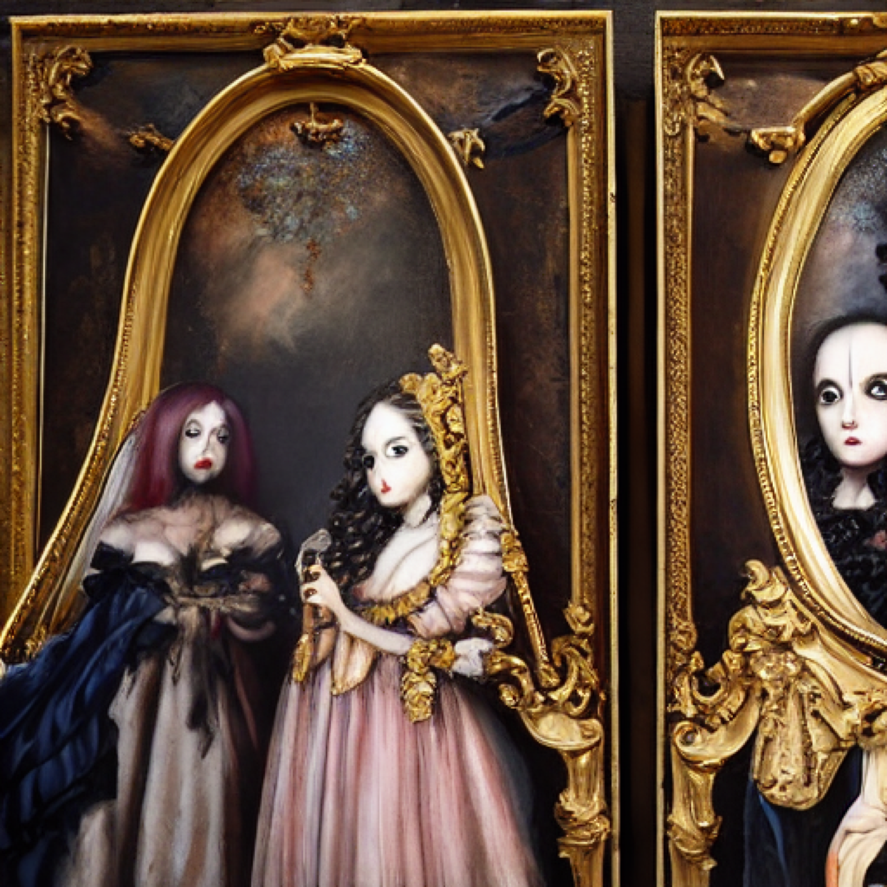

[↑ Back to contents](#contents)

---

<a id="2026-10-01"></a>

### October 1, 2026 — Refining the Question

- What is this work saying about racism?
- “In many instances of racism, people do not realise they are discriminating against others.”
- I reconsidered the question.
- How can an interactive AI portrait make viewers realise that attention, categorisation, and the desire to “see a person clearly” may contain unrecognised racialised assumptions?
- How can an interactive AI portrait make viewers realise that, when someone is watched, categorised, and “seen clearly” too intensely, attention itself can become a racialised pressure?
| Viewer’s position | What happens in the installation | What the viewer might realise |
| --- | --- | --- |
| Watching from a distance | All three faces are blurry; the whispers are faint | Looking has not yet been turned into a judgement |
| Facing one wall | That face becomes clear, as if confirmed by the system | My attention is distributing visibility |
| Looking for a long time | The face is scanned, marked, distorted, and replaced | “Seeing clearly” can also be a form of control or pressure |

I hope:

- Someone will think of a time they were judged by their appearance, accent, gender expression, or disability.
- Someone will realise they have also unconsciously stared at, guessed about, or categorised other people.
- A new visual effect occurred to me: being looked at turns a person into a doll or some kind of product.
- Related myth: people watched by Medusa’s eyes turn to stone.
- Possible elements: mirrors.
- The visual effect still needs work; it looks too ugly at the moment.
- I generated new images for inspiration and like this eerie profile; the scene looks good too.
- Prompts requesting no eyes did not work. The eyes just turned white, which was not eerie enough. The model still needs to be changed.
- I am wondering whether to try projection mapping. The image looks like a sculpture and is beautiful; it suddenly made me think of a weeping Virgin Mary, which could be interesting.
- A prompt asking for no nose did not work either. Perhaps I can find other prompts that fail and fine-tune the model to produce those results.
- The rubber-like bald head is fun.
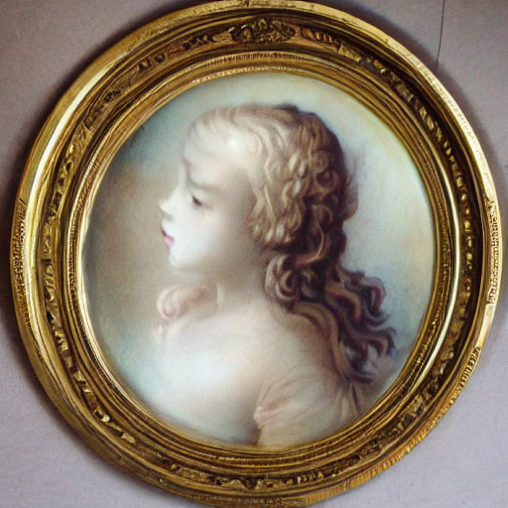


[↑ Back to contents](#contents)

---

<a id="2026-10-02"></a>

### October 2, 2026 — Downloading a Video-to-Video Model

- I downloaded the 28 GB introductory version of StreamDiffusion and tried generating images from prompts.
- I downloaded LTX Video.
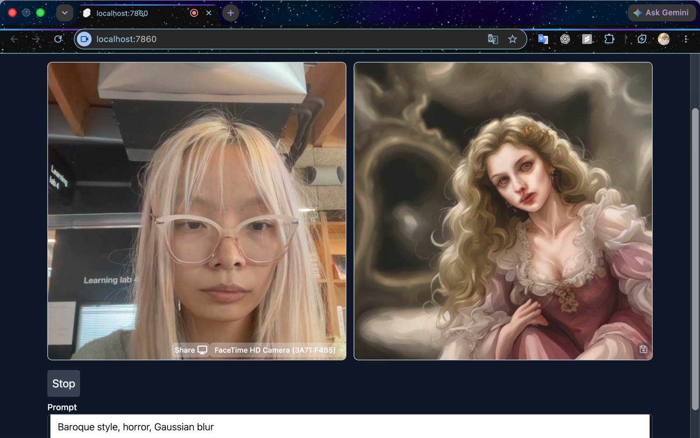

[↑ Back to contents](#contents)

---

<a id="2026-10-03"></a>

### October 3, 2026 — Tokens

- I need to understand how AI tokens are calculated and how hidden layers work. Once I understand the technology, I can use it for art.

[↑ Back to contents](#contents)

---

<a id="2026-10-05"></a>

### October 5, 2026 — Tracking the Generation Process of Specific Words

- I started tracking the background and the final image. Once I removed the final image, the heat map became clearer.
- When the heat map plays from beginning to end, it looks like an animation. I am thinking of studying specific words and tracking their process, returning to the theme of racism.
- Unconscious racialised looking + excessive visibility + categorisation.
- I initially plan to try three words: hair, face, clothes.

[↑ Back to contents](#contents)

---

<a id="2026-10-07"></a>

### October 7, 2026 — Comparing AI Attention and Human Attention

- Find a way to track human eye attention within three days.
- One idea: when a person looks somewhere, the fog on the screen is wiped away, as if the person were imitating AI denoising.
- When a person looks at the water, their eyes leave ripples on it.

[↑ Back to contents](#contents)

---

<a id="2026-10-09"></a>

### October 9, 2026 — Queer Input Methods

- I downloaded a new dataset, but the eye-tracking computer had a problem. I will continue next week.
- Human attention is interesting. Could it be connected to hallucinations?
- I read a paper on hidden layers and found that it used an old model with no text input.
- This made me think of queer game controllers. Perhaps I could find a model with no text input and use music as the input for image generation.
- I downloaded an early face model.
- I modified the face model’s hidden layers, and it worked very well; the images looked very artistic.
- I found that I could modify only part of the image, such as the area around the eyes or mouth, rather than changing the hidden layers of the whole image. This made the image more fantastical.

[↑ Back to contents](#contents)

---

<a id="2026-10-10"></a>

### October 10, 2026 — Preparing a Model to Connect to TD

- I downloaded a new denoising face model, “opencerebral/Lucy,” and modified its hidden layers. The result was good.
- I plan to connect the model to TD.

[↑ Back to contents](#contents)

---

<a id="2026-10-11"></a>

### October 11, 2026 — Tracking Gaze to Change a Face

- I thought of an initial interaction: a viewer’s gaze causes a face to change. In other words, their gaze changes the model’s hidden layers.
- I may add sound interaction, but I have not worked out how yet.
- I simulated gaze with the mouse: when the mouse stays in one place, the hidden layers in that area start to change.
- I have not figured out sound interaction, so I will first use the keyboard as a simulation: pressing a key will switch to a new image.
- I downloaded a version of MediaPipe that supports eye tracking: [MediaPipe for TouchDesigner](https://github.com/torinmb/mediapipe-touchdesigner/releases).
- I downloaded the eye-tracking version of MediaPipe and made a demo that worked a little.
- At the moment it can only track whether the eyes look to the left or right of the screen; it is not precise enough, and there is almost no response when the eyes look up or down.
- Also, when the eyes look left and right on the screen, the image itself is not full-screen, which makes the tracking inaccurate.
- I calibrated the gaze tracking by looking at the screen myself. I still need to try other methods; I could try the Tobii system at school.
Possible paper ideas:

- Controllers are political.
- Gaze as a “queer controller” changes the rules of interaction. I could think about how to connect this to the theme.
- The core invention in my research: attention tracking.
- Iterative design.
- How AI sees the world; art offers a way to change perspectives.
> 🎞 Video: CleanShot 2026-10-11 at 15.00.57.mp4 — not copied here (file too large for GitHub). [Watch it in the original Notion entry](https://app.notion.com/p/73937ec6ecd3821a98d681aefddc85da)

[↑ Back to contents](#contents)

---

<a id="2026-10-12"></a>

### October 12, 2026 — Continuing in the Lab

- The eye tracker was not working.
- I tried the keyboard and found it interesting, but I did not bring a USB cable. I will come back tomorrow.

[↑ Back to contents](#contents)

---

<a id="2026-10-13"></a>

### October 13, 2026 — Mapping the Keyboard

- Today I connected the keyboard to TD.
- Keyboard: KEYLAB ESSENTIAL 61.
- It has 36 white keys and 25 black keys.
- There is also a pedal, and something on it tracks gestures, similar to Leap Motion.

###### Layers I can change (11 positions)

| Layer | Where in the network | Image size | Channels | You can think of it as |
| --- | --- | --- | --- | --- |
| D0 | Encoder | 128×128 | 128 | The finest outlines and textures |
| D1 | Encoder | 64×64 | 128 | Details |
| D2 | Encoder | 32×32 | 256 | Medium-sized structures |
| D3 | Encoder (with self-attention) | 16×16 | 256 | Large local forms |
| D4 | Encoder | 8×8 | 512 | The very rough overall form |
| MID | Middle | 8×8 | 512 | The most abstract “concept” |
| U0 | Decoder | 8×8 | 512 | Reconstructing from the concept |
| U1 | Decoder (with self-attention) | 16×16 | 256 | Large structures |
| U2 | Decoder | 32×32 | 256 | Medium-sized structures |
| U3 | Decoder | 64×64 | 128 | The overall face and its tone |
| U4 | Decoder | 128×128 | 128 | The final details |

Possible changes:

- **Discrete elements go to the keys:** choose an instrument (a combination of layer + channel + mode), rather than assigning a new channel to every key.
- **Continuous elements go to sliders or gestures:** intensity, or how much of the fog to wipe away.
- **Gaze continues to control position.**
- **A new face** could be triggered by the pedal or a percussion pad.
- Demonstration: using the keyboard as input to change image texture.
> 📎 Attachment: piano_key_map_keylab61.html — see [the original Notion entry](https://app.notion.com/p/48e37ec6ecd3829dbdcd81ede367d566)

> 🎞 Video: IMG_3587.mov — not copied here (file too large for GitHub). [Watch it in the original Notion entry](https://app.notion.com/p/48e37ec6ecd3829dbdcd81ede367d566)

[↑ Back to contents](#contents)

---

<a id="2026-10-14"></a>

### October 14, 2026 — Adding Attention Tracking

- I copied the MediaPipe hand tracking out, but it did not work. I later found that the previous connection was wrong; after fixing it, it worked.
- At first, I made high notes on the keyboard duplicate multiple images and low notes reduce the number of images, but it did not look good enough.
- I added a kaleidoscope effect, which looked better, but playing the keyboard felt too limited.
- So I decided not to use the keyboard and instead try air-playing, to see whether I could map the hidden layers into the air.
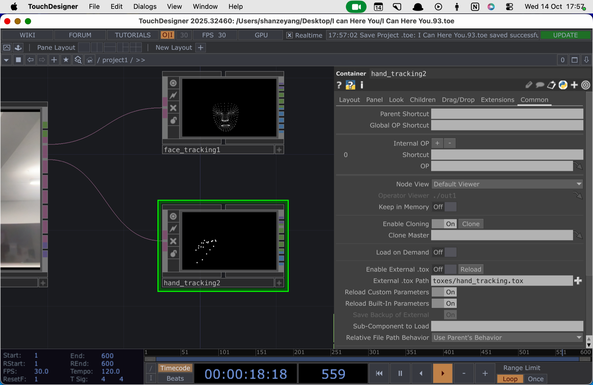

[↑ Back to contents](#contents)

---

<a id="2026-10-15"></a>

### October 15, 2026 — Adding Face Switching by Clapping

- I changed face switching from pressing the pedal to clapping.
In the camera view, the hand positions are divided from left to right into five zones:

| Zone 1 | Zone 2 | Zone 3 | Zone 4 | Zone 5 |
| --- | --- | --- | --- | --- |
| D0: outline and texture | D2: random | D3: dissolve | MID: distort | U4: details |

- Added random whispers.
Essay ideas:

- Third space.
- Shadow.

[↑ Back to contents](#contents)

---

<a id="2026-10-16"></a>

### October 16, 2026 — Adding New Elements

- Added ocean balls and a winning sound effect to make the childlike elements clearer.
- I tried a projector in the dark lab. Next I need to think about what to map the projection onto.
- I experimented with a cardboard box and the projector, and also connected the keyboard again to try it.
> 🎞 Video: 1.mp4 — not copied here (file too large for GitHub). [Watch it in the original Notion entry](https://app.notion.com/p/54437ec6ecd38377b6fe812ed1f4e299)

> 🎞 Video: 2.mp4 — not copied here (file too large for GitHub). [Watch it in the original Notion entry](https://app.notion.com/p/54437ec6ecd38377b6fe812ed1f4e299)

[↑ Back to contents](#contents)

---

<a id="2026-10-17"></a>

### October 17, 2026 — Thinking of a Children’s Castle

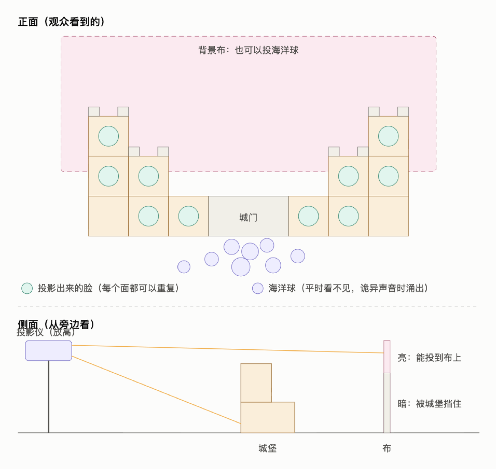

[↑ Back to contents](#contents)

---

<a id="2026-10-18"></a>

### October 18, 2026 — Inspired by a Church Light Show

- [Church light show reference](https://www.youtube.com/watch?v=QyCT8fMrAiY)
- Today I suddenly thought of a puppet show. I added wooden hands to the image and used a rabbit for testing.
🔗 [https://www.youtube.com/watch?v=QyCT8fMrAiY](https://www.youtube.com/watch?v=QyCT8fMrAiY)

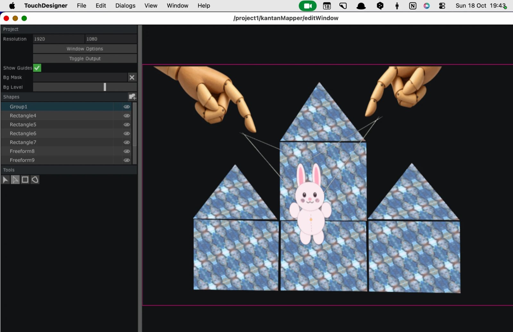

[↑ Back to contents](#contents)

---

<a id="2026-10-19"></a>

### October 19, 2026 — Adding Pixel Angel Eyes

- Today in the dark lab I successfully built a castle out of cardboard boxes and mapped the projector onto it.
- I removed the wooden hands and test rabbit, and changed the effect so that clicking the castle creates a shockwave.
- I wanted to add more uncanny elements, so I drew a pixel angel eye; it looked good.
- At the art shop today I saw blank masks. It could be fun to buy one and project onto it next time.
- I need to think more about what to project onto; the castle does not look good enough yet.
> 🎞 Video: IMG_3616.mov — not copied here (file too large for GitHub). [Watch it in the original Notion entry](https://app.notion.com/p/91637ec6ecd382b9925001213f7abc30)

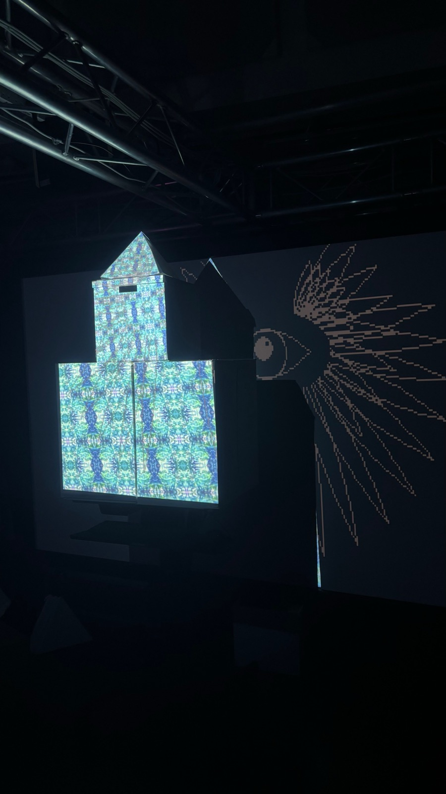

[↑ Back to contents](#contents)

---

<a id="2026-10-20"></a>

### October 20, 2026 — Rethinking the Theme

- Consider adding the sound of wind.
- Adjust the angel’s size.
- Rethink the theme being explored. The visualisation of AI’s hidden layers could still be useful.
- The visualisation currently looks a lot like a church light show.
- Perhaps I need a table at a fixed height; I might need to make something in the lab.
- The projected objects need to look more refined. Think about religious themes.
- A visualised wooden mural could work, or perhaps something 3D-printed.
- Perhaps there is a theme related to faces, bias, religion, and race that I could perform as a stage play.
- [“AI Ain’t I a Woman?”](https://lithub.com/ai-aint-i-a-woman-on-the-blindness-and-limitations-of-artificial-intelligence/)
- I reconsidered the theme: a “standard portrait” seems promising.
- The dataset I trained on consists of over a hundred celebrity faces and lacks people from other races. This is also something I can discuss.
- The source data itself represents a “standard face.”
- I could project onto many white masks; the white masks would represent standard faces.
- The background could retain the kaleidoscope-face effect, appearing occasionally to show faces blended together and express confusion.
- I ran an AI experiment, gradually overlaying generated faces to create an image of a standard face (1, 2, 4, 8, 16, 32, 64, 120).
- From images 1 to 4, many different faces still overlap in a chaotic jumble.
- From 8 to 16, the facial features begin to “settle” into the same positions.
- From 32 onward, the image becomes more stable and loses detail. Eventually it resolves into a soft, blurry, unremarkable face: the eyes, nose, and mouth are in the “right” places, but it belongs to no one.
🔗 [https://lithub.com/ai-aint-i-a-woman-on-the-blindness-and-limitations-of-artificial-intelligence/](https://lithub.com/ai-aint-i-a-woman-on-the-blindness-and-limitations-of-artificial-intelligence/)

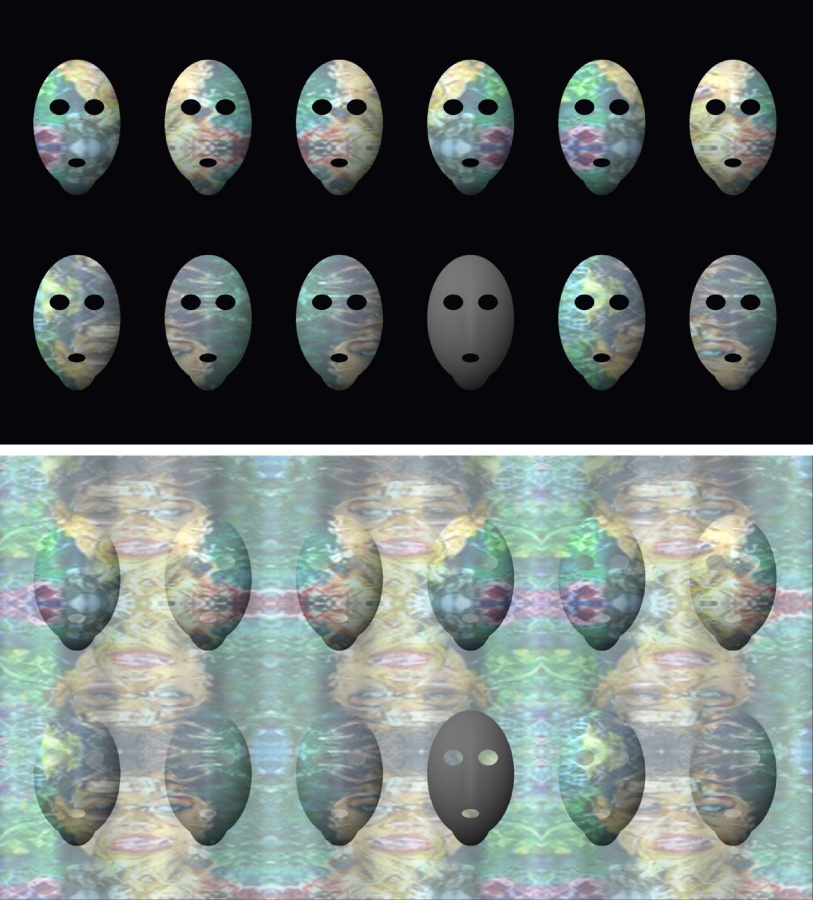

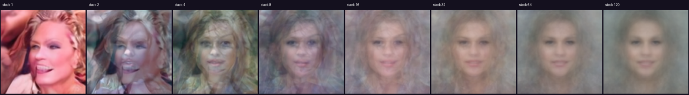


[↑ Back to contents](#contents)

---

<a id="2026-10-21"></a>

### October 21, 2026 — Projecting onto Face Masks

- Today I bought a face mask at the art shop, placed it on the castle, and successfully projected onto it.
- Later I realised that the mask’s eyes made projection difficult, so I covered the eyes and mouth from behind with paper.
- In the end, because the school speakers were not connected, I recorded a silent demonstration of the current work.
- I added an image overlaying the average face. When a hand appears, it scatters hundreds of overlaid faces, and finally returns to the kaleidoscope.
**Standard Face**

- I overlaid the CelebA faces generated by Lucy, so the average becomes the “standard face AI believes in.”
- The later sequence—hands poking it, the faces scattering, and then returning to the kaleidoscope—expresses the breaking of the “standard.”
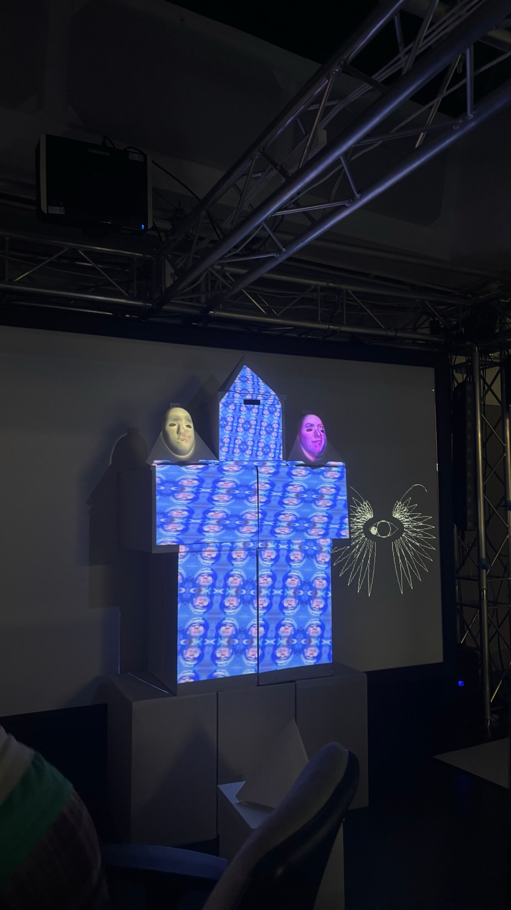

> 🎞 Video: 1.mp4 — not copied here (file too large for GitHub). [Watch it in the original Notion entry](https://app.notion.com/p/76937ec6ecd382178bc00139912c6c89)

[↑ Back to contents](#contents)

---

<a id="2026-10-22"></a>

### October 22, 2026 — Making the Theme of Bias More Prominent

- Invite people to test the installation.
- After discussing it with a friend, I received feedback that I could project a comparison onto the face mask to make bias more prominent.
- I could also add text to help viewers understand what this is, and perhaps find an AI model for that.
- I thought of a hierarchy of energy levels. The artwork currently expresses a critical emotion; should it move to a higher energy level, such as tolerance?
- I thought of community and the refutation of evolutionary theory.
- I could consider how to bring bias toward “coexistence.”

[↑ Back to contents](#contents)

---

<a id="2026-10-23"></a>

### October 23, 2026 — Adding Other Average Faces and User Testing

- I am considering making a wooden grid like a chessboard, with face masks on half of it; perhaps they could be movable.
- I want to turn the angel into a visualisation of deviation.
- The angel claims to treat every face equally, but opens its eyes wide only for faces that do not meet the standard.
- I invited passers-by to test it.
- A friend suggested projecting participants’ faces onto the masks.
- The average faces generated by my current dataset look too similar. I found external datasets and created other average faces; I am considering whether to include them in the visual effects.
- I also added eyes to the angel’s wings. When the deviation is too large, the eyes on the wings open, and the angel grows larger and turns red.
- I suddenly thought of adding a blurry-face effect—perhaps a mosaic face—and could add it tomorrow.
- If the audience’s faces are projected too, perhaps I could duplicate them.
- A blurry face wearing a hood could work.
- I could also add dolls and paper figures.
- Repeated lines of text could look good.
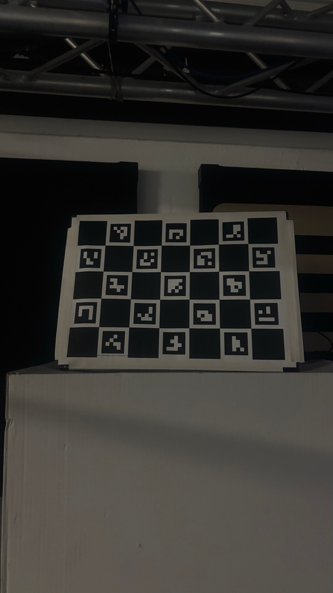

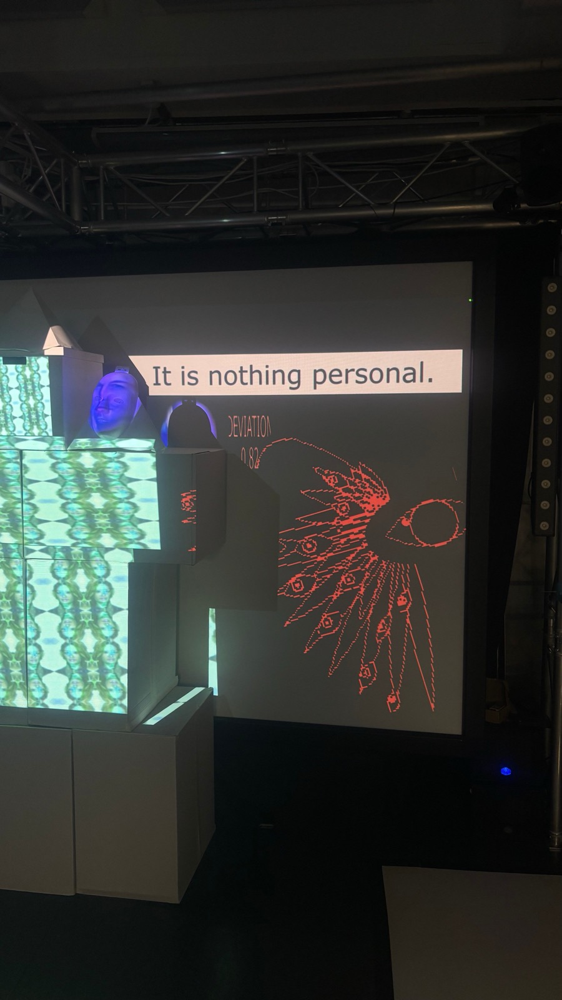

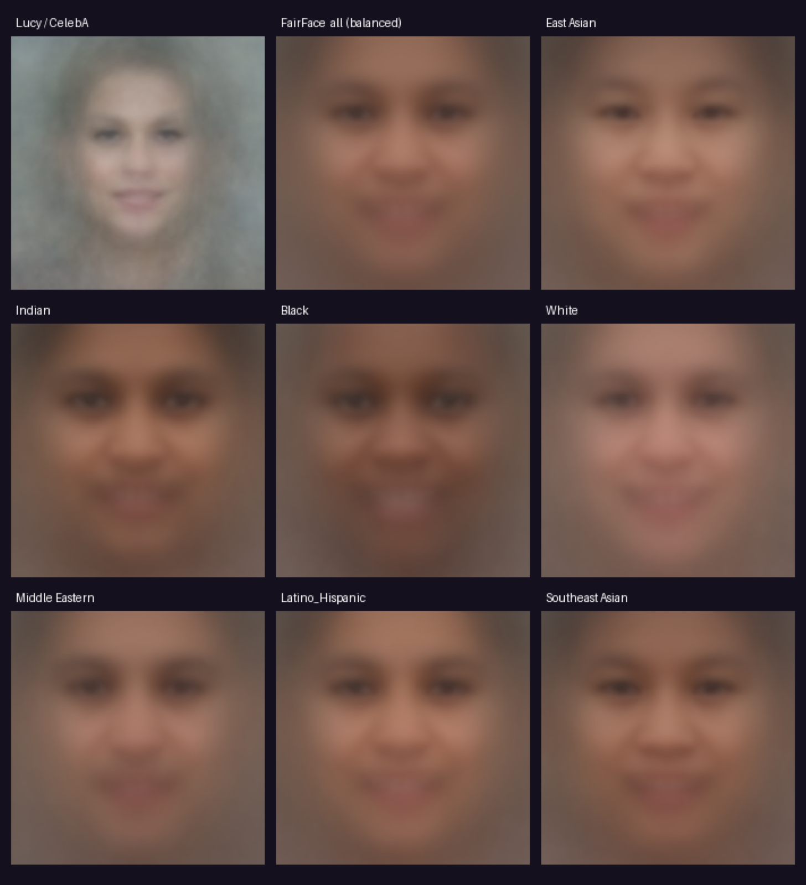

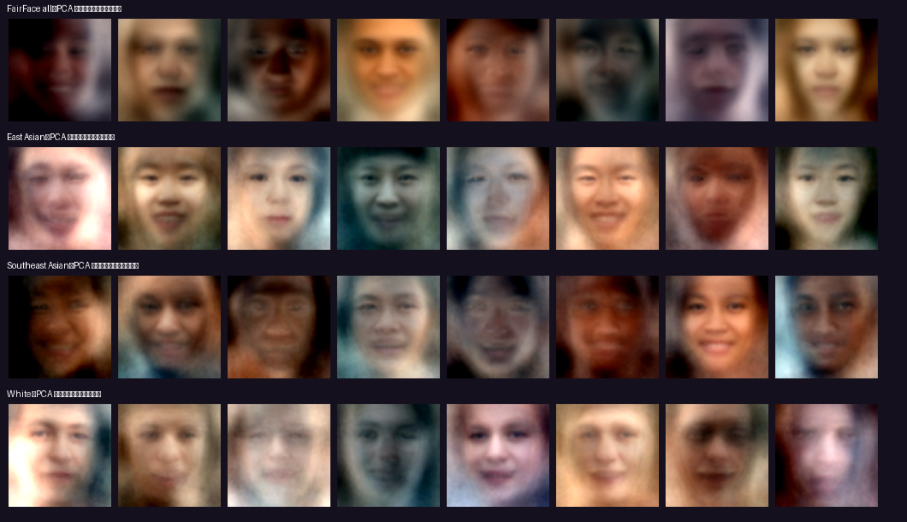

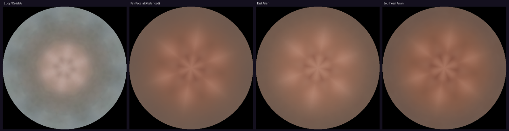

> 🎞 Video: 1.mp4 — not copied here (file too large for GitHub). [Watch it in the original Notion entry](https://app.notion.com/p/e3c37ec6ecd383ea83728113d195df4b)

[↑ Back to contents](#contents)

---

<a id="2026-10-24"></a>

### October 24, 2026 — Mosaic Effect

- Since I am trying to project onto the audience’s faces, I plan to read the paper about private images.
- I tried generating a checkerboard preview image.
- Perhaps the faces could move with the music.
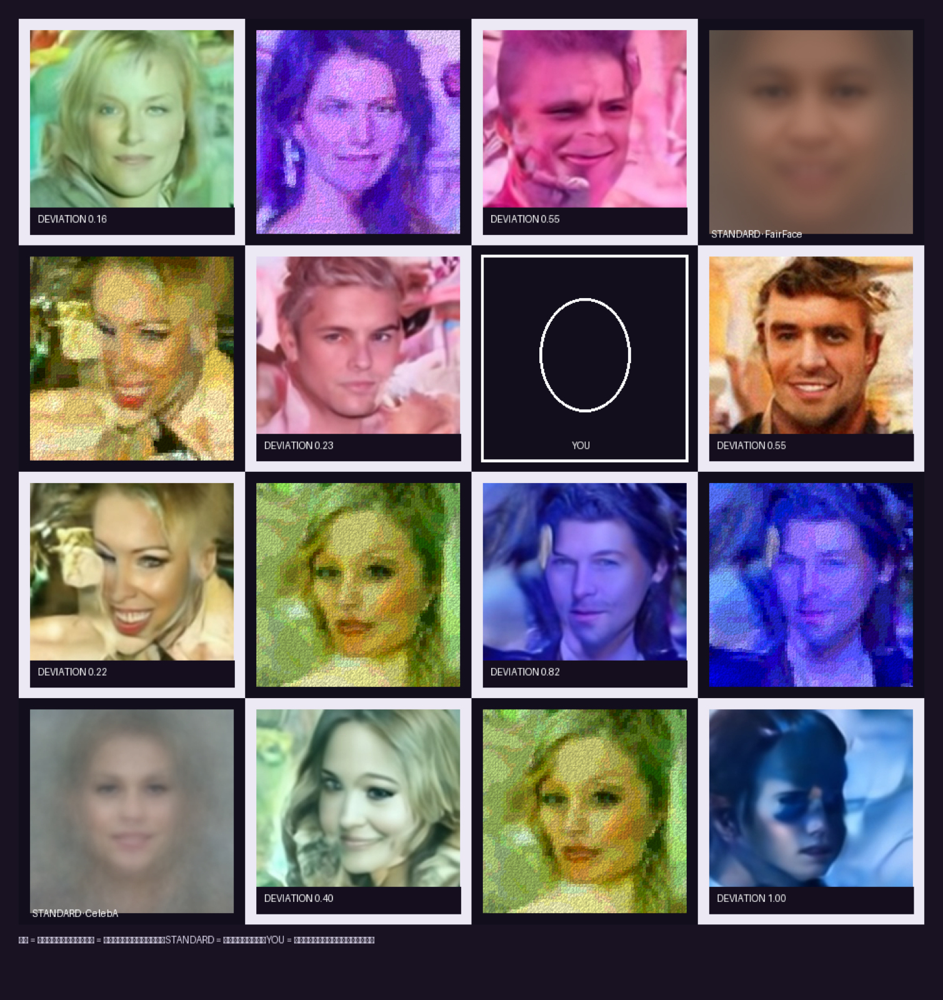

[↑ Back to contents](#contents)

---

<a id="2026-10-25"></a>

### October 25, 2026 — Rethinking the Prototype

- I started testing the chessboard scene.
- Works that inspired me: [Yoko Ono,](https://camstl.org/exhibitions/yoko-ono-play-it-by-trust/) *[Play It by Trust](https://camstl.org/exhibitions/yoko-ono-play-it-by-trust/)*, [Zach Blas,](https://zachblas.info/works/facial-weaponization-suite/) *[Facial Weaponization Suite](https://zachblas.info/works/facial-weaponization-suite/)*, and [Do Ho Suh](https://www.serpentinegalleries.org/whats-on/do-ho-suh/).
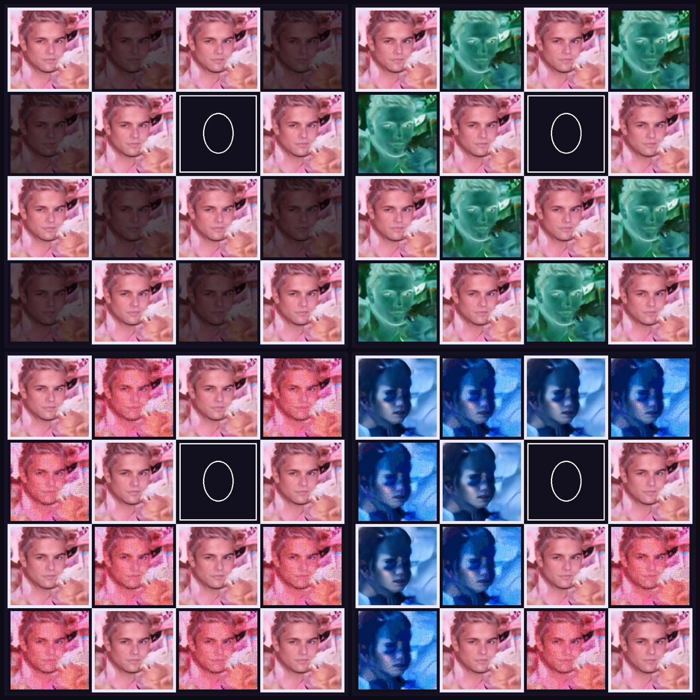

🔗 [Yoko Ono: Play it by Trust](https://camstl.org/exhibitions/yoko-ono-play-it-by-trust/)

🔗 [Facial Weaponization Suite | Zach Blas](https://zachblas.info/works/facial-weaponization-suite/)

🔗 [Do-Ho Suh - Serpentine Galleries](https://www.serpentinegalleries.org/whats-on/do-ho-suh/)

[↑ Back to contents](#contents)

---

<a id="2026-10-26"></a>

### October 26, 2026 — Choosing a Suitcase Prototype and User Testing

- I invited people to test the work.
- After talking with a classmate, I learned that they thought the triggered sound was the projected face singing. Perhaps I could make the face’s mouth open and close, as if it were singing.
- Participants did not seem to know how to play the piano, so I need to give them more prompts about interacting with the camera.
- Or I could connect the piano after all, so people who cannot air-play can control the sound.
- I made the mouth-opening effect, so it looks as if the face is singing.
- I plan to adjust the mosaic effect that appears after a hand pokes it; I want it to have more of a crayon texture, based on a reference image.
- I talked with my teacher and realised that the work is currently too scattered and the interactive experience is poor. There are too many objects and scenes, and many do not connect or have a clear purpose.
- Every element that appears should have a meaning. If it is an interactive installation, the audience should be focused on the interaction throughout.
- The installation I am currently imagining has a wall in the middle and a bed on each side. Face masks hang on the wall and speak; subtitles are projected on the wall and read aloud.
- The story is told from two perspectives: my experience of racial discrimination and the girl’s perspective.
- I am thinking of using two suitcases to represent two rooms. The suitcase also represents my repeated moves.
- Beneath them, a wooden board would display subtitles describing the two perspectives. The black area in the sketch would show the subtitles, perhaps by projection or screen.
- Speakers would sit behind the suitcases, with holes for the cables. They would read the subtitles, and there could be other sound interactions.
- A face mask would sit on each suitcase lid, representing the two rooms, with a face projected onto it.
- When the face speaks, its mouth would open and close, keeping the talking-face visual effect I had already made.
- I could reuse the door access-control lock from my old door and let people try opening and closing it.
- Possible idea: use a one-way mirror to show how poor sound insulation lets people in two rooms see one another’s private lives. If so, I would need only one suitcase.
- Perhaps the central wooden board should be large so text is easy to project.
- The suitcase needs to be on a table so the audience can see it easily.
- Possible interaction: a viewer presses the door lock, expecting privacy to be protected. The lock clicks, but the room behind the mirror lights up. The door has locked, but the boundary has failed.
- Or a face could appear beside another face.
| Element | First-version approach | Purpose |
| --- | --- | --- |
| Two face masks | Use the existing projected talking-face effect | Keep the visual core already developed |
| Two sets of subtitles | Separate screens, or matte, light-coloured text areas on the board | Prioritise legibility |
| Mirror | Use only a small window or a separate test module | Avoid disrupting the face projection |
| Door lock | Attach it to a separate small door panel or frame | Give the viewer a clear action |
| Speakers | Two independent channels, hidden near the respective suitcases | Give each room its own sound location |

Potentially useful works:

- [Tony Oursler](https://tonyoursler.com/lisson-gallery-london): projected faces that seem like people trapped inside objects.
- [Marcel Duchamp’s](https://www.moma.org/collection/works/80890) *[Boîte-en-valise](https://www.moma.org/collection/works/80890)*: a miniature copy of his works placed in a collapsible box, creating a “portable museum.” My suitcase is also a miniature of memory.
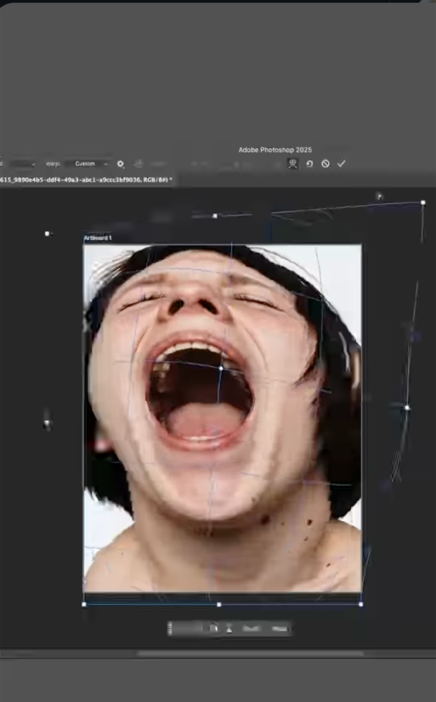

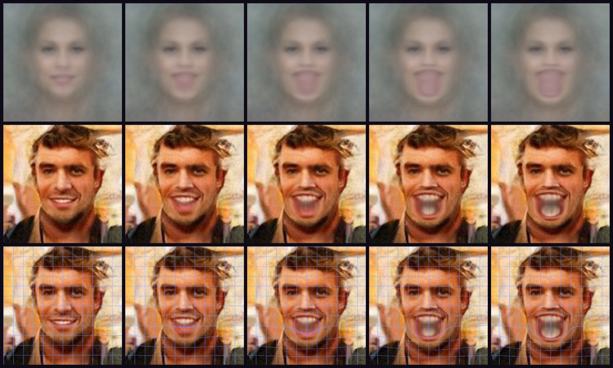

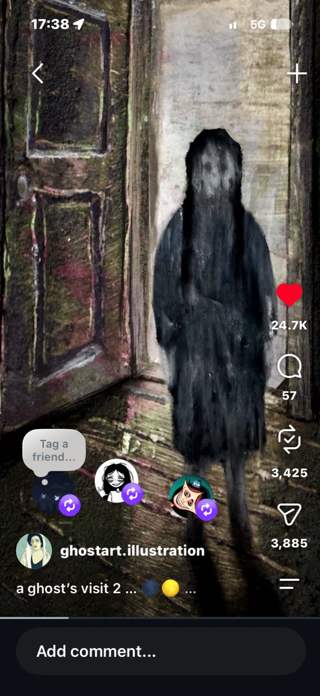

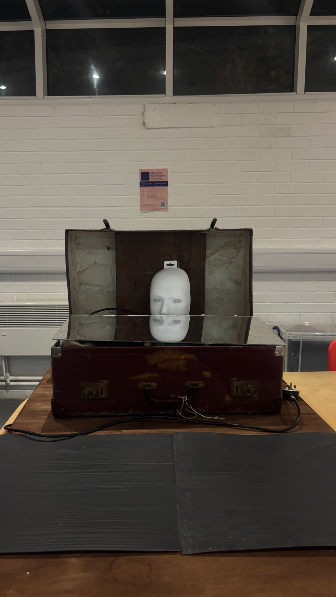

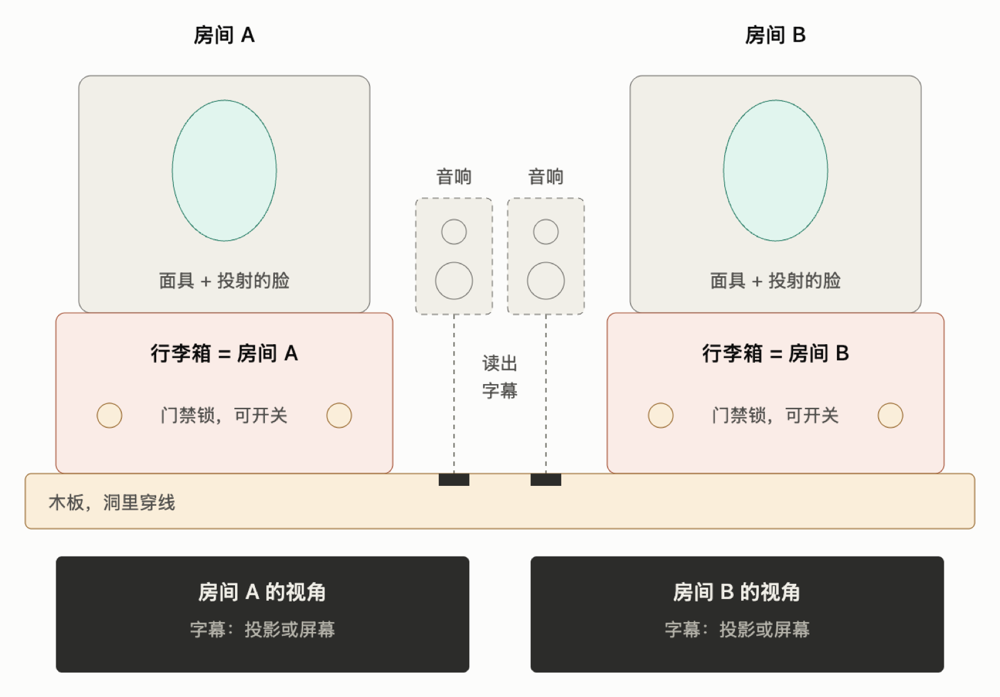

🔗 [Tony Oursler / gallery](https://tonyoursler.com/lisson-gallery-london)

🔗 [Marcel Duchamp. Box in a Valise (From or by Marcel Duchamp or Rrose Sélavy). 1935-41 | MoMA](https://www.moma.org/collection/works/80890)

[↑ Back to contents](#contents)

---

<a id="2026-10-27"></a>

### October 27, 2026 — Initial Projection

- Today’s final performance effect.
- I bought a suitcase, but the black fabric on its lid was difficult to project onto, so I temporarily put paper on it.
- I assembled an initial prototype. The background and centre use soundproofing foam; boxes support the two sides underneath at a suitable height.
- The suitcase on the left represents my room; the one on the right represents another room. I may put a bedside table there; for now, I used a cardboard box.
- Face masks hang on both sides. I plan to project other visual effects onto the soundproofing foam in the background.
- I added the keyboard again to make interaction easier for the audience and raised it on boxes.
- I kept the previous sound-mapping method for the keyboard. The middle keys can change the hidden layers and therefore change the face’s appearance.
- Holding down a black key brings up a heat map, another element related to attention.
- The other keys respond to pitch: the higher the sound, the farther away the kaleidoscopic face image moves; the lower the sound, the larger the image becomes.
- I also added descriptions in another language to tell the story from the other person’s perspective.
- I tried to make the computer read the text, but it sounded unpleasant, so I changed back to the Dream Voice sound effect, which already sounds like a person speaking.
- When the piano makes a sound, the projected face on the mask opens its mouth, as if speaking.
- I added a camera sound when the corresponding text appears.
- The two masks act out an intrusion into a room: a face that was in the room on the right suddenly moves to the left. A glitch pulls between the two masks, representing an ongoing intrusion.
- When the room on the left suitcase glitches, a cloud-like speech bubble appears, representing the poor mental state of the person in the room.
> 🎞 Video: 1.mp4 — not copied here (file too large for GitHub). [Watch it in the original Notion entry](https://app.notion.com/p/f7337ec6ecd383e8bd290199c52af418)

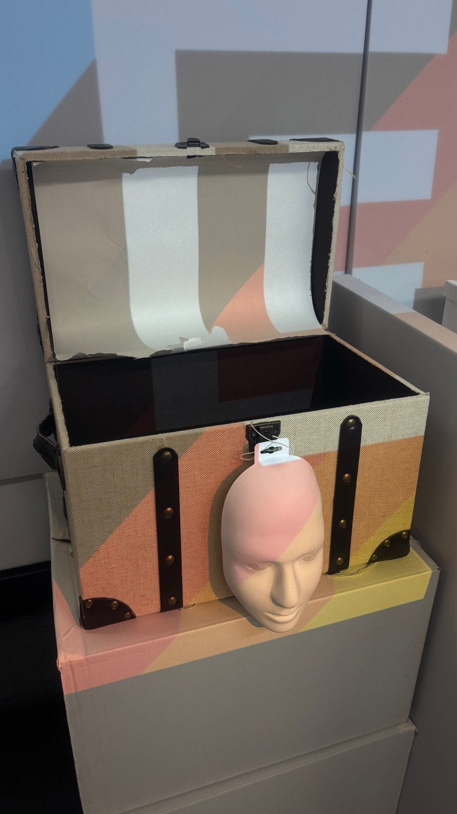

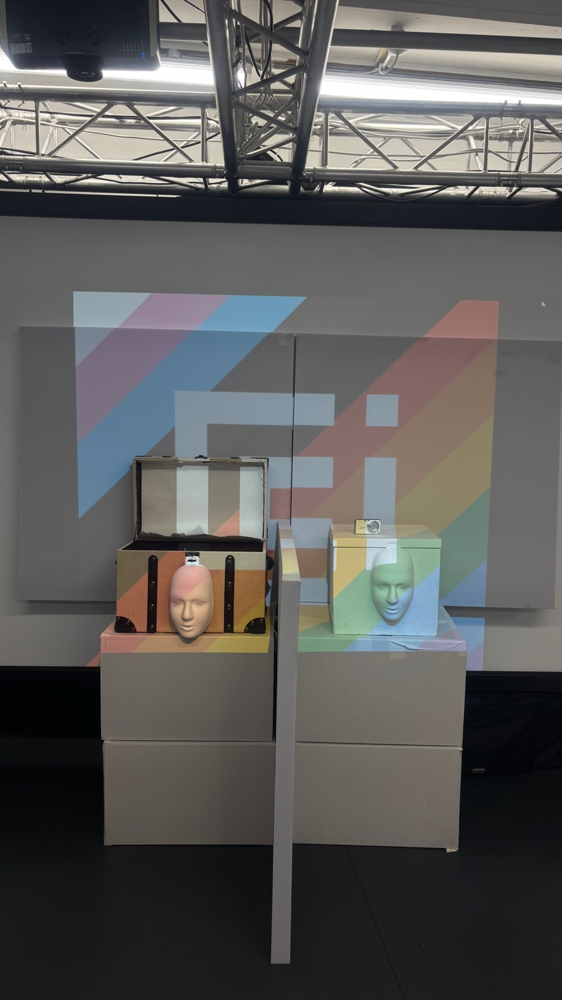

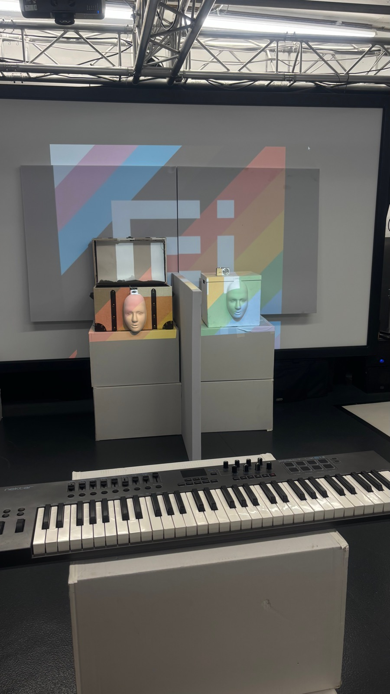

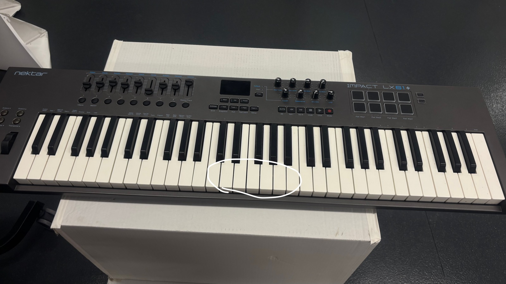

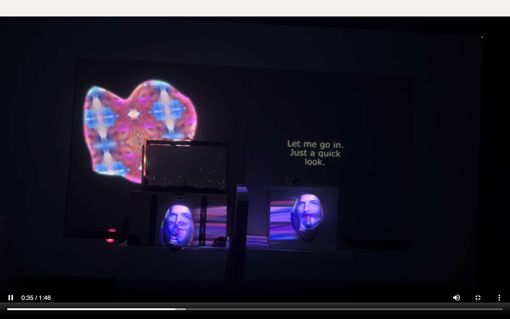

[↑ Back to contents](#contents)

---

<a id="2026-10-28"></a>

### October 28, 2026 — Adding a Bed and a Gift Box to the Projection

- I am thinking about what to put on the right side of the wall to represent someone living in their own home, something permanent.
- I thought of a fridge. When I previously lived in a landlord’s house, I saw the fridge covered with fridge magnets, postcards, memories, and photos with friends.
- I bought a gift box to represent permanent memories and put it in the room on the right.
- I planned to laser-cut a fridge, then realised I could simply stack two cardboard boxes to simulate one.
- Then I realised I was going off topic: if a cardboard box can simulate a fridge, laid down it can simulate a bed.
- I plan to put something like a rubber board behind the bed on the right and display postcards representing family and friends, suggesting that the landlord’s family lives in their own home.
- Possible development: make the power structure behind a lodger living in someone else’s home clearer, revealing the hidden loneliness.
- The current scene should focus more on the other person’s perspective and use satire to express my feelings.
- Perhaps cut a large wooden board to represent the wall and cover both sides with soundproofing foam. If time allows, add something representing a door.
- Tomorrow I need to bring a small pillow and bedsheets I saw last time to decorate both beds.

###### Part One: Calm

1. We need to rent out a room.
1. Someone is moving in!
1. Why did she just drag her large suitcase up the stairs?
1. What did she put in the fridge? I’m so curious. *(Take a photo.)*
1. …you won’t believe it, there’s a girl upstairs…

###### Part Two: The First Intrusion

1. …cultural background… completely different…
1. She has gone out!
1. Let me go in. Just a quick look.
1. …I’m in her room… right now… *(The white angel appears; the room glitches slightly.)*
1. The trash! She really did dye it herself! *(Take a photo.)*
1. …look at these photos… sending them to my friends… *(Take three photos; the white angel grows larger.)*
1. …everyone, come on… tonight I’ll tell you all about… the girl living in my house… *(The white angel disappears.)*
1. …she’s a… liar…
1. This is my house. *(The glitch disappears.)*

###### Transition: Calm

1. Don’t go into her room again.
1. What do I do? I already told the child not to go into her room.
1. She’s so smart. I didn’t even know opening a door could be recorded.
1. I can’t lose this income.
1. Listen up. We’re a family. We stick together.
1. Going into her room? That never happened. *(Take three photos; the red angel appears; the room glitches severely.)*

###### Part Three: The Second Intrusion

1. It’s just talking. It’s not a big deal.
1. I’m in my own room. *(The severe glitch disappears.)*

###### Ending

1. She has moved out at last.
1. Another guest will come.
> 🎞 Video: 2.mp4 — not copied here (file too large for GitHub). [Watch it in the original Notion entry](https://app.notion.com/p/e5637ec6ecd3836e8ba301b8d84cba2f)

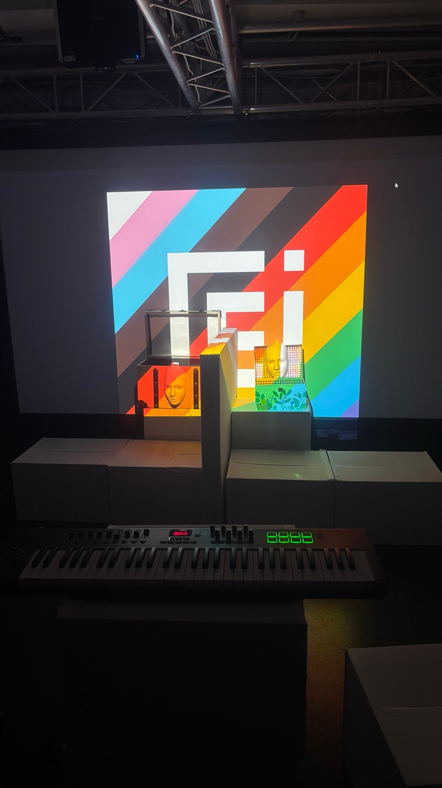

[↑ Back to contents](#contents)

---

<a id="2026-10-29"></a>

### October 29, 2026 — Continuing

- Inspiration: add *The Sims* elements and textures, turning the whole story into a game.
- From the girl’s perspective, her task is to explore the secrets of the mysterious girl who has moved into the house.
- Other characters, such as the mother and older brother, could be added.
- Blur the boundary between reality and the game. If playful game scenes happen in reality, viewers may reflect on that playfulness.
- My previous experience: because of my postgraduate course schedule, I could not find a place to live during the final three months. It was awkward, and I moved frequently.
- One experience of living in someone else’s home left a deep impression on me. I decided to use a playful game format to portray what I went through.
- Although it was painful, I took my teacher’s advice and found it interesting to describe things from the other person’s perspective.
- Use TD to project the game into this space and blur the boundary between game and reality, showing how play can sometimes hurt people.
- Perhaps keep the mosaic glitch from when the room is invaded; it could reveal code or something. The glitch might expand and blur the boundary between real play and the game.
- Perhaps add glitches to the faces.
- Game characters could look like shadows, obscuring specific people.
- Or I could project the characters onto mannequins.
- I suddenly thought of the widely circulated “Earth Online” game.
- After discussing it with classmates and my teacher, I received a new suggestion: rather than focus on telling the story, make the game more fun. Once viewers enjoy playing, they will naturally look at the description of the story that inspired it.
- I use the piano as input because *play* means both playing an instrument and playing a game.
- Installation reference: artist [Liz Magor](https://catrionajeffries.com/artists/liz-magor/works/liz-magor-one-bedroom-apartment-1996). Another reference: [video game installation and projection mapping](https://projection-mapping.org/video-game-installation/).
- After discussing it with a classmate, I may refer to the novel *[Hopscotch](https://en.wikipedia.org/wiki/Hopscotch_(Cort%C3%A1zar_novel))*, with its irregular narrative in which the ending changes each time.
- Piano keys could switch between chapters or lines. Viewers could choose different keys to hear different fragments, imagine different versions of the story, and reach different endings.
- I counted 36 white keys and 25 black keys on the piano.
- At present, each key corresponds to one sentence.
- I am thinking about adding the viewer’s face and a mosaic effect.
- I could find ways to trigger the face effect more often in the game. It is uncanny, so sometimes it could be enlarged to invite viewers to play with it.
- The game could end with a large reward, such as the angel visual effect or a full-screen kaleidoscopic face.
- Tomorrow I need to go to a charity shop to find some household items, such as a duvet, to bring to school and set up the installation.
🔗 [https://mubi.com/en/notebook/posts/cutscenes-critical-optimism-angela-washko-s-online-interventions](https://mubi.com/en/notebook/posts/cutscenes-critical-optimism-angela-washko-s-online-interventions)

🔗 [https://angelawashko.com/artwork/3635234-Womanhouse%20(Or%20How%20To%20Be%20A%20Virtuous%20Woman).html?utm_source=perplexity](https://angelawashko.com/artwork/3635234-Womanhouse%20(Or%20How%20To%20Be%20A%20Virtuous%20Woman).html?utm_source=perplexity)

🔗 [https://catrionajeffries.com/artists/liz-magor/works/liz-magor-one-bedroom-apartment-1996](https://catrionajeffries.com/artists/liz-magor/works/liz-magor-one-bedroom-apartment-1996)

🔗 [https://en.wikipedia.org/wiki/Hopscotch_(Cort%C3%A1zar_novel)](https://en.wikipedia.org/wiki/Hopscotch_(Cort%C3%A1zar_novel))

[↑ Back to contents](#contents)

---

<a id="2026-10-30"></a>

### October 30, 2026 — Adding a Duvet

- Repetition can create rhythm and trigger a physical response.
- The repeated faces in my work are a kind of music visualisation. Appearing around the room, they represent an outsider invading a boundary.
- The rules of the game need to be designed carefully: rules determine how a game is played and also represent the designer’s ideas.
- I bought two duvets at Primark and found duvet covers, pillowcases, and a suitcase at a charity shop.
- After setting them up, the space looked a little like two rooms.
- I turned on the ceiling projector; perhaps I could project onto the duvet too.
- I tried a basic synchronised projection. When my hand moved in front of the camera, a wooden hand, a halo, and a light appeared on the duvet.
- The wooden hand looked too ugly. I will think more about its texture tomorrow.
🔗 [https://www.tate.org.uk/art/artworks/warhol-marilyn-diptych-t03093](https://www.tate.org.uk/art/artworks/warhol-marilyn-diptych-t03093)

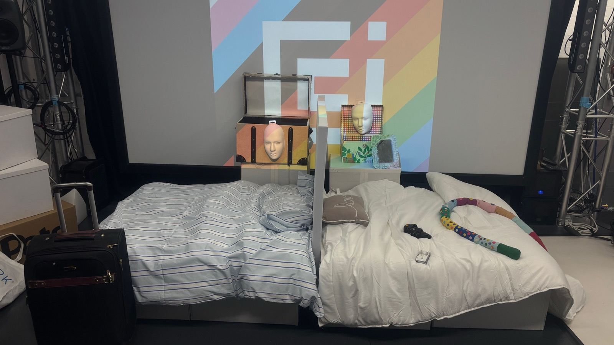

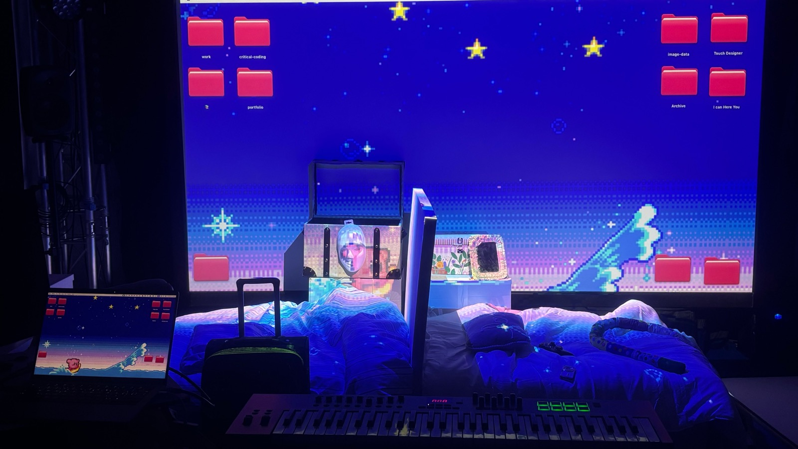

[↑ Back to contents](#contents)

---

<a id="2026-10-31"></a>

### October 31, 2026 — Adding Lines That Invade Reality

- The projector in front was too high to project onto the bed, so I decided to add an overhead projector.
- It feels like a room under a spotlight: a private space exposed to the light.
- I tested the projection area with a grid texture and unexpectedly found that the grid looked good across the whole screen. I could add this scene later.
- The duvet cover made the projection unclear, so I removed it and used it underneath as a bedsheet.
- I first tried putting the kaleidoscopic face effect on the duvet in the room on the left. It worked well.
- Adjusting the rectangle is too cumbersome. Tomorrow I will see whether I can duplicate a Kantan Mapper; it is easier for mapping.
- The interaction worked well, and I suddenly thought of adding a puzzle element.
- I found a mirror and tried projecting mirrored text onto the duvet. When someone holds the mirror with their back to the bed, they can read the text in the reflection.
- I initially mirrored all the story subtitles on the large screen, but reading them continuously in a mirror was too difficult. I decided to put only one mirrored sentence on the duvet for now.
- Tomorrow I will see whether the visuals on the wall can disappear when a viewer turns away, then become visible again in the mirror when they turn back.
- This represents the gaslighting caused in the story by denying that anyone entered the girl’s room.
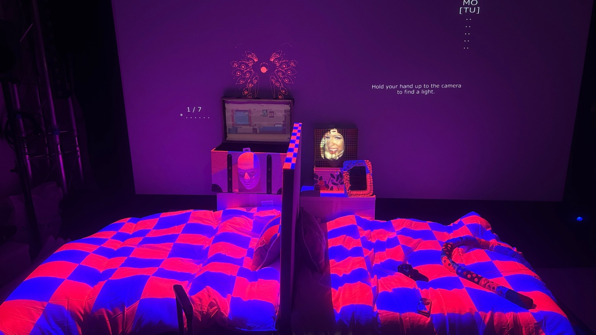

> 🎞 Video: 0.mp4 — not copied here (file too large for GitHub). [Watch it in the original Notion entry](https://app.notion.com/p/58637ec6ecd383a99f0d01645db48986)

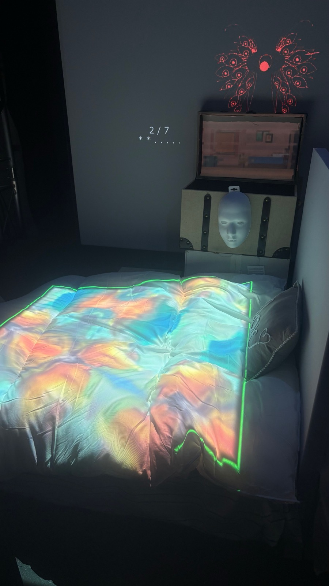

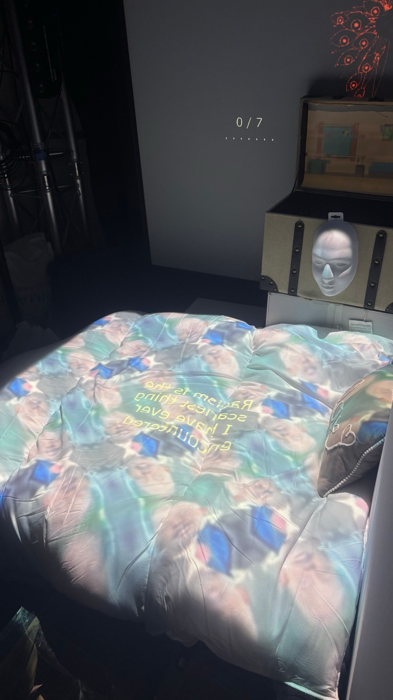

[↑ Back to contents](#contents)

---

<a id="2026-11-02"></a>

### November 2, 2026 — Adding a Piano Book and User Testing

- A classmate tried the game and found the current scene design confusing.
- First, when the spotlight found a light point, they did not realise they should make a fist to collect it. Perhaps the point should be collected automatically when illuminated.
- When another classmate moved her hand over the image on the suitcase, she imagined something appearing on the real suitcase, so this needs to change.
- The mapping between the objects on the bed and the scene on the suitcase lid needs improvement.
- Some piano keys were lit while being held, so the tester thought those were the keys they needed to press. I intended the lights to show which keys had already been pressed; I need to change this.
- Classmates did not notice that each piano key represents a different sentence. I need to introduce this.
- One classmate suggested displaying the rules in a different font so they are easier to see.
- Some testers kept their hands in front of the camera to trigger the piano. I considered changing this, but another tester enjoyed air-piano, so I plan to keep it.
- Some people kept their hands in front of the camera to find light points quickly and move to the next day; I may need to think about this.
- Someone did not realise the room on the left was the guest’s room and suggested adding a doorplate.
- Someone thought the projected people on the masks were characters or different emotions. I could consider how to change this.
- Someone found the light-point count on the left confusing, so I need to revise the description.
- After everyone played, I asked: “What kind of story do you think this is?”
- One person said they were so absorbed in finding light points and triggering the music that they did not read the sentences carefully.
- Someone thought it was a conversation between a girl in the past and a girl in the present. This may be because the tester was not a native English speaker and found the sentences difficult to read.
- Someone recognised from the story that this had happened to me and was about renting a room. I was very happy.
- My teacher gave me a lot of useful advice. I remembered that the kaleidoscopic face represents my emotions, so I need to project it in the room on the left.
- I could project my perspective as text on the bed on the left, corresponding to their perspective as text on the bed on the right.
- Text projected onto the bed is not very clear, so the text on both sides could scroll: the text on the left bed gradually moves onto the screen, while the text on the right gradually moves from the screen onto their bed.
- The reason for using a piano is still unclear. Each key currently represents a sentence, like a book, so perhaps I should add a book. When people interact with it, an animation could show the book opening and text appearing on the page. Perhaps I could use an iPad.
- I set a limit so that after people press a few piano keys each day, no more sentences appear. This confused them, so I plan to show a sentence indicating that the day is over.

###### White keys (36 lines)

- W01. We need to rent out a room.
- W02. Someone is moving in!
- W03. I went through the trash in her room. She really does have a secret! Gotcha!
- W04. Why did she just drag her large suitcase up the stairs?
- W05. What did she put in the fridge? I’m so curious.
- W06. …you won’t believe it, there’s a girl upstairs…
- W07. …she doesn’t talk much, does she?…
- W08. …what is she doing up there all day?…
- W09. …cultural background… completely different…
- W10. I opened her wardrobe. She hid it well, but I still found it.
- W11. She put a little bell on her door.
- W12. She told us: please don’t go into her room.
- W13. The bell is off when she’s home. It’s on when she’s out.
- W14. The bell was taped above the door. Not very firmly.
- W15. She has gone out!
- W16. The door is open. Just a little.
- W17. The bell rang.
- W18. It kept ringing. It wouldn’t stop.
- W19. Then the bell stopped.
- W20. The door was shut again. Nobody said a word.
- W21. Don’t go into her room again.
- W22. What do I do? I already told the child not to go into her room.
- W23. She’s so smart. I didn’t even know opening a door could be recorded.
- W24. I can’t lose this income.
- W25. I’m so busy at work. I really don’t want to deal with this.
- W26. I didn’t think she’d actually tell Mom.
- W27. She looked easy to push around.
- W28. Why don’t you go play at your friend’s house today?
- W29. Listen up. We’re a family. We stick together.
- W30. You must be mistaken.
- W31. Going into her room? That never happened.
- W32. It’s just talking. It’s not a big deal.
- W33. I’m in my own room.
- W34. She has moved out at last.
- W35. Another guest will come.
- W36. The door is closed. The room is clean.

###### Black keys (25 lines)

- B01. Mom says someone is moving in.
- B02. She put a bell on her door? What?
- B03. Why would anyone put a bell on a door?
- B04. She told me not to go into her room.
- B05. But she’s out. How could she possibly know?
- B06. I don’t believe it.
- B07. I watched her door when she was home.
- B08. She opened it. She closed it. No bell.
- B09. It must be broken. Or switched off.
- B10. I stood at her door. I didn’t open it.
- B11. …I wonder what’s in there…
- B12. Mom said no. So I walked away.
- B13. The bell never rang.
- B14. She’s out. Just a quick look.
- B15. I only looked. I didn’t touch anything.
- B16. The bell is ringing!
- B17. Why won’t it stop?
- B18. The door won’t close.
- B19. Please. Help me close it.
- B20. Then it stopped. I couldn’t breathe.
- B21. She’ll know. She always knows.
- B22. She turned it off when she was home. She turned it on when she left.
- B23. She came home. She looked at me.
- B24. I’m scared.
- B25. I just wanted to see.

###### My perspective

1. M01. One suitcase. That was all I brought up the stairs.
1. M02. Why did she come into my room? This is my private space!
1. M03. So I put a bell on the door of my room.
1. M04. I asked: please don’t go into my room again.
1. M05. When I’m home, I switch it off. When I’m out, it’s on.
1. M06. Every time I leave, I wonder what I’ll find.
1. M07. Things were not exactly where I left them.
1. M08. The bell rang. I received notifications on my phone.
1. M09. I needed proof that I wasn’t imagining it.
1. M10. I heard her on the phone, talking about me. When I said something, she said: “I’m in my own room.” Does that mean the harm she did to me doesn’t exist?
1. M11. The door shut. Nobody said a word.
1. M12. They said: it’s just talking. It’s not a big deal.
1. M13. They didn’t even think it was racism. That is what hurt the most.
1. M14. I moved out. The room is clean.
1. M15. Another guest will come. Will she have a bell too? They’ve served so many guests before; why did this still happen?
> 🎞 Video: 1.mp4 — not copied here (file too large for GitHub). [Watch it in the original Notion entry](https://app.notion.com/p/98b37ec6ecd382e989d181f0edf1993c)

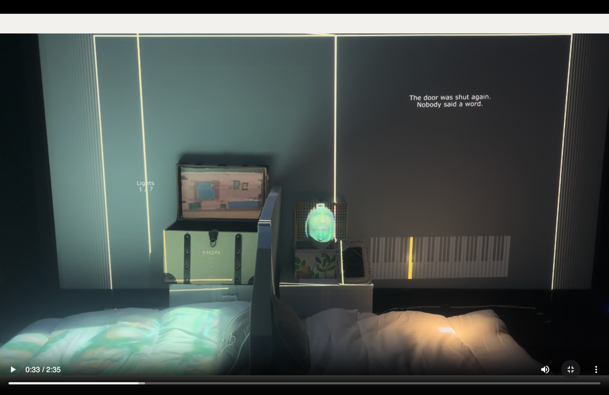

[↑ Back to contents](#contents)

---

<a id="2026-11-03"></a>

### November 3, 2026 — Adding a Chair and Wardrobe

- My teacher said that if I want to submit the work for the winter exhibition, they will try to arrange the projector setup for the installation. I need to draw a diagram showing how the objects and projectors should be arranged and what kind of wall they should be placed beside.
- Today I borrowed a wardrobe my teacher had in the lab. It looks like a book, especially because its surface resembles a cover.
- I decided not to use a wall and to put the wardrobe directly between the two beds.
- I had planned for the player to sit on the bed on the left, but I looked at the size of a single bed in a furniture shop and found it too long for the exhibition. I decided to use cardboard boxes to simulate the bed.
- Tomorrow I need to buy larger sheets for both beds to cover the cardboard.
- I put a chair in front of the wardrobe so the audience can sit there.
- Since the wardrobe already looks like a book, I decided to remove the keyboard and make an animation of pages turning inside the wardrobe.
- I originally planned to use the red-and-blue grid as the default game-cover pattern and project it onto the duvet.
- Later I found that a wireframe looked better and gave the impression that this real world was still loading, so I plan to keep it.
- The cover text is still default text; I have not decided what to write.
- I am treating the wardrobe as a book. When its doors open to change the story text, a single page-turning effect appears.
- It is nearly finished, so I can start writing the paper.
- Paper idea: use a game adapted from real experiences to reveal invisible racism and promote diversity.
- The game mechanics and rules should also fit the theme. The audience experiences the game in an open environment, blurring the boundary between reality and play and encouraging players to play in their own way.

###### Day 1 (MON)

| Page | Who | Their words | My perspective |
| --- | --- | --- | --- |
| 1 | Inside the house | We need to rent out a room. | — |
| 2 | Girl | Mom says someone is moving in. | — |
| 3 | Inside the house | Someone is moving in! | — |
| 4 | Girl | She put a bell on her door? What? | So I put a bell on the door of my room. |
| 5 | Inside the house | It kept ringing. It wouldn’t stop. | The bell rang. I received notifications on my phone. |
| 6 | Girl | Why would anyone put a bell on a door? | I need to protect my privacy. |
| 7 | Inside the house | Why did she just drag her large suitcase up the stairs? | One suitcase. That was all I brought up the stairs. |
| 8 | Girl | She told me not to go into her room. | I asked: please don’t go into my room again. |
| 9 | Inside the house | What did she put in the fridge? I’m so curious. | I opened my suitcase and put the food in the fridge. |

###### Day 2 (TUE)

| Page | Who | Their words | My perspective |
| --- | --- | --- | --- |
| 1 | Inside the house | …you won’t believe it, there’s a girl upstairs… | I heard her on the phone, talking about me… |
| 2 | Girl | But she’s out. How could she possibly know? | The walls were so thin. In my own room, I heard her on the phone, talking about me. |
| 3 | Inside the house | …she doesn’t talk much, does she?… | I can hear her on the phone again. I’m going mad. |
| 4 | Girl | I don’t believe it. | — |
| 5 | Inside the house | …what is she doing up there all day?… | I opened my laptop and got to work. |
| 6 | Girl | I watched her door when she was home. | Why can I still hear her phone call? I’m trying to ignore it. |
| 7 | Inside the house | …cultural background… completely different… | They didn’t even think it was racism… |
| 8 | Inside the house | I opened her wardrobe. She hid it well, but I still found it. | Why did she come into my room? This is my private space! |

###### Day 3 (WED)

| Page | Who | Their words | My perspective |
| --- | --- | --- | --- |
| 1 | Inside the house | She put a little bell on her door. | I need to protect my privacy. |
| 2 | Girl | She opened it. She closed it. No bell. | I adjust the doorbell sound every time I leave and come back. |
| 3 | Inside the house | She told us: please don’t go into her room. | M04 |
| 4 | Girl | It must be broken. Or switched off. | M05: When I’m home, I switch it off. When I’m out, it’s on. |
| 5 | Inside the house | The bell is off when she’s home. It’s on when she’s out. | M05 |
| 6 | Girl | I stood at her door. I didn’t open it. | — |
| 7 | Inside the house | The bell was taped above the door. Not very firmly. | M05 |
| 8 | Girl | …I wonder what’s in there… | — |
| 9 | Inside the house | She has gone out! | M06: Every time I leave, I wonder what I’ll find. |

###### Day 4 (THU)

| Page | Who | Their words | My perspective |
| --- | --- | --- | --- |
| 1 | Inside the house | The door is open. Just a little. | M07: Things were not exactly where I left them. |
| 2 | Girl | Mom said no. So I walked away. | — |
| 3 | Inside the house | The bell rang. | M08 |
| 4 | Girl | The bell never rang. | — |
| 5 | Inside the house | I went through the trash in her room. She really does have a secret! Gotcha! | M02 |
| 6 | Girl | She’s out. Just a quick look. | M06 |
| 7 | Inside the house | Then the bell stopped. | M12: The door shut. Nobody said a word. |
| 8 | Inside the house | The door was shut again. Nobody said a word. | M12 |
| 9 | Inside the house | Don’t go into her room again. | — |

###### Day 5 (FRI)

| Page | Who | Their words | My perspective |
| --- | --- | --- | --- |
| 1 | Inside the house | What do I do? I already told the child not to go into her room. | — |
| 2 | Girl | I only looked. I didn’t touch anything. | M07 |
| 3 | Inside the house | She’s so smart. I didn’t even know opening a door could be recorded. | M09: I needed proof that I wasn’t imagining it. |
| 4 | Girl | The bell is ringing! | M08 |
| 5 | Inside the house | I can’t lose this income. | M17: They’ve served so many guests before; why did this still happen? |
| 6 | Girl | Why won’t it stop? | M08 |
| 7 | Inside the house | I’m so busy at work. I really don’t want to deal with this. | M17 |
| 8 | Girl | The door won’t close. | — |
| 9 | Inside the house | I didn’t think she’d actually tell Mom. | — |

###### Day 6 (SAT)

| Page | Who | Their words | My perspective |
| --- | --- | --- | --- |
| 1 | Inside the house | She looked easy to push around. | — |
| 2 | Girl | Please. Help me close it. | — |
| 3 | Inside the house | Why don’t you go play at your friend’s house today? | — |
| 4 | Girl | Then it stopped. I couldn’t breathe. | — |
| 5 | Inside the house | Listen up. We’re a family. We stick together. | — |
| 6 | Girl | She’ll know. She always knows. | M09 |
| 7 | Inside the house | You must be mistaken. | M11: Does that mean the harm she did to me doesn’t exist? |
| 8 | Inside the house | Going into her room? That never happened. | M11 |

###### Day 7 (SUN)

| Page | Who | Their words | My perspective |
| --- | --- | --- | --- |
| 1 | Inside the house | It’s just talking. It’s not a big deal. | M13: They said: it’s just talking. It’s not a big deal. |
| 2 | Girl | She turned it off when she was home. She turned it on when she left. | M05 |
| 3 | Inside the house | She said: “I’m in my own room.” | M10 |
| 4 | Girl | She came home. She looked at me. | — |
| 5 | Inside the house | She has moved out at last. | M15: I moved out. The room is clean. |
| 6 | Girl | I’m scared. | — |
| 7 | Inside the house | Another guest will come. | M16: Another guest will come. Will she have a bell too? |
| 8 | Girl | I just wanted to see. | — |
| 9 | Inside the house | The door is closed. The room is clean. | M15 |

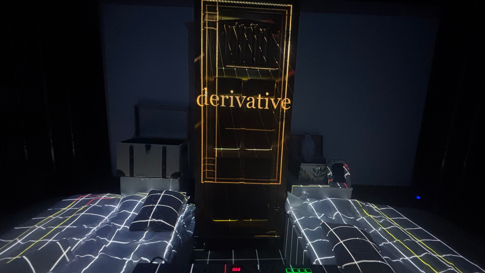

[↑ Back to contents](#contents)

---

<a id="2026-11-04"></a>

### November 4, 2026 — Attending a Hackathon

- I need to draw an exhibition diagram.
- I found the interaction method in this project interesting and could use it as a reference: [Enchanted Forest: The Melody of Spirits](https://www.outernet.com/news/enchanted-forest-the-melody-of-spirits).
- The repeated drumbeat also sounds good; I could add it when I have time.
🔗 [https://www.outernet.com/news/enchanted-forest-the-melody-of-spirits?utm_source=chatgpt.com](https://www.outernet.com/news/enchanted-forest-the-melody-of-spirits?utm_source=chatgpt.com)

[↑ Back to contents](#contents)

---

<a id="2026-11-05"></a>

### November 5, 2026 — Making “Breath Wave” at the Hackathon

- I attended a hackathon and was responsible for all the technical work, using TouchDesigner and Arduino.
- I completed this interactive projection project in one day.
- I plan to use the techniques from this project in my final work.
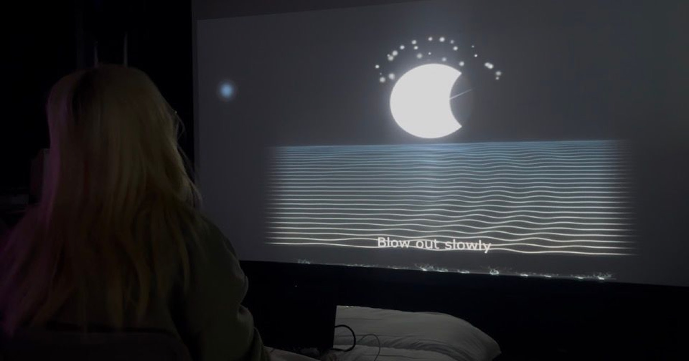

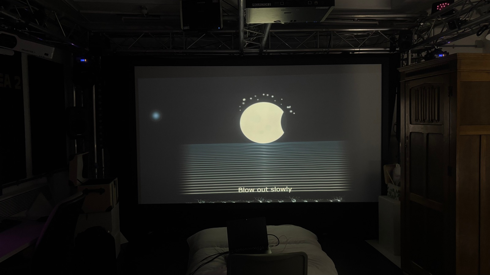

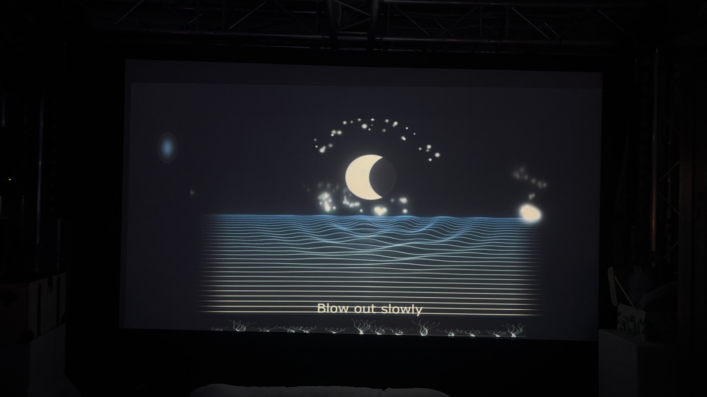

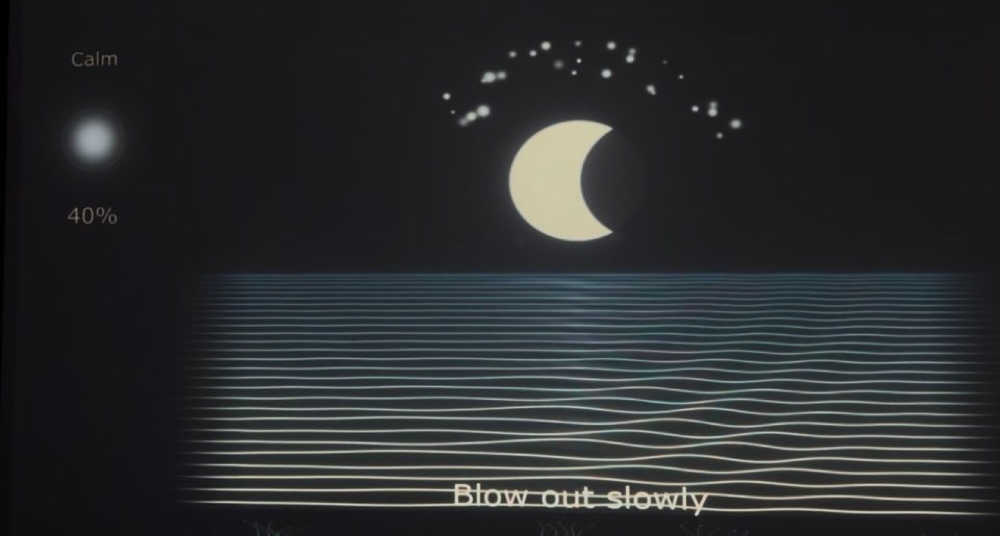

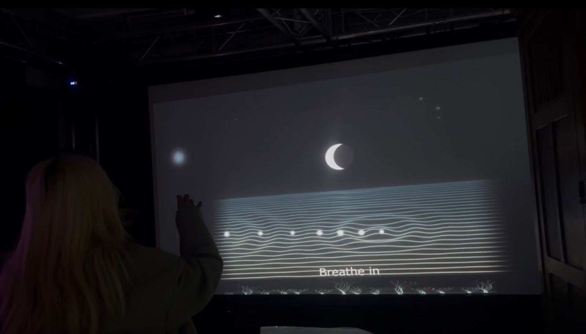

[↑ Back to contents](#contents)

---

<a id="2026-11-06"></a>

### November 6, 2026 — Simplifying the Project

- When I came to test the installation on-site today, many of yesterday’s ideas did not work out.
- The AI heat map is no longer needed, so I removed it and kept only the kaleidoscopic texture.
- I am thinking of replacing the old suitcase projecting into the room with my real suitcase, which would also give a larger projection area.
- I plan to use a makeup case like a safe. I found one in my new place, and it is suitable for projection. I cannot explain the old suitcase, but this makeup case is something I encountered while travelling.
- I changed the cover title from the default text to “Thin Walls.” It suits the story and draws attention to the thin wall that used to be between the two beds; now there is not even a wall, as if it has become too thin to see.
- After testing today, I found that players become absorbed in catching light points with their hands and triggering music. Perhaps another person could read the text in the wardrobe.
- It could be a cooperative puzzle game.
- I am thinking of adding cloth tracking.
- Research question: What reflections might an immersive game environment create when it takes place in reality?
- Possibilities: an escape room; remove the extra bed; add different things to each day; perhaps include heart-rate tracking.
- Continue researching how projection can reconstruct reality and create immersion.
- Perhaps put miniature speakers beside the ears, like the speakers on either side of a VR headset.
- This could make people feel that their bodies are different from reality.
- Eye tracking.
- Perhaps put only duvets on the left and right and have people sit on a sofa cushion.
- It could perhaps become a multiplayer game.
- I thought of the speaking tube between rooms. Could I make something similar and put one on either side of the wardrobe?
- Tomorrow I will go to Flying Tiger to buy some special refractive mirrors, magic glasses, or a kaleidoscope, and perhaps experiment with them.
- I also thought of the curtain from before; perhaps I could use it for experiments.
- To explore immersion, after trying a VR headset, I felt I should return to eye tracking.
- I want to use projection to recreate VR interactions and rewrite reality. VR headsets are too heavy for me; I get dizzy after wearing one for a while, and my head is too small, so I have to keep holding it.
- I need to figure out how to track pupils.
- Touch interaction might use TouchDesigner technology: interactive projection mapping (MediaPipe camera / Leap Motion).
- To recreate how objects in VR obscure real objects, I may need organza or a fabric-tracking cloth.
- To recreate the headset’s earphones, I need to look for bone-conduction headphones that clip onto the head. Perhaps the sound will change as people move through the scene wearing them, with different sound mapping.
- I could buy the one-way mirror I thought of earlier and try it.
- First thing to do tomorrow: add interactive projection so that a hand leaves a trace whenever it moves across any physical surface with a projection on it.
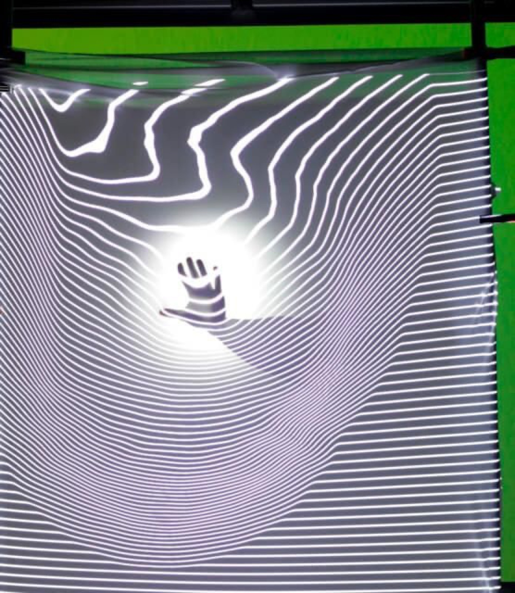

[↑ Back to contents](#contents)

---

<a id="2026-11-07"></a>

### November 7, 2026 — Thinking About How to Reconstruct Reality

- I thought of the artwork where a projection was placed in water; it really reconstructs reality.
- Perhaps mist could work too. I could buy a steamer and try it.
- On the tram, someone stood on one side of a transparent window, and I saw the landscape behind their reflection on the other side.
- When the person moved away, I saw the real scenery on the other side; when they came back, I could see only the view outside the window. The person was wearing a black coat.
- I thought of 3D films in cinemas, which also require glasses.
- Is there a way to alter reality without wearing anything?
- I plan to use the techniques from my hackathon project: first, make a hand leave a trace when it moves in front of a camera; later, see whether interactive projection can let a hand leave a trace when it moves across a projected area.
- Perhaps sound could come from speakers hidden in pillows. When viewers lie down, they would hear the sound as if it were beside their ears.
- Pillow speakers.
- Perhaps viewers could leave a trace somewhere: the mark left by a sliding hand could become a straight line, representing how, when I experienced discrimination and felt upset, I sometimes swiped at my screen.
- I am thinking of adding sharp lines to represent wounds I dreamt about while experiencing discrimination. I later drew this image.
- I would like to add sharp lines: when viewers swipe across the projection, such lines could appear, along with blood.
- I added a wound effect. When a hand moves in front of the camera, it appears. I will test it with the projector at school on Monday.
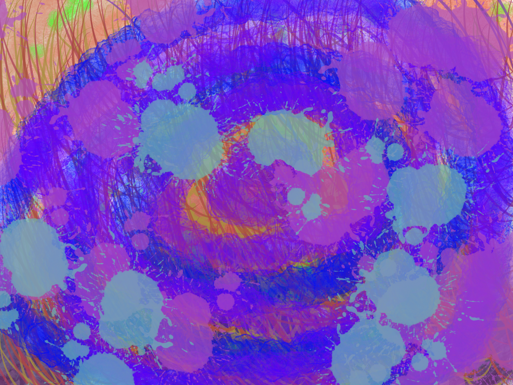

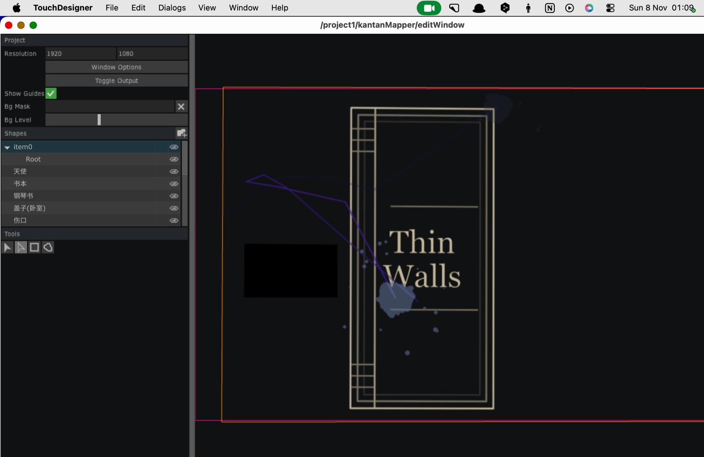

[↑ Back to contents](#contents)

---

<a id="2026-11-08"></a>

### November 8, 2026 — Rewriting the Question Being Explored

- Sadiq points out that traditional diversity training often relies on stereotypes, while people can understand differences more readily through real personal stories and lived experience.
- Sharing stories is a good method, so I turned my experience into a novel-like game to share it.
- I remembered the layout of the original room and drew it in the lower-right corner.
- I reversed the original room layout and thought about how to reconstruct the installation. I drew the installation layout in the lower-right corner.
- The wardrobe is the main element: it is both a wall and a book. I will put the box that previously projected my room beneath the wardrobe.
- The audience needs to sit in front of the wardrobe. If the projection cannot reach the area below it, I will put the box to the left of the wardrobe so the viewer can use one hand to collect light points and trigger music.
- The viewer sits in front of the wardrobe, covers themselves with the duvet, and explores the story from the girl’s perspective.
- What I need to do on Monday: find a sensor so that the game starts when the wardrobe door opens.
- A mirror might make the space look wider and larger than it is.
- This is too complicated. I should just remove the bed on the right.
🔗 [https://www.youtube.com/watch?v=HR4wz1b54hw](https://www.youtube.com/watch?v=HR4wz1b54hw)

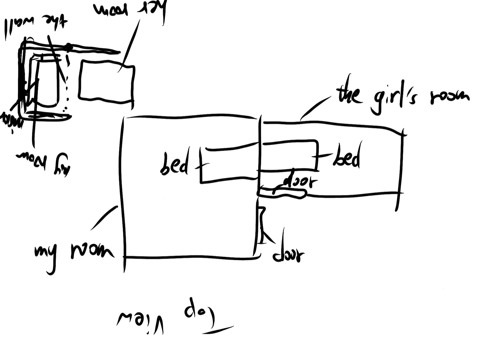

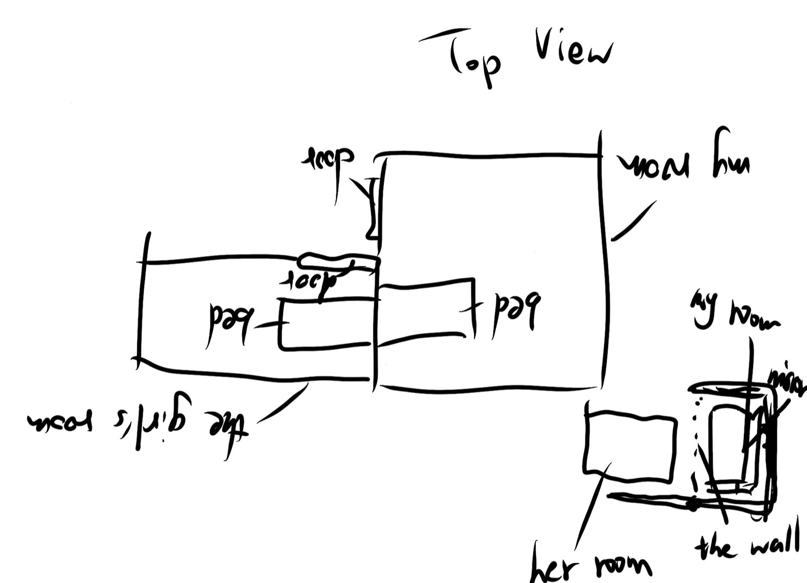

[↑ Back to contents](#contents)

---

<a id="2026-11-09"></a>

### November 9, 2026 — A New Interaction Idea

- I suddenly realised that, since the audience sees the story from the girl’s perspective, I do not need the girl’s room. The audience only needs to sit in a chair facing the wardrobe and open the story.
- The bed on the left is my room; the image on the suitcase lid in front represents a miniature of my room.
- After testing it with a classmate, she recommended a game similar to my project: *What Remains of Edith Finch*, the fish-tank section: [reference](https://xhslink.cn/o/AY8aIdnozl5).
- Today, after putting the box inside the wardrobe, I moved the other bed in front of the wardrobe so the user can lie on it and look at the wardrobe.
- From this viewpoint, the room below the wardrobe is hidden, so I moved the room projection to the upper-right corner of the wardrobe door. My classmate liked this interaction.
- The problem is that there is nowhere to put the other duvet or the kaleidoscopic face, and the viewer cannot see them when lying down.
- A classmate suggested making the setting more attractive, perhaps by finding a bedside table and an antique wardrobe.
- The setting reminded a classmate of *Alice in Wonderland*. Perhaps I could make the room appear to float.
- I need to prepare for user testing and complete the ethics form.
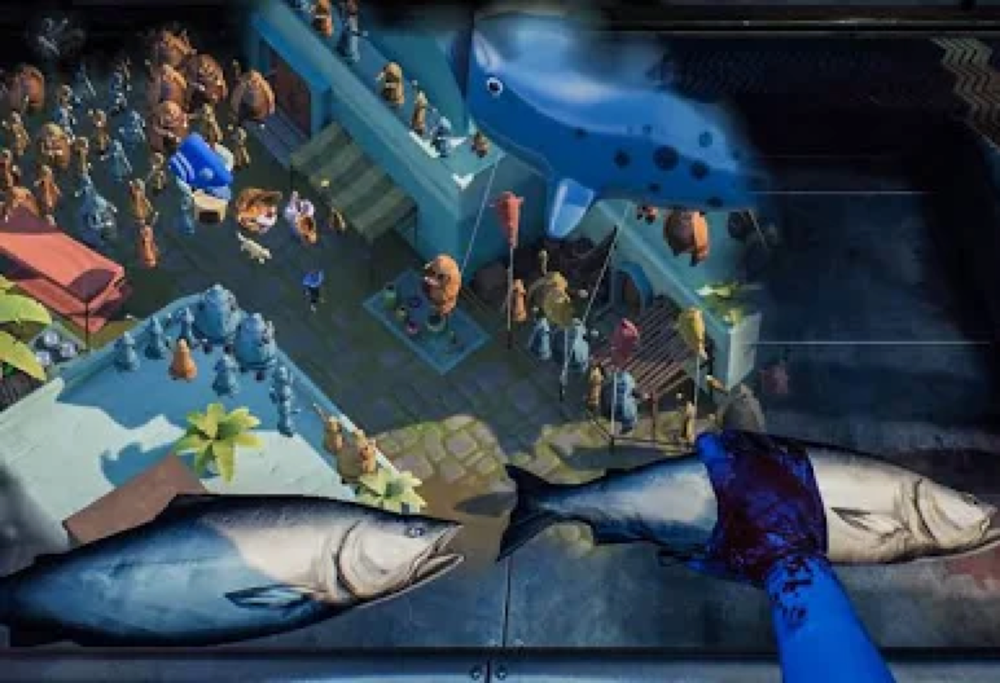

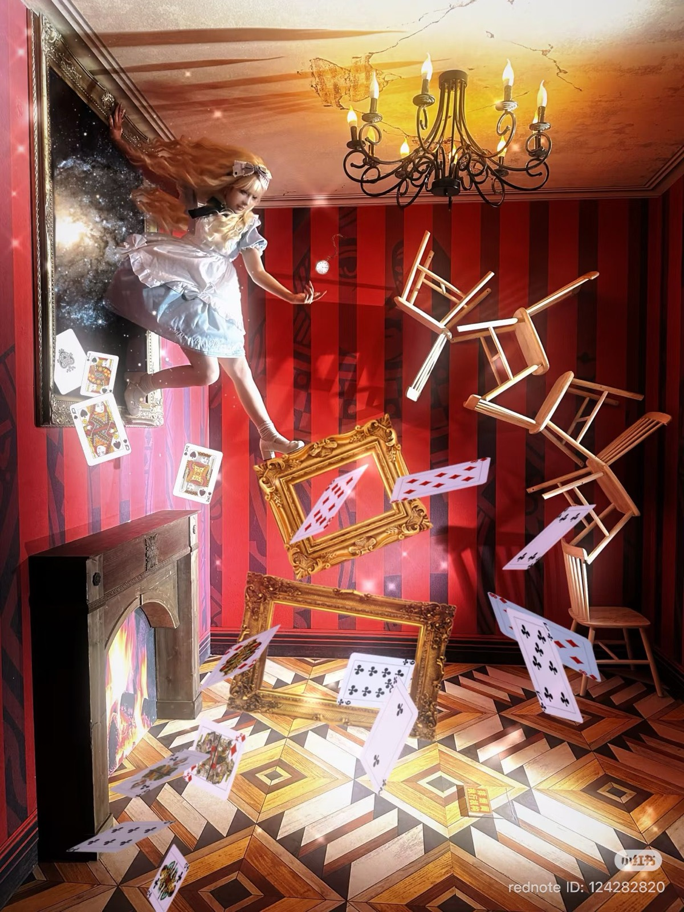

[↑ Back to contents](#contents)

---

<a id="2026-11-10"></a>

### November 10, 2026 — Further Adjustments

- I need to remove the sun spot from the room; viewers may think it is a light point.

[↑ Back to contents](#contents)

---

<a id="2026-11-11"></a>

### November 11, 2026 — Recording a Video

- I recorded a video and took some initial photos today. The video is incomplete, so I need to find time to record it again.
- I submitted the work for the winter exhibition and drew a diagram at the same time.
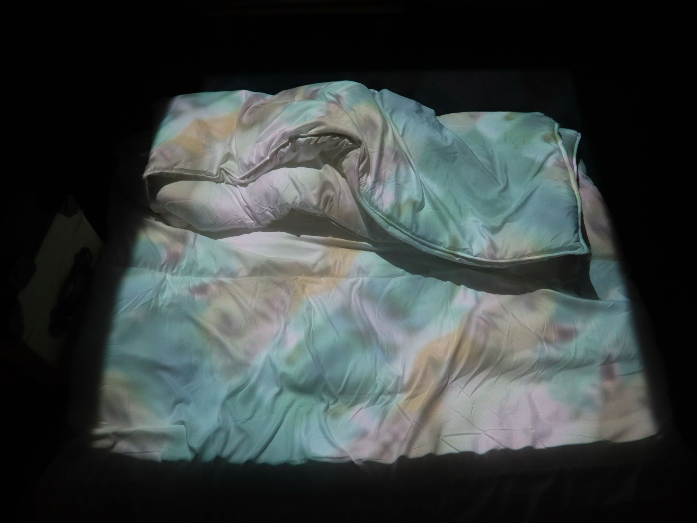


[↑ Back to contents](#contents)

---

<a id="2026-11-17"></a>

### November 17, 2026 — Recording the Video Again

- I realised the previous video did not include close-up shots, so I recorded it again today.
- I asked a classmate to test the work, and they said they liked it a lot.
- I asked again: “What kind of story do you think this game is telling?”
- My classmate said she loved how comfortable it felt to lie on the duvet, even though the story was creepy. She liked the combination. She thought the story was about looking into a room inside the wardrobe while lying on a comfortable bed, even though the things in that room were not meant to be seen.

[↑ Back to contents](#contents)

---

<a id="2026-11-18"></a>

### November 18, 2026 — Recording a Video

- I recorded the video again today and invited a classmate to test the project.
- The classmate said that the hand controls both the flashlight and the purple line representing a wound. The purple line is very noticeable and ends in blood, so at first they did not pay attention to the flashlight.
- I changed it so that only the flashlight appears while searching for light points, and only the purple line appears at other times. This ensures there is only one mouse-like visual indicator on the wardrobe at a time.
- The classmate also said that when the suitcase was on the left, it was difficult to move a hand in front of the camera; they had to move it forward and backward.
- We moved the suitcase beneath the wardrobe and put the camera on the suitcase. Now, when participants lie on the bed, they can move their hands directly in front of the wardrobe, which is easier to understand.
- Today I wanted to borrow an Arduino button to put on the box so the audience could start the game, but I forgot that the buttons here need something built around them and a hole drilled for installation.
- After putting the computer inside the box, I wondered whether knocking on the box could start the game.
- At first, one knock started it, but it was easy to trigger accidentally, so I changed it to repeated knocks.
- My hand started to hurt, so it was inconvenient. Then I realised that closing the box makes the computer vibrate as it makes a sound. If the viewer waves a hand in front of the camera to trigger a sound, the computer inside will make a sound, causing the box itself to vibrate repeatedly and start the game.
- I received a conditional offer for the winter exhibition. I will have a meeting to receive feedback on the project; the installation is probably too large and needs to be reduced.
- I remembered a classmate mentioning a scene like *Alice in Wonderland*. Perhaps I could hang up the duvet, on the left or right of the wardrobe, so one projector could cover it. I need to avoid distracting the audience, though. Maybe I could hang other things, such as a chair.
- Perhaps viewers could stand to play, or I could put a chair with a sofa in front so they can cover themselves with a duvet to simulate a bed and sit comfortably.
- I still hope to achieve the interactive projection I saw earlier. Perhaps I could add a camera to the wardrobe to track the audience’s hands and create interactions when they touch the duvet or wardrobe.
- Touching the duvet seems promising. I could use the water-ripple effect from an earlier project so that the kaleidoscopic face pattern ripples when someone touches the duvet.
- Or I could use the local hidden-layer modification I thought of before, so that the area changes colour when someone touches the duvet.
- Perhaps I could add sound mapping; I had wanted to do this earlier but forgot.

[↑ Back to contents](#contents)

---

<a id="2026-11-19"></a>

### November 19, 2026 — Possible Future Changes

- Possible change: hang up the duvet, and when someone stands and leans against it, create an effect as if they were lying on a bed and pressing into the duvet.
- If the duvet is too heavy to hang, I could hang pillows instead—several of them—and put a chair or sofa in front, then cover the audience with the duvet.

[↑ Back to contents](#contents)

---

