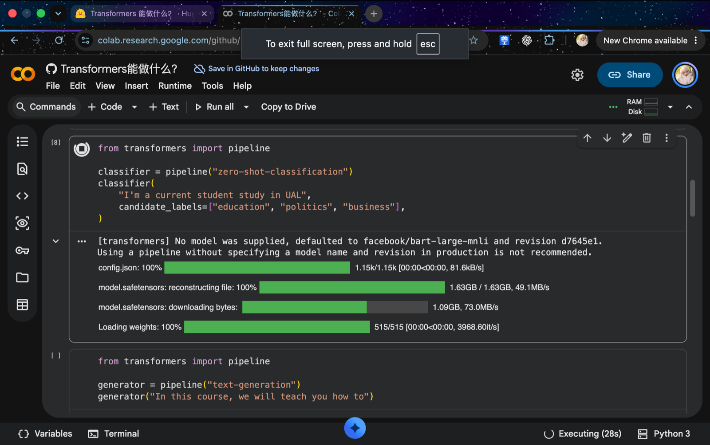

[← 2026-08-14](2026-08-14.md) | [Contents](../README.md) | [2026-08-18 →](2026-08-18.md)

# August 17, 2026 — Paper Recommended by My Teacher

- I had previously settled on a topic: visualising the black box behind AI.
- I received a reply from my teacher today.
- I read the paper they recommended; it was very useful.
- Today I started the LLM Course and tried some hands-on exercises.
> 📎 Attachment: Sanchez et al. - 2026 - Artists on a Decade of AI Evolution An Interview Study of Affordances, Culture, and Artistic Practi (1).pdf — see [the original Notion entry](https://app.notion.com/p/44a37ec6ecd383d8bfd401302929afcd)

---

[← 2026-08-14](2026-08-14.md) | [Contents](../README.md) | [2026-08-18 →](2026-08-18.md)
