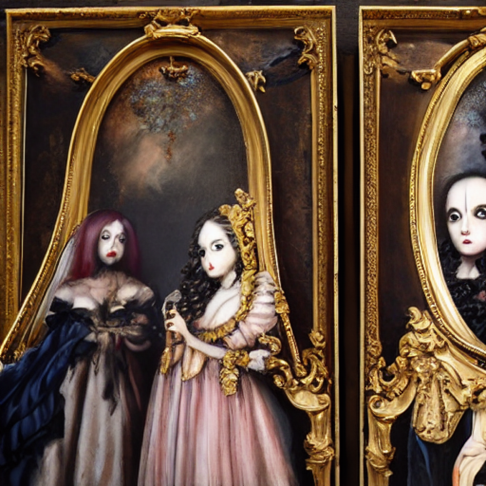

[← 2026-09-28](2026-09-28.md) | [Contents](../README.md) | [2026-10-01 →](2026-10-01.md)

# September 29, 2026 — Making a Prototype

- I am getting ready to make a prototype.
- First, I will connect images to three scenes in TD and play them to see how they look.
- I like the effect in this image. I am thinking about making the model’s characters have large eyes and small mouths, so they look mean.
- Huge mouths and out-of-control facial features.
- Mean-looking faces.
- Attention being drawn in.
- Perhaps add animation, with mouths opening and closing.
- Facial features shifting out of place.
- Electronic music sounds good.

---

[← 2026-09-28](2026-09-28.md) | [Contents](../README.md) | [2026-10-01 →](2026-10-01.md)
