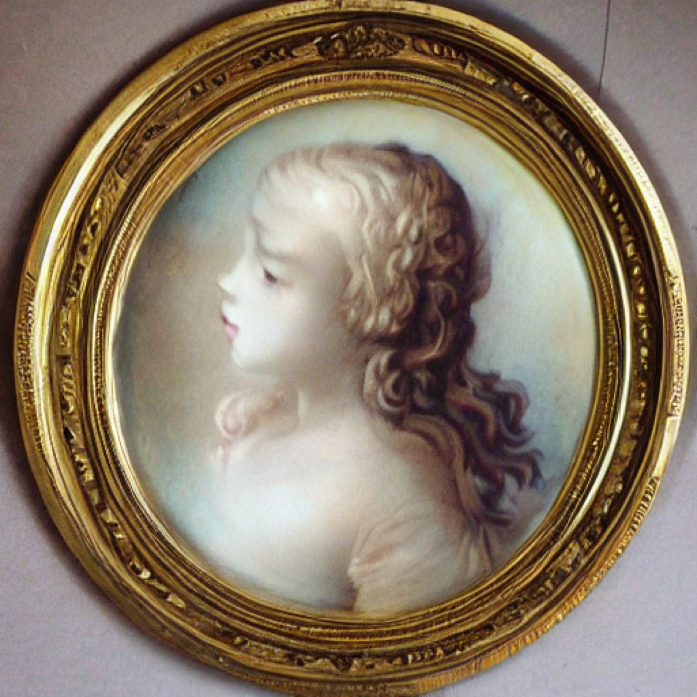
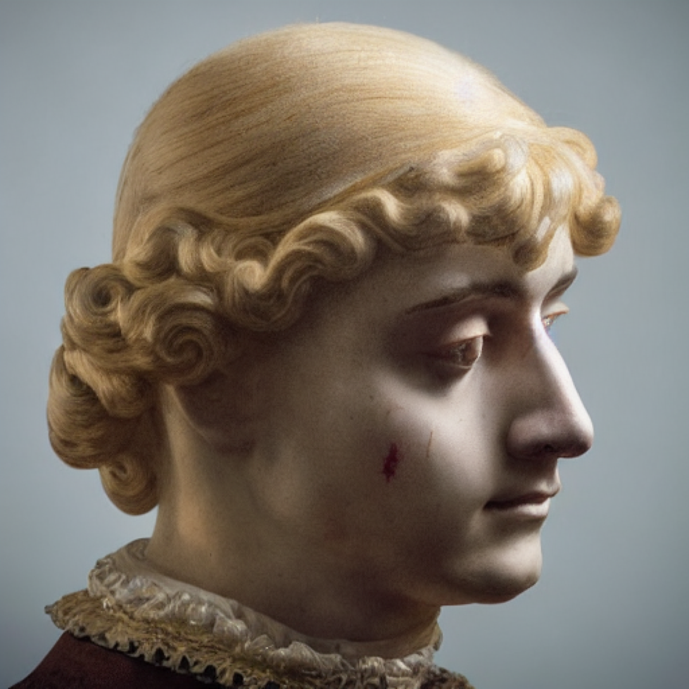
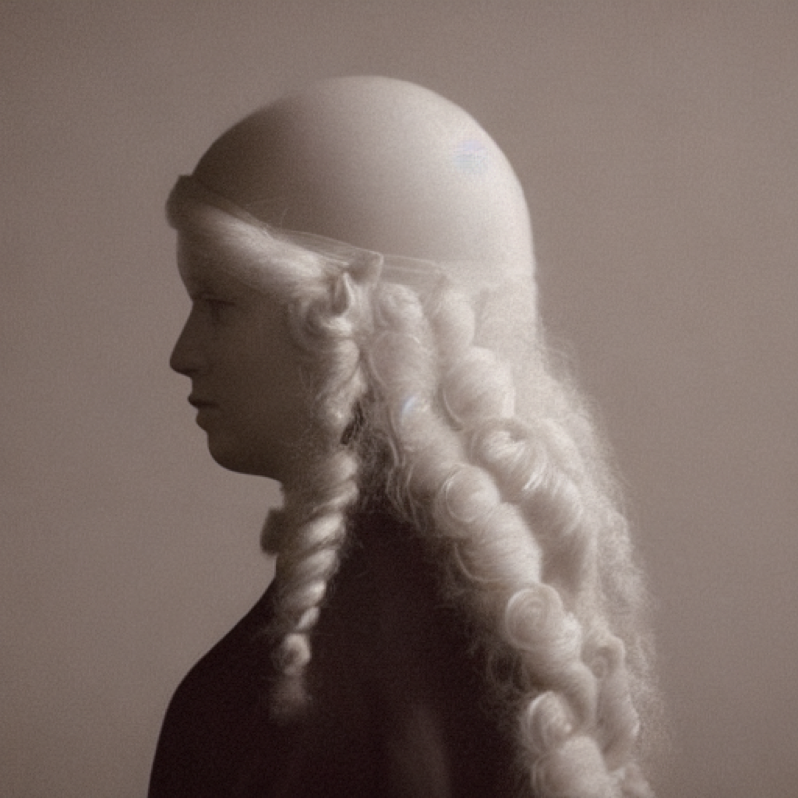

[← 2026-09-29](2026-09-29.md) | [Contents](../README.md) | [2026-10-02 →](2026-10-02.md)

# October 1, 2026 — Refining the Question

- What is this work saying about racism?
- “In many instances of racism, people do not realise they are discriminating against others.”
- I reconsidered the question.
- How can an interactive AI portrait make viewers realise that attention, categorisation, and the desire to “see a person clearly” may contain unrecognised racialised assumptions?
- How can an interactive AI portrait make viewers realise that, when someone is watched, categorised, and “seen clearly” too intensely, attention itself can become a racialised pressure?
| Viewer’s position | What happens in the installation | What the viewer might realise |
| --- | --- | --- |
| Watching from a distance | All three faces are blurry; the whispers are faint | Looking has not yet been turned into a judgement |
| Facing one wall | That face becomes clear, as if confirmed by the system | My attention is distributing visibility |
| Looking for a long time | The face is scanned, marked, distorted, and replaced | “Seeing clearly” can also be a form of control or pressure |

I hope:

- Someone will think of a time they were judged by their appearance, accent, gender expression, or disability.
- Someone will realise they have also unconsciously stared at, guessed about, or categorised other people.
- A new visual effect occurred to me: being looked at turns a person into a doll or some kind of product.
- Related myth: people watched by Medusa’s eyes turn to stone.
- Possible elements: mirrors.
- The visual effect still needs work; it looks too ugly at the moment.
- I generated new images for inspiration and like this eerie profile; the scene looks good too.
- Prompts requesting no eyes did not work. The eyes just turned white, which was not eerie enough. The model still needs to be changed.
- I am wondering whether to try projection mapping. The image looks like a sculpture and is beautiful; it suddenly made me think of a weeping Virgin Mary, which could be interesting.
- A prompt asking for no nose did not work either. Perhaps I can find other prompts that fail and fine-tune the model to produce those results.
- The rubber-like bald head is fun.

---

[← 2026-09-29](2026-09-29.md) | [Contents](../README.md) | [2026-10-02 →](2026-10-02.md)
