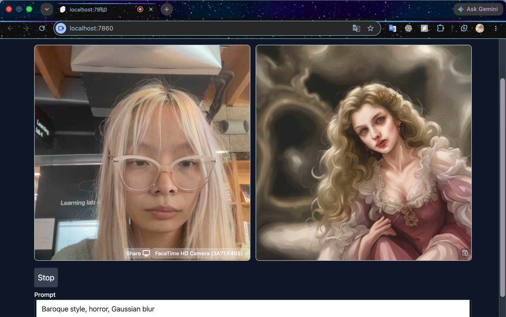

[← 2026-10-01](2026-10-01.md) | [Contents](../README.md) | [2026-10-03 →](2026-10-03.md)

# October 2, 2026 — Downloading a Video-to-Video Model

- I downloaded the 28 GB introductory version of StreamDiffusion and tried generating images from prompts.
- I downloaded LTX Video.

---

[← 2026-10-01](2026-10-01.md) | [Contents](../README.md) | [2026-10-03 →](2026-10-03.md)
