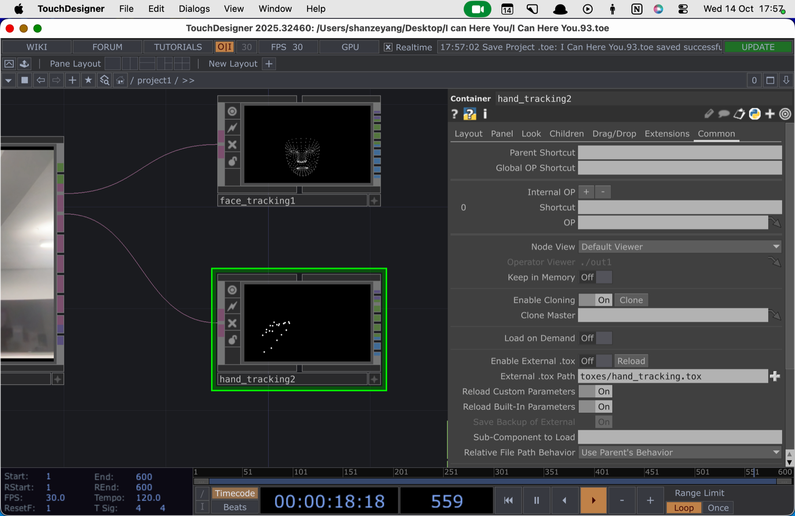

[← 2026-10-13](2026-10-13.md) | [Contents](../README.md) | [2026-10-15 →](2026-10-15.md)

# October 14, 2026 — Adding Attention Tracking

- I copied the MediaPipe hand tracking out, but it did not work. I later found that the previous connection was wrong; after fixing it, it worked.
- At first, I made high notes on the keyboard duplicate multiple images and low notes reduce the number of images, but it did not look good enough.
- I added a kaleidoscope effect, which looked better, but playing the keyboard felt too limited.
- So I decided not to use the keyboard and instead try air-playing, to see whether I could map the hidden layers into the air.

---

[← 2026-10-13](2026-10-13.md) | [Contents](../README.md) | [2026-10-15 →](2026-10-15.md)
