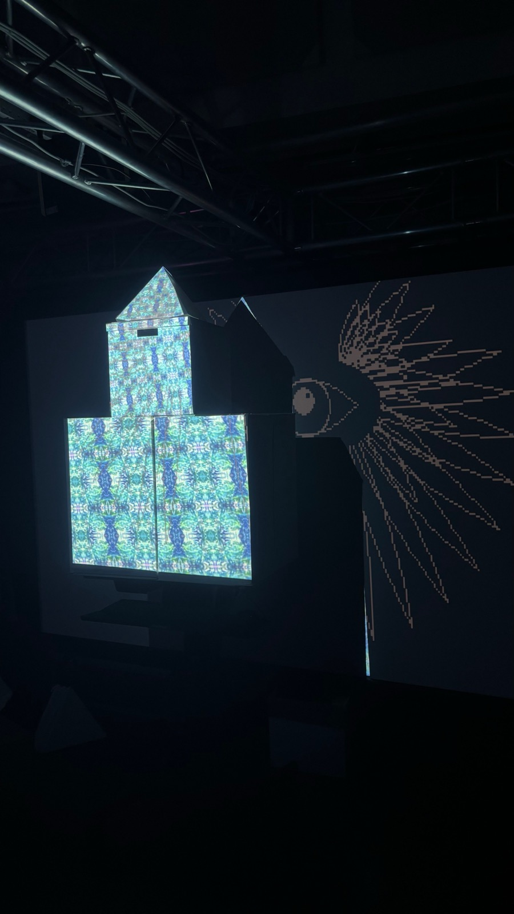

[← 2026-10-18](2026-10-18.md) | [Contents](../README.md) | [2026-10-20 →](2026-10-20.md)

# October 19, 2026 — Adding Pixel Angel Eyes

- Today in the dark lab I successfully built a castle out of cardboard boxes and mapped the projector onto it.
- I removed the wooden hands and test rabbit, and changed the effect so that clicking the castle creates a shockwave.
- I wanted to add more uncanny elements, so I drew a pixel angel eye; it looked good.
- At the art shop today I saw blank masks. It could be fun to buy one and project onto it next time.
- I need to think more about what to project onto; the castle does not look good enough yet.
> 🎞 Video: IMG_3616.mov — not copied here (file too large for GitHub). [Watch it in the original Notion entry](https://app.notion.com/p/91637ec6ecd382b9925001213f7abc30)

---

[← 2026-10-18](2026-10-18.md) | [Contents](../README.md) | [2026-10-20 →](2026-10-20.md)
