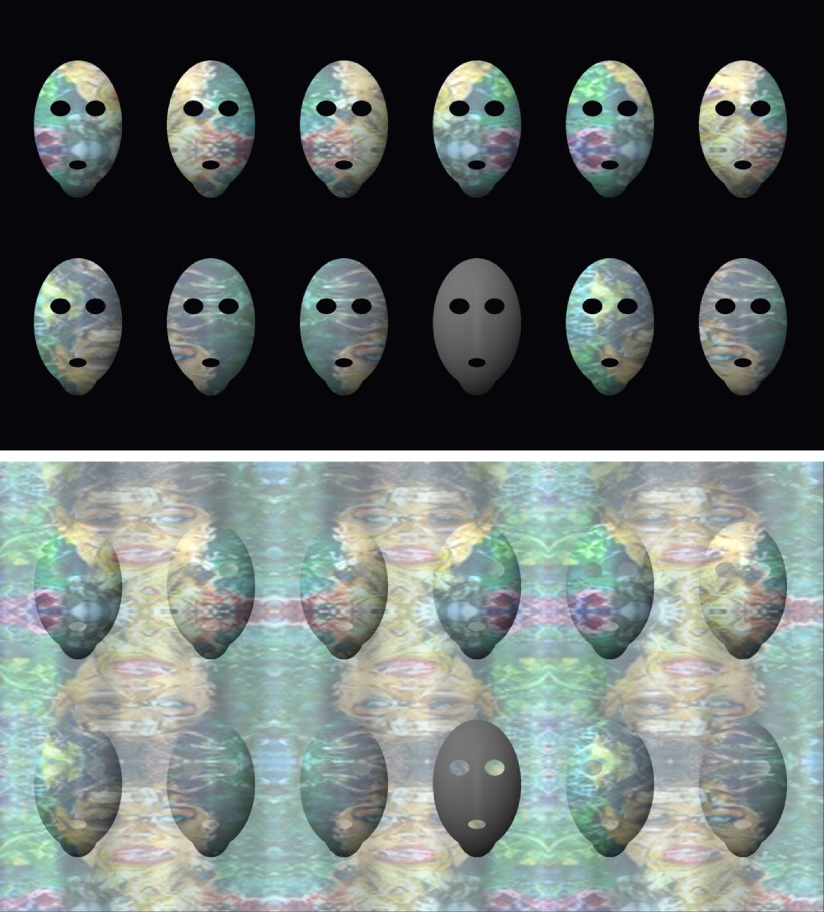
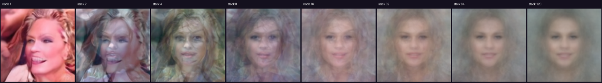

[← 2026-10-19](2026-10-19.md) | [Contents](../README.md) | [2026-10-21 →](2026-10-21.md)

# October 20, 2026 — Rethinking the Theme

- Consider adding the sound of wind.
- Adjust the angel’s size.
- Rethink the theme being explored. The visualisation of AI’s hidden layers could still be useful.
- The visualisation currently looks a lot like a church light show.
- Perhaps I need a table at a fixed height; I might need to make something in the lab.
- The projected objects need to look more refined. Think about religious themes.
- A visualised wooden mural could work, or perhaps something 3D-printed.
- Perhaps there is a theme related to faces, bias, religion, and race that I could perform as a stage play.
- [“AI Ain’t I a Woman?”](https://lithub.com/ai-aint-i-a-woman-on-the-blindness-and-limitations-of-artificial-intelligence/)
- I reconsidered the theme: a “standard portrait” seems promising.
- The dataset I trained on consists of over a hundred celebrity faces and lacks people from other races. This is also something I can discuss.
- The source data itself represents a “standard face.”
- I could project onto many white masks; the white masks would represent standard faces.
- The background could retain the kaleidoscope-face effect, appearing occasionally to show faces blended together and express confusion.
- I ran an AI experiment, gradually overlaying generated faces to create an image of a standard face (1, 2, 4, 8, 16, 32, 64, 120).
- From images 1 to 4, many different faces still overlap in a chaotic jumble.
- From 8 to 16, the facial features begin to “settle” into the same positions.
- From 32 onward, the image becomes more stable and loses detail. Eventually it resolves into a soft, blurry, unremarkable face: the eyes, nose, and mouth are in the “right” places, but it belongs to no one.
🔗 [https://lithub.com/ai-aint-i-a-woman-on-the-blindness-and-limitations-of-artificial-intelligence/](https://lithub.com/ai-aint-i-a-woman-on-the-blindness-and-limitations-of-artificial-intelligence/)

---

[← 2026-10-19](2026-10-19.md) | [Contents](../README.md) | [2026-10-21 →](2026-10-21.md)
