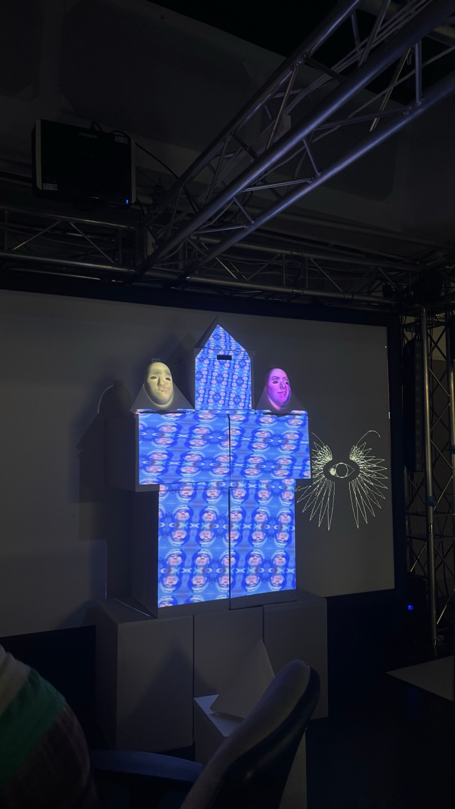

[← 2026-10-20](2026-10-20.md) | [Contents](../README.md) | [2026-10-22 →](2026-10-22.md)

# October 21, 2026 — Projecting onto Face Masks

- Today I bought a face mask at the art shop, placed it on the castle, and successfully projected onto it.
- Later I realised that the mask’s eyes made projection difficult, so I covered the eyes and mouth from behind with paper.
- In the end, because the school speakers were not connected, I recorded a silent demonstration of the current work.
- I added an image overlaying the average face. When a hand appears, it scatters hundreds of overlaid faces, and finally returns to the kaleidoscope.
**Standard Face**

- I overlaid the CelebA faces generated by Lucy, so the average becomes the “standard face AI believes in.”
- The later sequence—hands poking it, the faces scattering, and then returning to the kaleidoscope—expresses the breaking of the “standard.”

> 🎞 Video: 1.mp4 — not copied here (file too large for GitHub). [Watch it in the original Notion entry](https://app.notion.com/p/76937ec6ecd382178bc00139912c6c89)

---

[← 2026-10-20](2026-10-20.md) | [Contents](../README.md) | [2026-10-22 →](2026-10-22.md)
