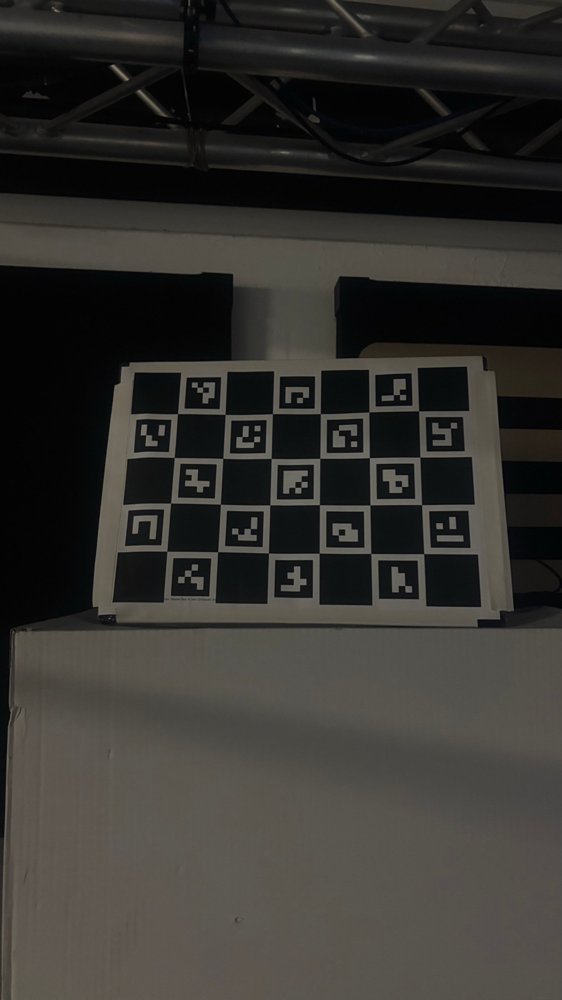
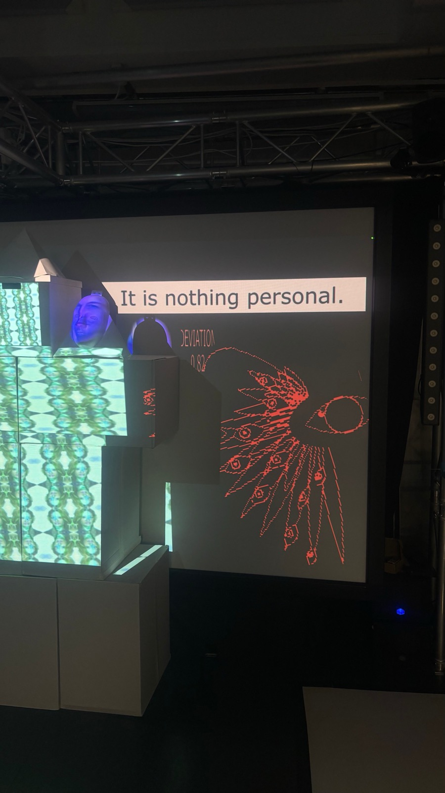
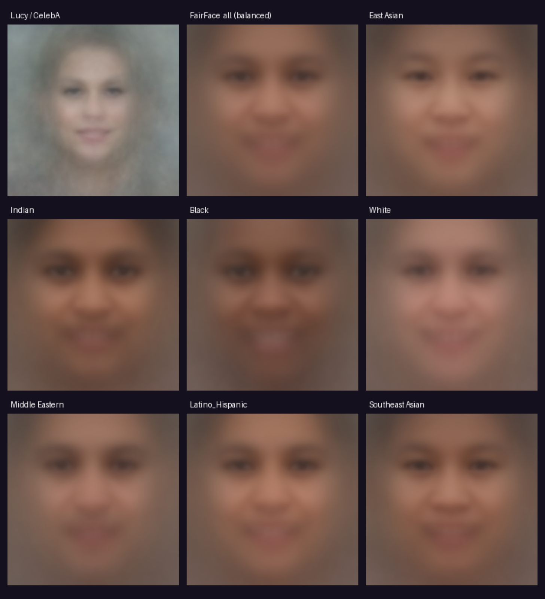
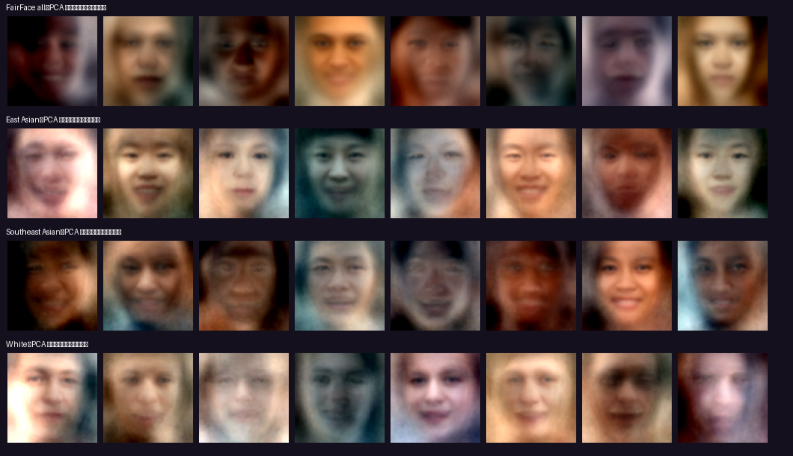
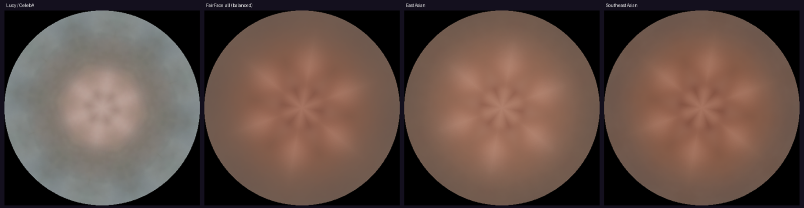

[← 2026-10-22](2026-10-22.md) | [Contents](../README.md) | [2026-10-24 →](2026-10-24.md)

# October 23, 2026 — Adding Other Average Faces and User Testing

- I am considering making a wooden grid like a chessboard, with face masks on half of it; perhaps they could be movable.
- I want to turn the angel into a visualisation of deviation.
- The angel claims to treat every face equally, but opens its eyes wide only for faces that do not meet the standard.
- I invited passers-by to test it.
- A friend suggested projecting participants’ faces onto the masks.
- The average faces generated by my current dataset look too similar. I found external datasets and created other average faces; I am considering whether to include them in the visual effects.
- I also added eyes to the angel’s wings. When the deviation is too large, the eyes on the wings open, and the angel grows larger and turns red.
- I suddenly thought of adding a blurry-face effect—perhaps a mosaic face—and could add it tomorrow.
- If the audience’s faces are projected too, perhaps I could duplicate them.
- A blurry face wearing a hood could work.
- I could also add dolls and paper figures.
- Repeated lines of text could look good.

> 🎞 Video: 1.mp4 — not copied here (file too large for GitHub). [Watch it in the original Notion entry](https://app.notion.com/p/e3c37ec6ecd383ea83728113d195df4b)

---

[← 2026-10-22](2026-10-22.md) | [Contents](../README.md) | [2026-10-24 →](2026-10-24.md)
