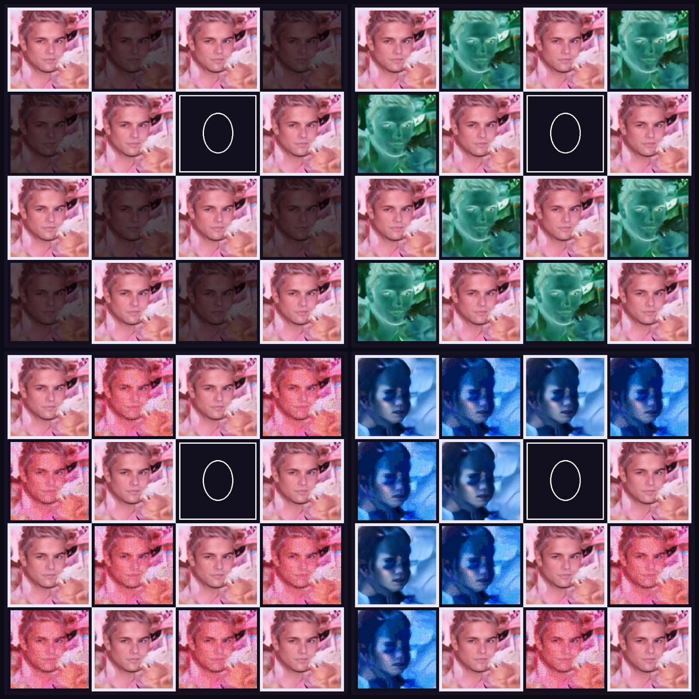

[← 2026-10-24](2026-10-24.md) | [Contents](../README.md) | [2026-10-26 →](2026-10-26.md)

# October 25, 2026 — Rethinking the Prototype

- I started testing the chessboard scene.
- Works that inspired me: [Yoko Ono,](https://camstl.org/exhibitions/yoko-ono-play-it-by-trust/) *[Play It by Trust](https://camstl.org/exhibitions/yoko-ono-play-it-by-trust/)*, [Zach Blas,](https://zachblas.info/works/facial-weaponization-suite/) *[Facial Weaponization Suite](https://zachblas.info/works/facial-weaponization-suite/)*, and [Do Ho Suh](https://www.serpentinegalleries.org/whats-on/do-ho-suh/).

🔗 [Yoko Ono: Play it by Trust](https://camstl.org/exhibitions/yoko-ono-play-it-by-trust/)

🔗 [Facial Weaponization Suite | Zach Blas](https://zachblas.info/works/facial-weaponization-suite/)

🔗 [Do-Ho Suh - Serpentine Galleries](https://www.serpentinegalleries.org/whats-on/do-ho-suh/)

---

[← 2026-10-24](2026-10-24.md) | [Contents](../README.md) | [2026-10-26 →](2026-10-26.md)
