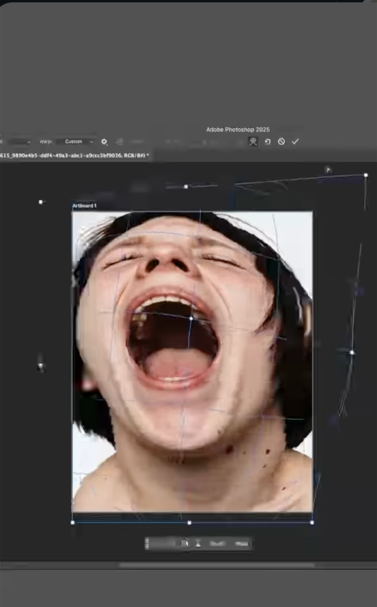
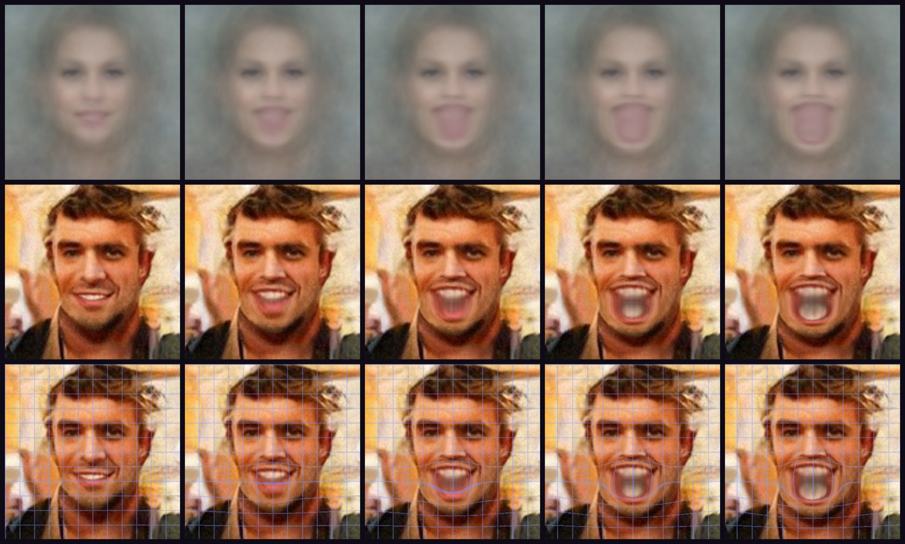
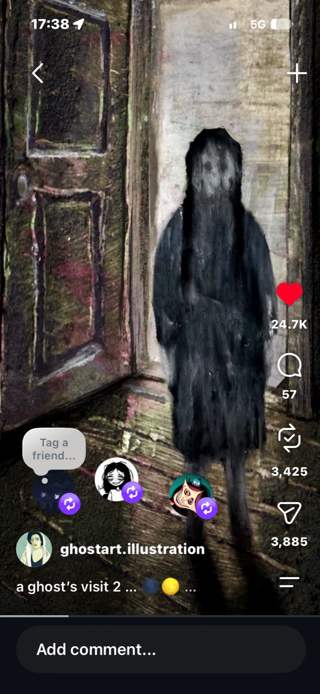
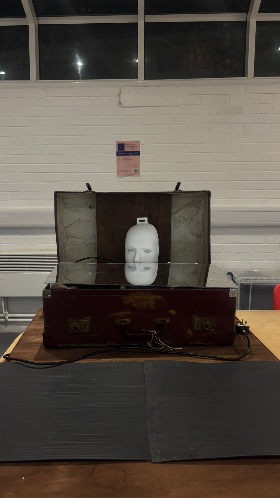
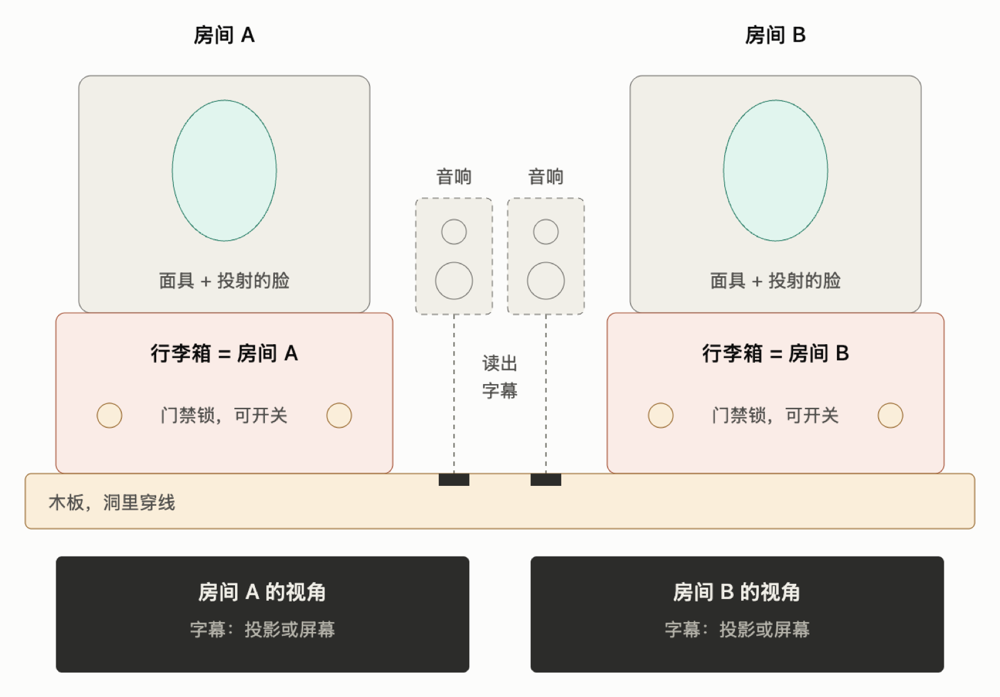

[← 2026-10-25](2026-10-25.md) | [Contents](../README.md) | [2026-10-27 →](2026-10-27.md)

# October 26, 2026 — Choosing a Suitcase Prototype and User Testing

- I invited people to test the work.
- After talking with a classmate, I learned that they thought the triggered sound was the projected face singing. Perhaps I could make the face’s mouth open and close, as if it were singing.
- Participants did not seem to know how to play the piano, so I need to give them more prompts about interacting with the camera.
- Or I could connect the piano after all, so people who cannot air-play can control the sound.
- I made the mouth-opening effect, so it looks as if the face is singing.
- I plan to adjust the mosaic effect that appears after a hand pokes it; I want it to have more of a crayon texture, based on a reference image.
- I talked with my teacher and realised that the work is currently too scattered and the interactive experience is poor. There are too many objects and scenes, and many do not connect or have a clear purpose.
- Every element that appears should have a meaning. If it is an interactive installation, the audience should be focused on the interaction throughout.
- The installation I am currently imagining has a wall in the middle and a bed on each side. Face masks hang on the wall and speak; subtitles are projected on the wall and read aloud.
- The story is told from two perspectives: my experience of racial discrimination and the girl’s perspective.
- I am thinking of using two suitcases to represent two rooms. The suitcase also represents my repeated moves.
- Beneath them, a wooden board would display subtitles describing the two perspectives. The black area in the sketch would show the subtitles, perhaps by projection or screen.
- Speakers would sit behind the suitcases, with holes for the cables. They would read the subtitles, and there could be other sound interactions.
- A face mask would sit on each suitcase lid, representing the two rooms, with a face projected onto it.
- When the face speaks, its mouth would open and close, keeping the talking-face visual effect I had already made.
- I could reuse the door access-control lock from my old door and let people try opening and closing it.
- Possible idea: use a one-way mirror to show how poor sound insulation lets people in two rooms see one another’s private lives. If so, I would need only one suitcase.
- Perhaps the central wooden board should be large so text is easy to project.
- The suitcase needs to be on a table so the audience can see it easily.
- Possible interaction: a viewer presses the door lock, expecting privacy to be protected. The lock clicks, but the room behind the mirror lights up. The door has locked, but the boundary has failed.
- Or a face could appear beside another face.
| Element | First-version approach | Purpose |
| --- | --- | --- |
| Two face masks | Use the existing projected talking-face effect | Keep the visual core already developed |
| Two sets of subtitles | Separate screens, or matte, light-coloured text areas on the board | Prioritise legibility |
| Mirror | Use only a small window or a separate test module | Avoid disrupting the face projection |
| Door lock | Attach it to a separate small door panel or frame | Give the viewer a clear action |
| Speakers | Two independent channels, hidden near the respective suitcases | Give each room its own sound location |

Potentially useful works:

- [Tony Oursler](https://tonyoursler.com/lisson-gallery-london): projected faces that seem like people trapped inside objects.
- [Marcel Duchamp’s](https://www.moma.org/collection/works/80890) *[Boîte-en-valise](https://www.moma.org/collection/works/80890)*: a miniature copy of his works placed in a collapsible box, creating a “portable museum.” My suitcase is also a miniature of memory.

🔗 [Tony Oursler / gallery](https://tonyoursler.com/lisson-gallery-london)

🔗 [Marcel Duchamp. Box in a Valise (From or by Marcel Duchamp or Rrose Sélavy). 1935-41 | MoMA](https://www.moma.org/collection/works/80890)

---

[← 2026-10-25](2026-10-25.md) | [Contents](../README.md) | [2026-10-27 →](2026-10-27.md)
