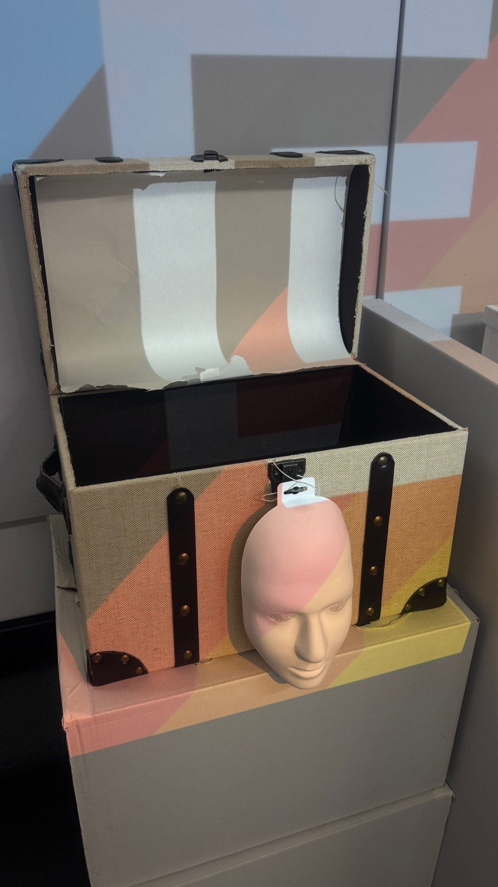
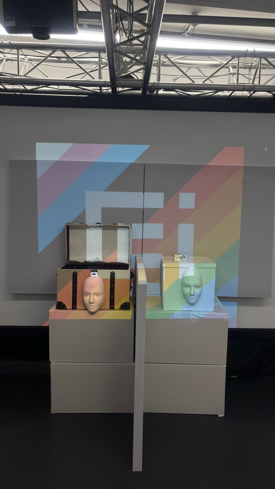
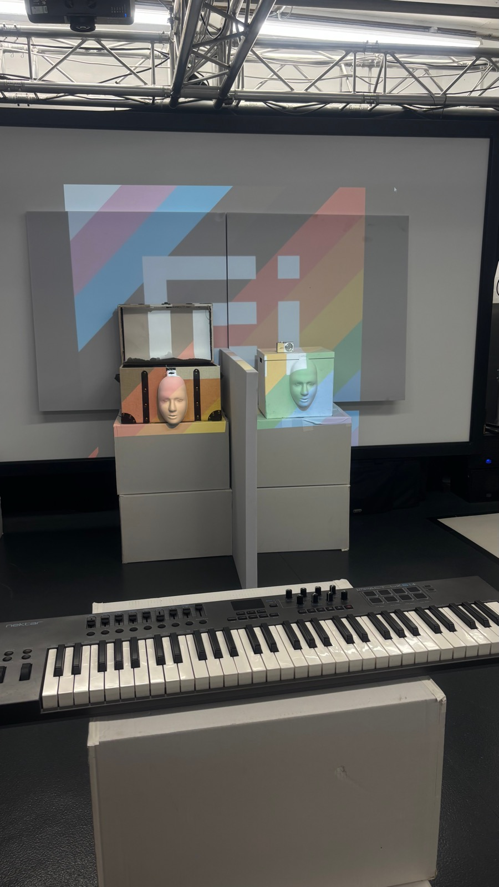
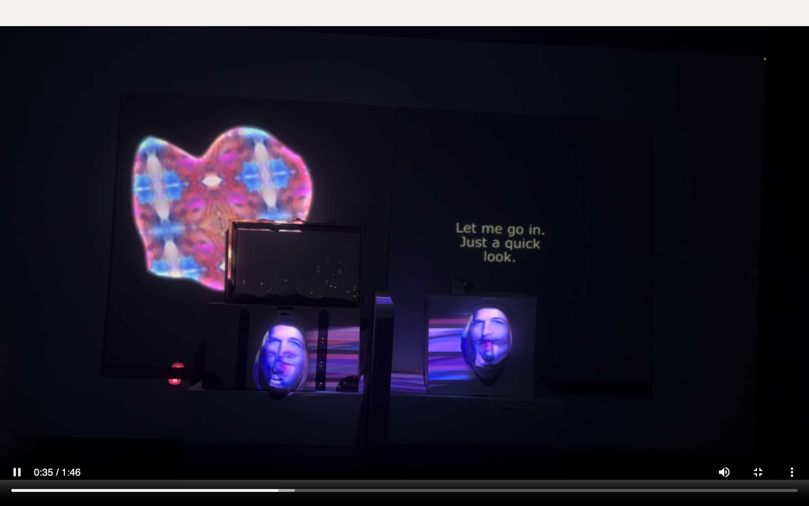

[← 2026-10-26](2026-10-26.md) | [Contents](../README.md) | [2026-10-28 →](2026-10-28.md)

# October 27, 2026 — Initial Projection

- Today’s final performance effect.
- I bought a suitcase, but the black fabric on its lid was difficult to project onto, so I temporarily put paper on it.
- I assembled an initial prototype. The background and centre use soundproofing foam; boxes support the two sides underneath at a suitable height.
- The suitcase on the left represents my room; the one on the right represents another room. I may put a bedside table there; for now, I used a cardboard box.
- Face masks hang on both sides. I plan to project other visual effects onto the soundproofing foam in the background.
- I added the keyboard again to make interaction easier for the audience and raised it on boxes.
- I kept the previous sound-mapping method for the keyboard. The middle keys can change the hidden layers and therefore change the face’s appearance.
- Holding down a black key brings up a heat map, another element related to attention.
- The other keys respond to pitch: the higher the sound, the farther away the kaleidoscopic face image moves; the lower the sound, the larger the image becomes.
- I also added descriptions in another language to tell the story from the other person’s perspective.
- I tried to make the computer read the text, but it sounded unpleasant, so I changed back to the Dream Voice sound effect, which already sounds like a person speaking.
- When the piano makes a sound, the projected face on the mask opens its mouth, as if speaking.
- I added a camera sound when the corresponding text appears.
- The two masks act out an intrusion into a room: a face that was in the room on the right suddenly moves to the left. A glitch pulls between the two masks, representing an ongoing intrusion.
- When the room on the left suitcase glitches, a cloud-like speech bubble appears, representing the poor mental state of the person in the room.
> 🎞 Video: 1.mp4 — not copied here (file too large for GitHub). [Watch it in the original Notion entry](https://app.notion.com/p/f7337ec6ecd383e8bd290199c52af418)

---

[← 2026-10-26](2026-10-26.md) | [Contents](../README.md) | [2026-10-28 →](2026-10-28.md)
