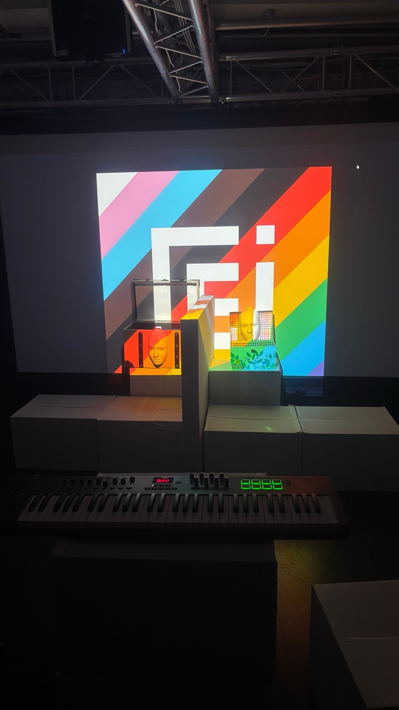

[← 2026-10-27](2026-10-27.md) | [Contents](../README.md) | [2026-10-29 →](2026-10-29.md)

# October 28, 2026 — Adding a Bed and a Gift Box to the Projection

- I am thinking about what to put on the right side of the wall to represent someone living in their own home, something permanent.
- I thought of a fridge. When I previously lived in a landlord’s house, I saw the fridge covered with fridge magnets, postcards, memories, and photos with friends.
- I bought a gift box to represent permanent memories and put it in the room on the right.
- I planned to laser-cut a fridge, then realised I could simply stack two cardboard boxes to simulate one.
- Then I realised I was going off topic: if a cardboard box can simulate a fridge, laid down it can simulate a bed.
- I plan to put something like a rubber board behind the bed on the right and display postcards representing family and friends, suggesting that the landlord’s family lives in their own home.
- Possible development: make the power structure behind a lodger living in someone else’s home clearer, revealing the hidden loneliness.
- The current scene should focus more on the other person’s perspective and use satire to express my feelings.
- Perhaps cut a large wooden board to represent the wall and cover both sides with soundproofing foam. If time allows, add something representing a door.
- Tomorrow I need to bring a small pillow and bedsheets I saw last time to decorate both beds.

###### Part One: Calm

1. We need to rent out a room.
1. Someone is moving in!
1. Why did she just drag her large suitcase up the stairs?
1. What did she put in the fridge? I’m so curious. *(Take a photo.)*
1. …you won’t believe it, there’s a girl upstairs…

###### Part Two: The First Intrusion

1. …cultural background… completely different…
1. She has gone out!
1. Let me go in. Just a quick look.
1. …I’m in her room… right now… *(The white angel appears; the room glitches slightly.)*
1. The trash! She really did dye it herself! *(Take a photo.)*
1. …look at these photos… sending them to my friends… *(Take three photos; the white angel grows larger.)*
1. …everyone, come on… tonight I’ll tell you all about… the girl living in my house… *(The white angel disappears.)*
1. …she’s a… liar…
1. This is my house. *(The glitch disappears.)*

###### Transition: Calm

1. Don’t go into her room again.
1. What do I do? I already told the child not to go into her room.
1. She’s so smart. I didn’t even know opening a door could be recorded.
1. I can’t lose this income.
1. Listen up. We’re a family. We stick together.
1. Going into her room? That never happened. *(Take three photos; the red angel appears; the room glitches severely.)*

###### Part Three: The Second Intrusion

1. It’s just talking. It’s not a big deal.
1. I’m in my own room. *(The severe glitch disappears.)*

###### Ending

1. She has moved out at last.
1. Another guest will come.
> 🎞 Video: 2.mp4 — not copied here (file too large for GitHub). [Watch it in the original Notion entry](https://app.notion.com/p/e5637ec6ecd3836e8ba301b8d84cba2f)

---

[← 2026-10-27](2026-10-27.md) | [Contents](../README.md) | [2026-10-29 →](2026-10-29.md)
