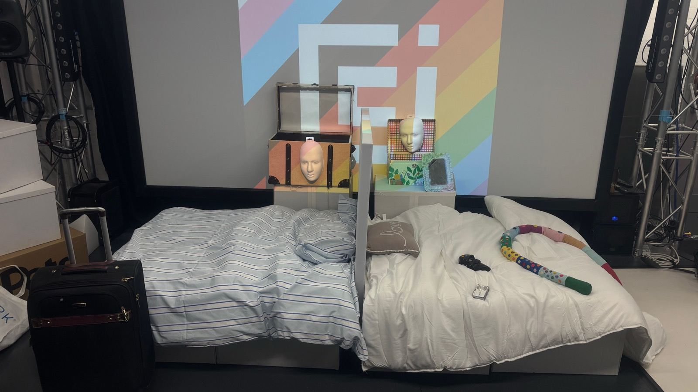
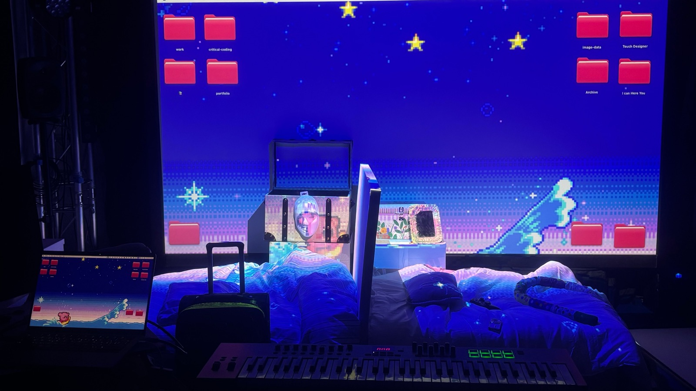

[← 2026-10-29](2026-10-29.md) | [Contents](../README.md) | [2026-10-31 →](2026-10-31.md)

# October 30, 2026 — Adding a Duvet

- Repetition can create rhythm and trigger a physical response.
- The repeated faces in my work are a kind of music visualisation. Appearing around the room, they represent an outsider invading a boundary.
- The rules of the game need to be designed carefully: rules determine how a game is played and also represent the designer’s ideas.
- I bought two duvets at Primark and found duvet covers, pillowcases, and a suitcase at a charity shop.
- After setting them up, the space looked a little like two rooms.
- I turned on the ceiling projector; perhaps I could project onto the duvet too.
- I tried a basic synchronised projection. When my hand moved in front of the camera, a wooden hand, a halo, and a light appeared on the duvet.
- The wooden hand looked too ugly. I will think more about its texture tomorrow.
🔗 [https://www.tate.org.uk/art/artworks/warhol-marilyn-diptych-t03093](https://www.tate.org.uk/art/artworks/warhol-marilyn-diptych-t03093)

---

[← 2026-10-29](2026-10-29.md) | [Contents](../README.md) | [2026-10-31 →](2026-10-31.md)
