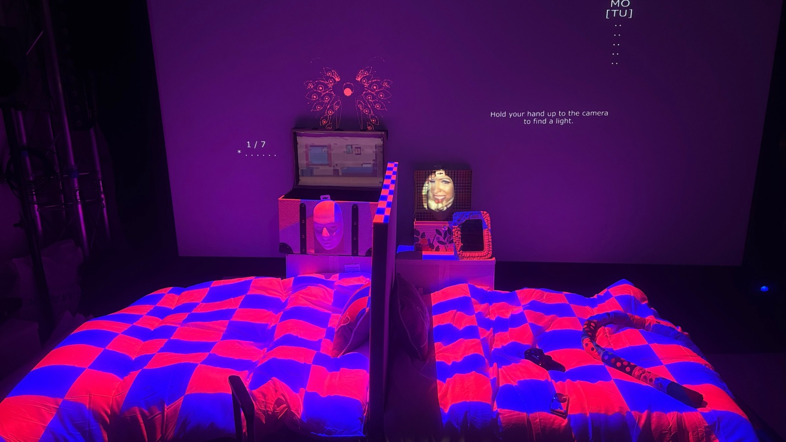
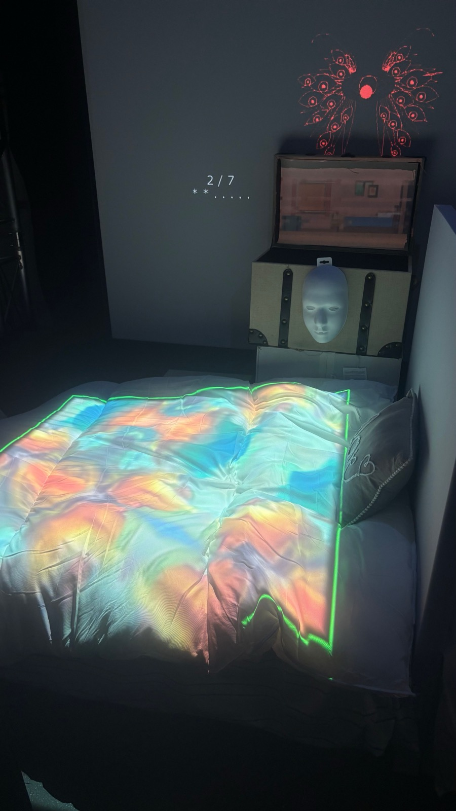
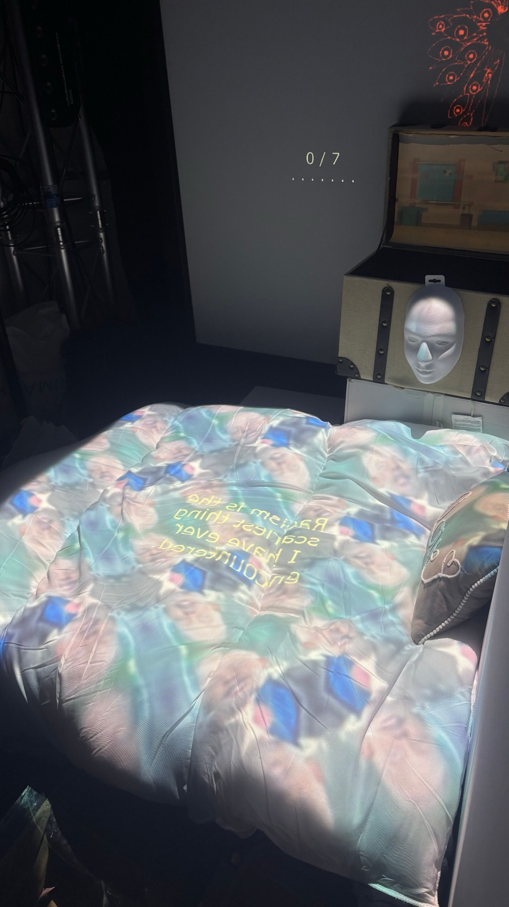

[← 2026-10-30](2026-10-30.md) | [Contents](../README.md) | [2026-11-02 →](2026-11-02.md)

# October 31, 2026 — Adding Lines That Invade Reality

- The projector in front was too high to project onto the bed, so I decided to add an overhead projector.
- It feels like a room under a spotlight: a private space exposed to the light.
- I tested the projection area with a grid texture and unexpectedly found that the grid looked good across the whole screen. I could add this scene later.
- The duvet cover made the projection unclear, so I removed it and used it underneath as a bedsheet.
- I first tried putting the kaleidoscopic face effect on the duvet in the room on the left. It worked well.
- Adjusting the rectangle is too cumbersome. Tomorrow I will see whether I can duplicate a Kantan Mapper; it is easier for mapping.
- The interaction worked well, and I suddenly thought of adding a puzzle element.
- I found a mirror and tried projecting mirrored text onto the duvet. When someone holds the mirror with their back to the bed, they can read the text in the reflection.
- I initially mirrored all the story subtitles on the large screen, but reading them continuously in a mirror was too difficult. I decided to put only one mirrored sentence on the duvet for now.
- Tomorrow I will see whether the visuals on the wall can disappear when a viewer turns away, then become visible again in the mirror when they turn back.
- This represents the gaslighting caused in the story by denying that anyone entered the girl’s room.

> 🎞 Video: 0.mp4 — not copied here (file too large for GitHub). [Watch it in the original Notion entry](https://app.notion.com/p/58637ec6ecd383a99f0d01645db48986)

---

[← 2026-10-30](2026-10-30.md) | [Contents](../README.md) | [2026-11-02 →](2026-11-02.md)
