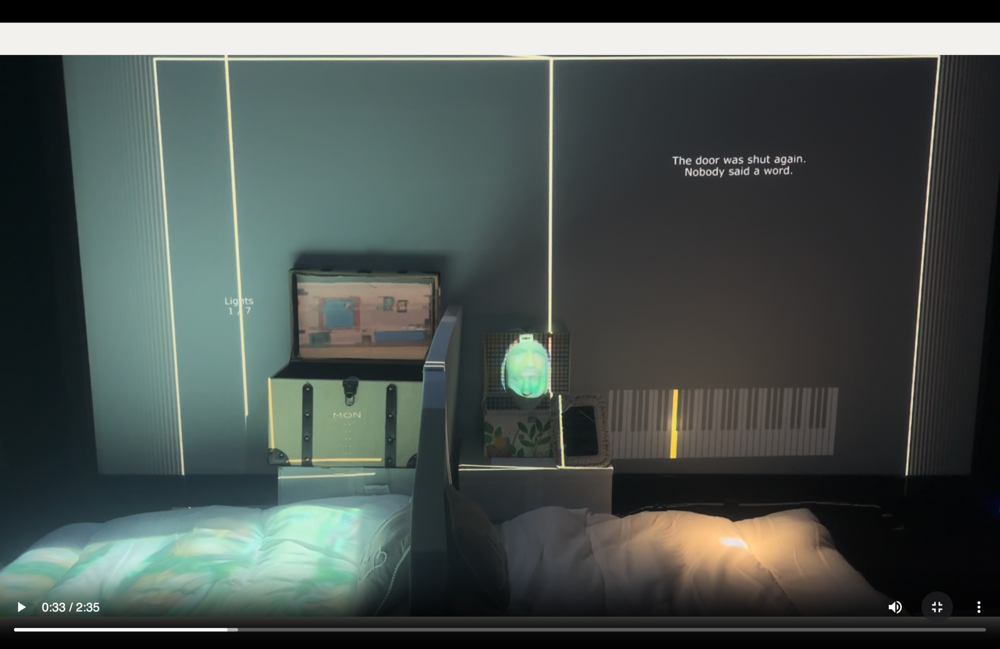

[← 2026-10-31](2026-10-31.md) | [Contents](../README.md) | [2026-11-03 →](2026-11-03.md)

# November 2, 2026 — Adding a Piano Book and User Testing

- A classmate tried the game and found the current scene design confusing.
- First, when the spotlight found a light point, they did not realise they should make a fist to collect it. Perhaps the point should be collected automatically when illuminated.
- When another classmate moved her hand over the image on the suitcase, she imagined something appearing on the real suitcase, so this needs to change.
- The mapping between the objects on the bed and the scene on the suitcase lid needs improvement.
- Some piano keys were lit while being held, so the tester thought those were the keys they needed to press. I intended the lights to show which keys had already been pressed; I need to change this.
- Classmates did not notice that each piano key represents a different sentence. I need to introduce this.
- One classmate suggested displaying the rules in a different font so they are easier to see.
- Some testers kept their hands in front of the camera to trigger the piano. I considered changing this, but another tester enjoyed air-piano, so I plan to keep it.
- Some people kept their hands in front of the camera to find light points quickly and move to the next day; I may need to think about this.
- Someone did not realise the room on the left was the guest’s room and suggested adding a doorplate.
- Someone thought the projected people on the masks were characters or different emotions. I could consider how to change this.
- Someone found the light-point count on the left confusing, so I need to revise the description.
- After everyone played, I asked: “What kind of story do you think this is?”
- One person said they were so absorbed in finding light points and triggering the music that they did not read the sentences carefully.
- Someone thought it was a conversation between a girl in the past and a girl in the present. This may be because the tester was not a native English speaker and found the sentences difficult to read.
- Someone recognised from the story that this had happened to me and was about renting a room. I was very happy.
- My teacher gave me a lot of useful advice. I remembered that the kaleidoscopic face represents my emotions, so I need to project it in the room on the left.
- I could project my perspective as text on the bed on the left, corresponding to their perspective as text on the bed on the right.
- Text projected onto the bed is not very clear, so the text on both sides could scroll: the text on the left bed gradually moves onto the screen, while the text on the right gradually moves from the screen onto their bed.
- The reason for using a piano is still unclear. Each key currently represents a sentence, like a book, so perhaps I should add a book. When people interact with it, an animation could show the book opening and text appearing on the page. Perhaps I could use an iPad.
- I set a limit so that after people press a few piano keys each day, no more sentences appear. This confused them, so I plan to show a sentence indicating that the day is over.

###### White keys (36 lines)

- W01. We need to rent out a room.
- W02. Someone is moving in!
- W03. I went through the trash in her room. She really does have a secret! Gotcha!
- W04. Why did she just drag her large suitcase up the stairs?
- W05. What did she put in the fridge? I’m so curious.
- W06. …you won’t believe it, there’s a girl upstairs…
- W07. …she doesn’t talk much, does she?…
- W08. …what is she doing up there all day?…
- W09. …cultural background… completely different…
- W10. I opened her wardrobe. She hid it well, but I still found it.
- W11. She put a little bell on her door.
- W12. She told us: please don’t go into her room.
- W13. The bell is off when she’s home. It’s on when she’s out.
- W14. The bell was taped above the door. Not very firmly.
- W15. She has gone out!
- W16. The door is open. Just a little.
- W17. The bell rang.
- W18. It kept ringing. It wouldn’t stop.
- W19. Then the bell stopped.
- W20. The door was shut again. Nobody said a word.
- W21. Don’t go into her room again.
- W22. What do I do? I already told the child not to go into her room.
- W23. She’s so smart. I didn’t even know opening a door could be recorded.
- W24. I can’t lose this income.
- W25. I’m so busy at work. I really don’t want to deal with this.
- W26. I didn’t think she’d actually tell Mom.
- W27. She looked easy to push around.
- W28. Why don’t you go play at your friend’s house today?
- W29. Listen up. We’re a family. We stick together.
- W30. You must be mistaken.
- W31. Going into her room? That never happened.
- W32. It’s just talking. It’s not a big deal.
- W33. I’m in my own room.
- W34. She has moved out at last.
- W35. Another guest will come.
- W36. The door is closed. The room is clean.

###### Black keys (25 lines)

- B01. Mom says someone is moving in.
- B02. She put a bell on her door? What?
- B03. Why would anyone put a bell on a door?
- B04. She told me not to go into her room.
- B05. But she’s out. How could she possibly know?
- B06. I don’t believe it.
- B07. I watched her door when she was home.
- B08. She opened it. She closed it. No bell.
- B09. It must be broken. Or switched off.
- B10. I stood at her door. I didn’t open it.
- B11. …I wonder what’s in there…
- B12. Mom said no. So I walked away.
- B13. The bell never rang.
- B14. She’s out. Just a quick look.
- B15. I only looked. I didn’t touch anything.
- B16. The bell is ringing!
- B17. Why won’t it stop?
- B18. The door won’t close.
- B19. Please. Help me close it.
- B20. Then it stopped. I couldn’t breathe.
- B21. She’ll know. She always knows.
- B22. She turned it off when she was home. She turned it on when she left.
- B23. She came home. She looked at me.
- B24. I’m scared.
- B25. I just wanted to see.

###### My perspective

1. M01. One suitcase. That was all I brought up the stairs.
1. M02. Why did she come into my room? This is my private space!
1. M03. So I put a bell on the door of my room.
1. M04. I asked: please don’t go into my room again.
1. M05. When I’m home, I switch it off. When I’m out, it’s on.
1. M06. Every time I leave, I wonder what I’ll find.
1. M07. Things were not exactly where I left them.
1. M08. The bell rang. I received notifications on my phone.
1. M09. I needed proof that I wasn’t imagining it.
1. M10. I heard her on the phone, talking about me. When I said something, she said: “I’m in my own room.” Does that mean the harm she did to me doesn’t exist?
1. M11. The door shut. Nobody said a word.
1. M12. They said: it’s just talking. It’s not a big deal.
1. M13. They didn’t even think it was racism. That is what hurt the most.
1. M14. I moved out. The room is clean.
1. M15. Another guest will come. Will she have a bell too? They’ve served so many guests before; why did this still happen?
> 🎞 Video: 1.mp4 — not copied here (file too large for GitHub). [Watch it in the original Notion entry](https://app.notion.com/p/98b37ec6ecd382e989d181f0edf1993c)

---

[← 2026-10-31](2026-10-31.md) | [Contents](../README.md) | [2026-11-03 →](2026-11-03.md)
