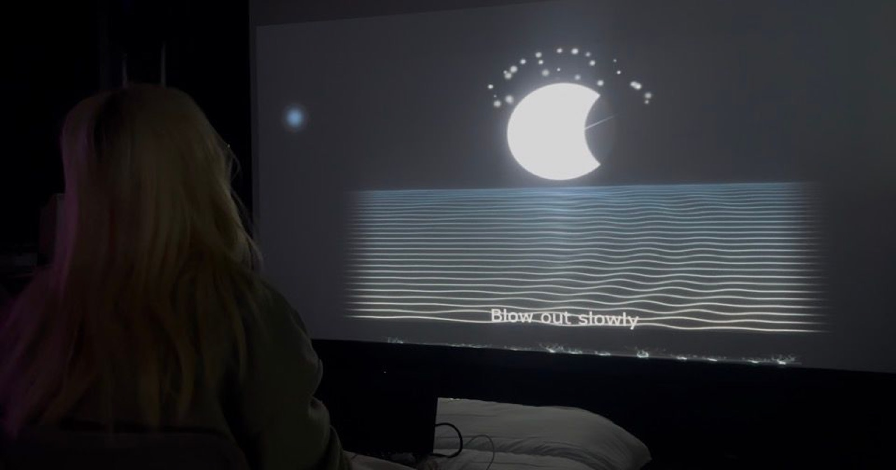
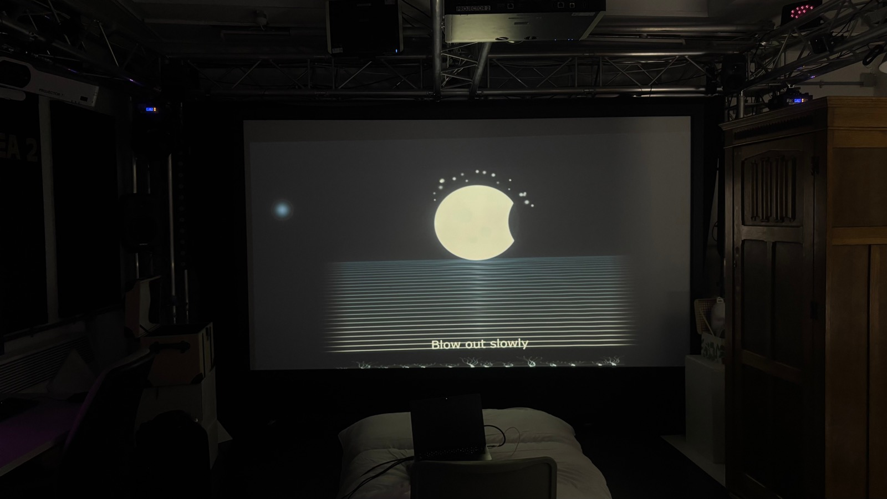
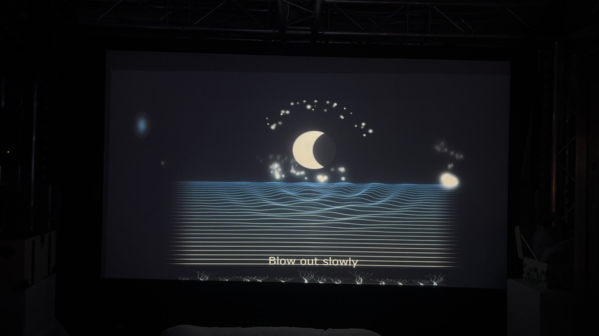
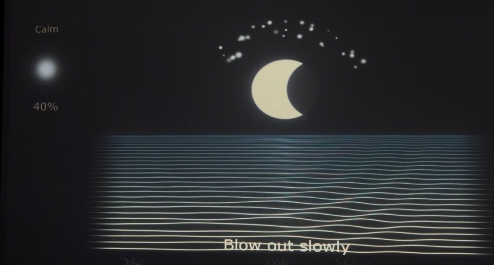
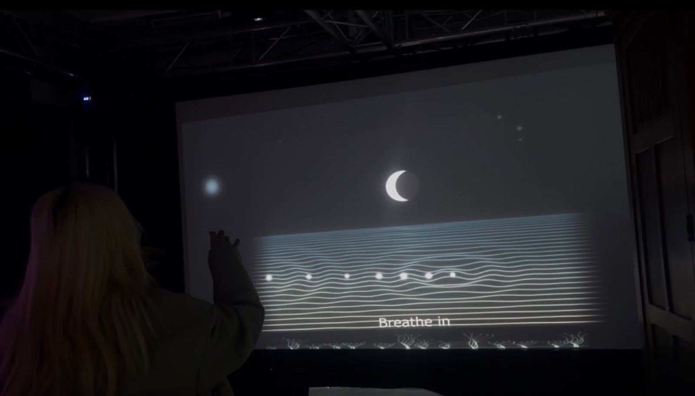

[← 2026-11-04](2026-11-04.md) | [Contents](../README.md) | [2026-11-06 →](2026-11-06.md)

# November 5, 2026 — Making “Breath Wave” at the Hackathon

- I attended a hackathon and was responsible for all the technical work, using TouchDesigner and Arduino.
- I completed this interactive projection project in one day.
- I plan to use the techniques from this project in my final work.

---

[← 2026-11-04](2026-11-04.md) | [Contents](../README.md) | [2026-11-06 →](2026-11-06.md)
