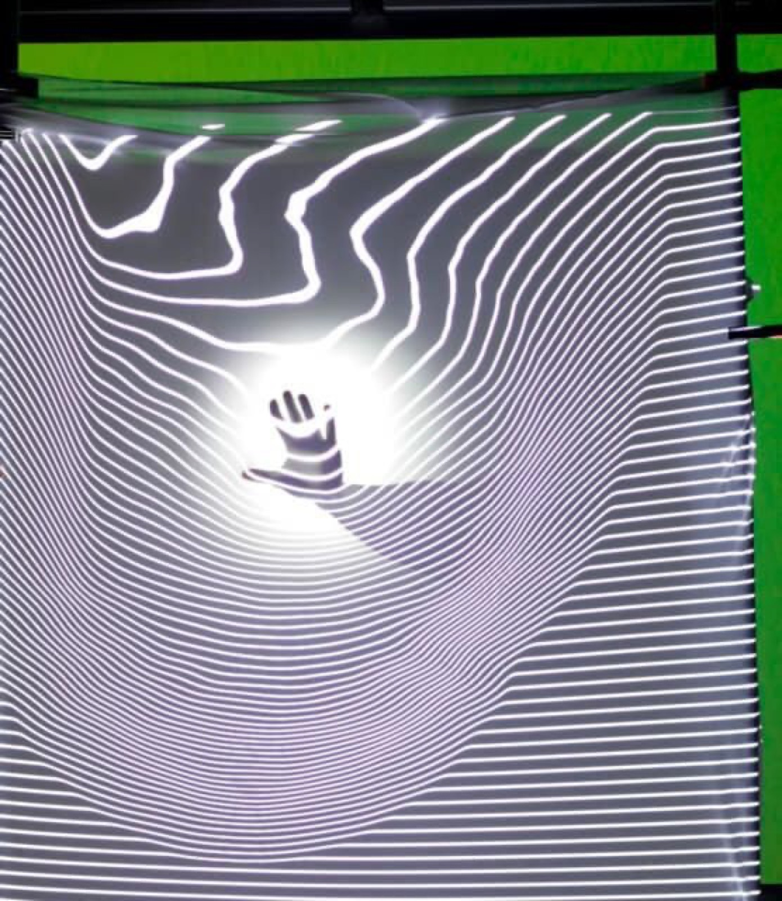

[← 2026-11-05](2026-11-05.md) | [Contents](../README.md) | [2026-11-07 →](2026-11-07.md)

# November 6, 2026 — Simplifying the Project

- When I came to test the installation on-site today, many of yesterday’s ideas did not work out.
- The AI heat map is no longer needed, so I removed it and kept only the kaleidoscopic texture.
- I am thinking of replacing the old suitcase projecting into the room with my real suitcase, which would also give a larger projection area.
- I plan to use a makeup case like a safe. I found one in my new place, and it is suitable for projection. I cannot explain the old suitcase, but this makeup case is something I encountered while travelling.
- I changed the cover title from the default text to “Thin Walls.” It suits the story and draws attention to the thin wall that used to be between the two beds; now there is not even a wall, as if it has become too thin to see.
- After testing today, I found that players become absorbed in catching light points with their hands and triggering music. Perhaps another person could read the text in the wardrobe.
- It could be a cooperative puzzle game.
- I am thinking of adding cloth tracking.
- Research question: What reflections might an immersive game environment create when it takes place in reality?
- Possibilities: an escape room; remove the extra bed; add different things to each day; perhaps include heart-rate tracking.
- Continue researching how projection can reconstruct reality and create immersion.
- Perhaps put miniature speakers beside the ears, like the speakers on either side of a VR headset.
- This could make people feel that their bodies are different from reality.
- Eye tracking.
- Perhaps put only duvets on the left and right and have people sit on a sofa cushion.
- It could perhaps become a multiplayer game.
- I thought of the speaking tube between rooms. Could I make something similar and put one on either side of the wardrobe?
- Tomorrow I will go to Flying Tiger to buy some special refractive mirrors, magic glasses, or a kaleidoscope, and perhaps experiment with them.
- I also thought of the curtain from before; perhaps I could use it for experiments.
- To explore immersion, after trying a VR headset, I felt I should return to eye tracking.
- I want to use projection to recreate VR interactions and rewrite reality. VR headsets are too heavy for me; I get dizzy after wearing one for a while, and my head is too small, so I have to keep holding it.
- I need to figure out how to track pupils.
- Touch interaction might use TouchDesigner technology: interactive projection mapping (MediaPipe camera / Leap Motion).
- To recreate how objects in VR obscure real objects, I may need organza or a fabric-tracking cloth.
- To recreate the headset’s earphones, I need to look for bone-conduction headphones that clip onto the head. Perhaps the sound will change as people move through the scene wearing them, with different sound mapping.
- I could buy the one-way mirror I thought of earlier and try it.
- First thing to do tomorrow: add interactive projection so that a hand leaves a trace whenever it moves across any physical surface with a projection on it.

---

[← 2026-11-05](2026-11-05.md) | [Contents](../README.md) | [2026-11-07 →](2026-11-07.md)
