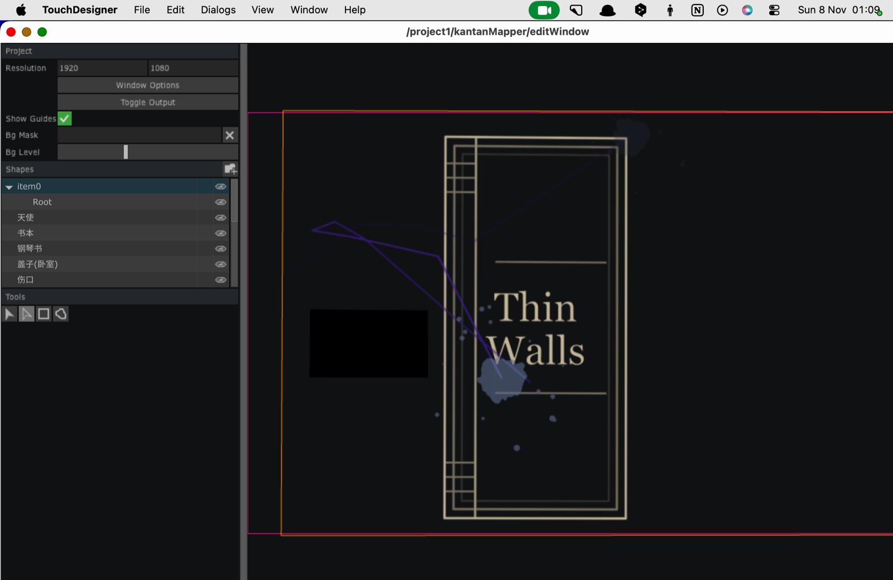

[← 2026-11-06](2026-11-06.md) | [Contents](../README.md) | [2026-11-08 →](2026-11-08.md)

# November 7, 2026 — Thinking About How to Reconstruct Reality

- I thought of the artwork where a projection was placed in water; it really reconstructs reality.
- Perhaps mist could work too. I could buy a steamer and try it.
- On the tram, someone stood on one side of a transparent window, and I saw the landscape behind their reflection on the other side.
- When the person moved away, I saw the real scenery on the other side; when they came back, I could see only the view outside the window. The person was wearing a black coat.
- I thought of 3D films in cinemas, which also require glasses.
- Is there a way to alter reality without wearing anything?
- I plan to use the techniques from my hackathon project: first, make a hand leave a trace when it moves in front of a camera; later, see whether interactive projection can let a hand leave a trace when it moves across a projected area.
- Perhaps sound could come from speakers hidden in pillows. When viewers lie down, they would hear the sound as if it were beside their ears.
- Pillow speakers.
- Perhaps viewers could leave a trace somewhere: the mark left by a sliding hand could become a straight line, representing how, when I experienced discrimination and felt upset, I sometimes swiped at my screen.
- I am thinking of adding sharp lines to represent wounds I dreamt about while experiencing discrimination. I later drew this image.
- I would like to add sharp lines: when viewers swipe across the projection, such lines could appear, along with blood.
- I added a wound effect. When a hand moves in front of the camera, it appears. I will test it with the projector at school on Monday.

---

[← 2026-11-06](2026-11-06.md) | [Contents](../README.md) | [2026-11-08 →](2026-11-08.md)
