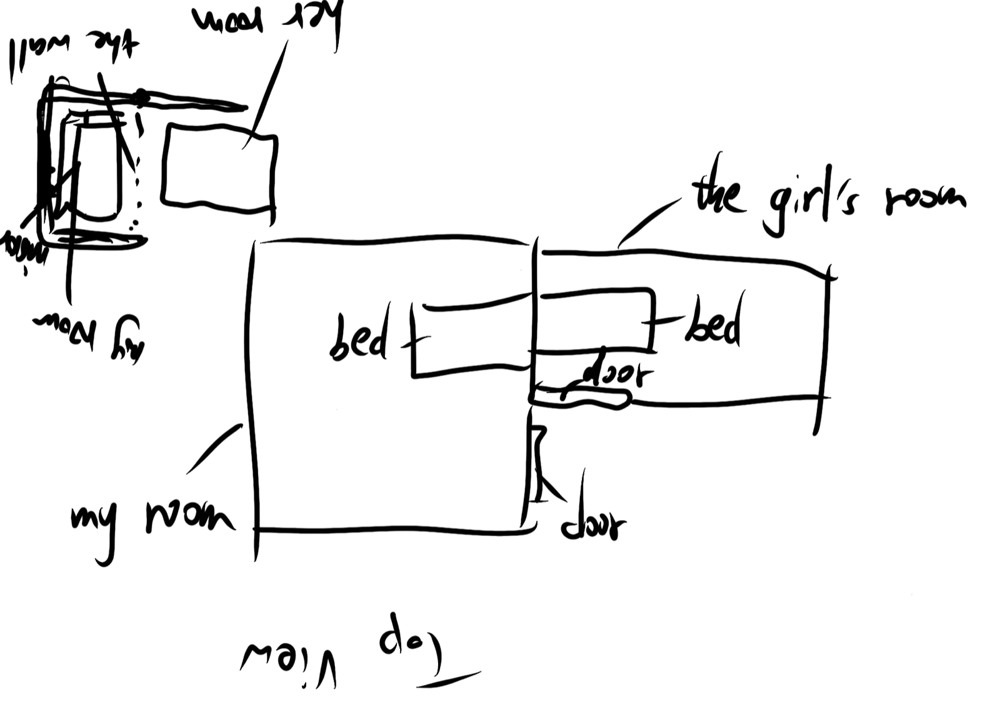
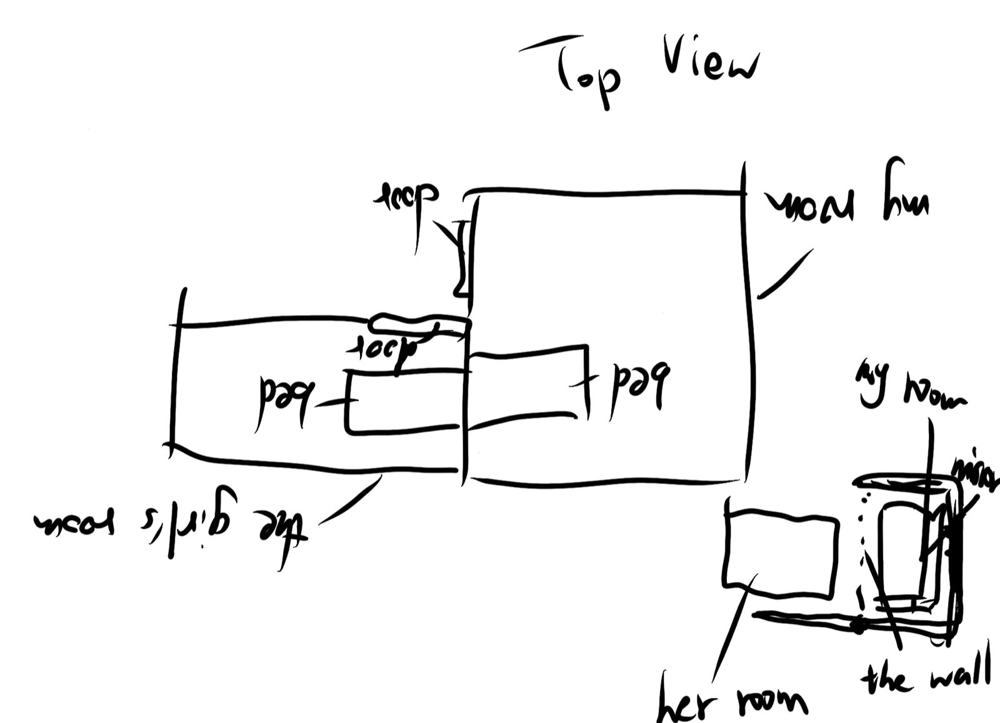

[← 2026-11-07](2026-11-07.md) | [Contents](../README.md) | [2026-11-09 →](2026-11-09.md)

# November 8, 2026 — Rewriting the Question Being Explored

- Sadiq points out that traditional diversity training often relies on stereotypes, while people can understand differences more readily through real personal stories and lived experience.
- Sharing stories is a good method, so I turned my experience into a novel-like game to share it.
- I remembered the layout of the original room and drew it in the lower-right corner.
- I reversed the original room layout and thought about how to reconstruct the installation. I drew the installation layout in the lower-right corner.
- The wardrobe is the main element: it is both a wall and a book. I will put the box that previously projected my room beneath the wardrobe.
- The audience needs to sit in front of the wardrobe. If the projection cannot reach the area below it, I will put the box to the left of the wardrobe so the viewer can use one hand to collect light points and trigger music.
- The viewer sits in front of the wardrobe, covers themselves with the duvet, and explores the story from the girl’s perspective.
- What I need to do on Monday: find a sensor so that the game starts when the wardrobe door opens.
- A mirror might make the space look wider and larger than it is.
- This is too complicated. I should just remove the bed on the right.
🔗 [https://www.youtube.com/watch?v=HR4wz1b54hw](https://www.youtube.com/watch?v=HR4wz1b54hw)

---

[← 2026-11-07](2026-11-07.md) | [Contents](../README.md) | [2026-11-09 →](2026-11-09.md)
