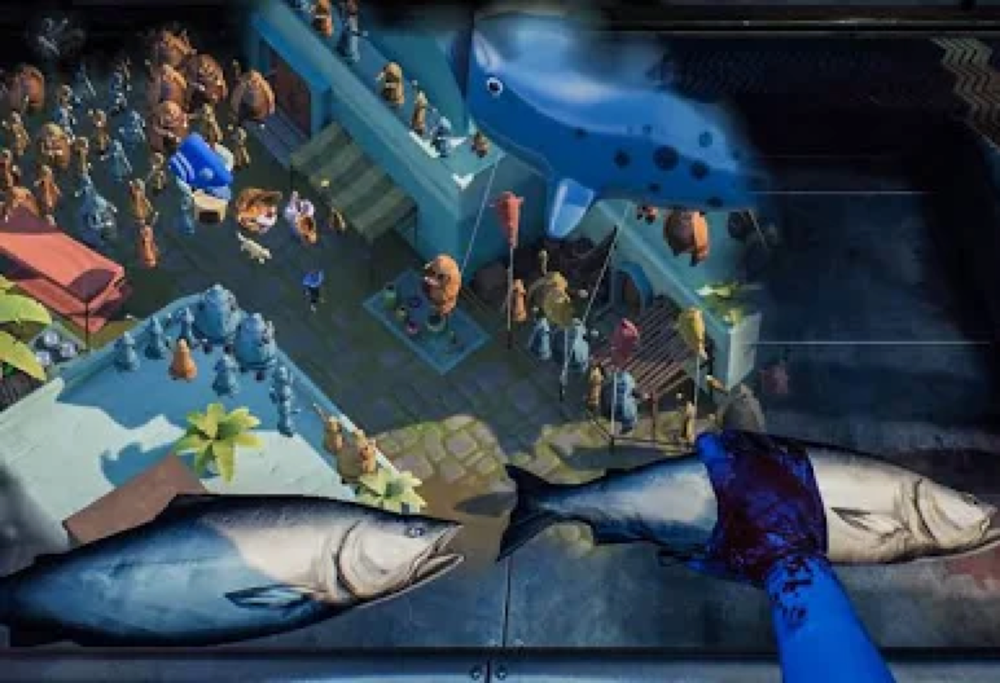
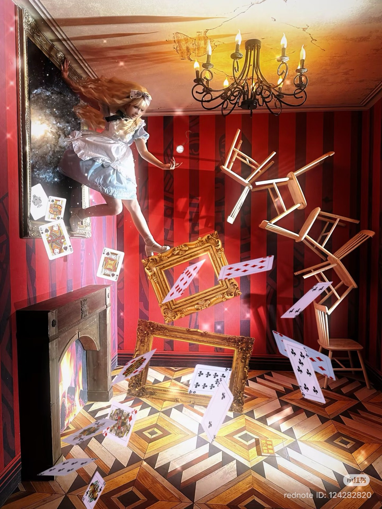

[← 2026-11-08](2026-11-08.md) | [Contents](../README.md) | [2026-11-10 →](2026-11-10.md)

# November 9, 2026 — A New Interaction Idea

- I suddenly realised that, since the audience sees the story from the girl’s perspective, I do not need the girl’s room. The audience only needs to sit in a chair facing the wardrobe and open the story.
- The bed on the left is my room; the image on the suitcase lid in front represents a miniature of my room.
- After testing it with a classmate, she recommended a game similar to my project: *What Remains of Edith Finch*, the fish-tank section: [reference](https://xhslink.cn/o/AY8aIdnozl5).
- Today, after putting the box inside the wardrobe, I moved the other bed in front of the wardrobe so the user can lie on it and look at the wardrobe.
- From this viewpoint, the room below the wardrobe is hidden, so I moved the room projection to the upper-right corner of the wardrobe door. My classmate liked this interaction.
- The problem is that there is nowhere to put the other duvet or the kaleidoscopic face, and the viewer cannot see them when lying down.
- A classmate suggested making the setting more attractive, perhaps by finding a bedside table and an antique wardrobe.
- The setting reminded a classmate of *Alice in Wonderland*. Perhaps I could make the room appear to float.
- I need to prepare for user testing and complete the ethics form.

---

[← 2026-11-08](2026-11-08.md) | [Contents](../README.md) | [2026-11-10 →](2026-11-10.md)
